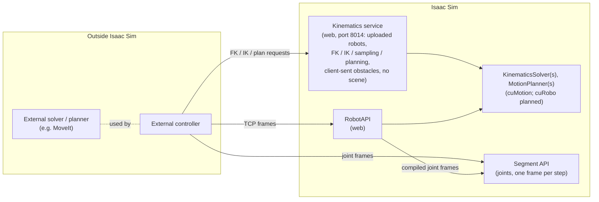
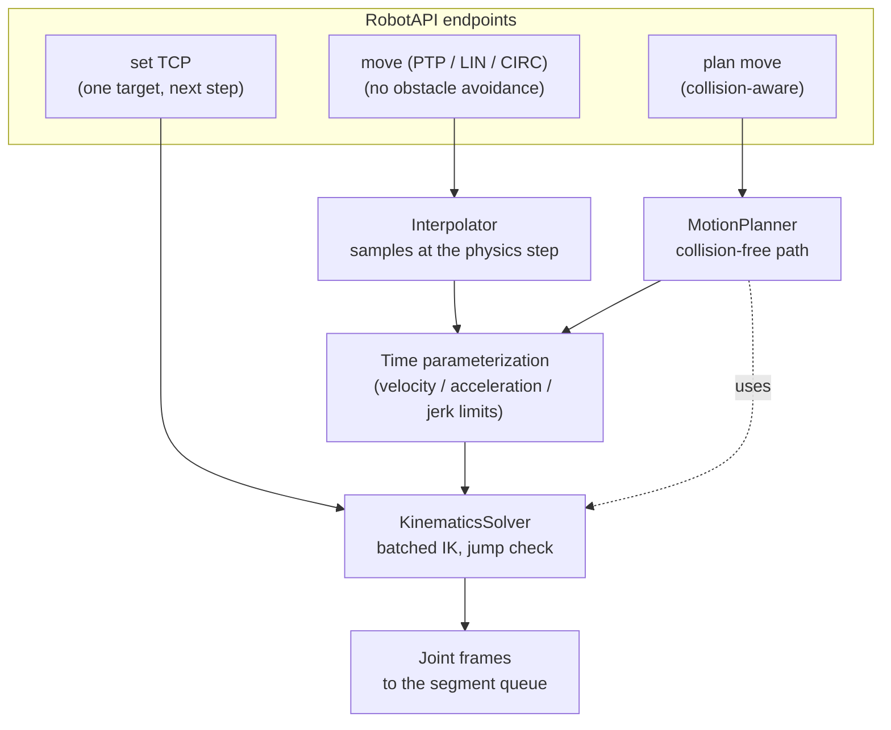
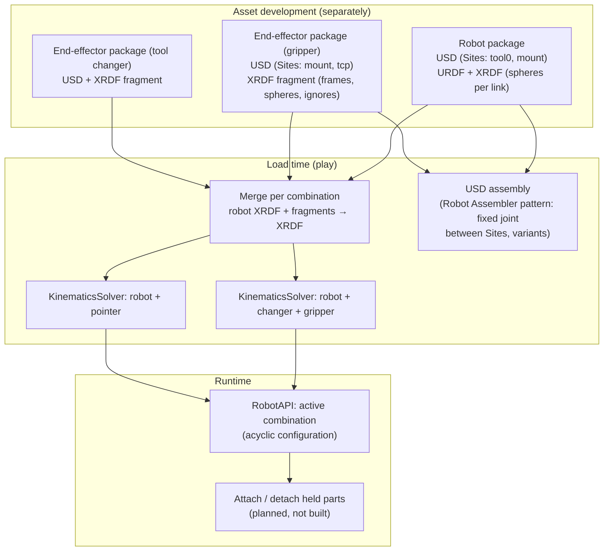
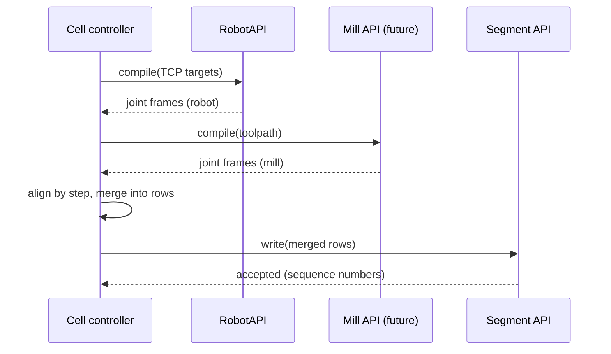

# Robot control

> **Abstract.** The technical design for robot control above the segment, as implemented: the kinematics service
> (a scene-free, MoveIt-like REST service over uploaded robots, port 8014, on `ApiHost`), the `MotionPlanner` and
> `plan` moves, the RobotAPI, motion layering, batch IK, the jump check, TCPs and one solver per end-effector
> combination, the XRDF fragment merge, pose models, units (open), streams, and several robots per segment.
> Everything described is built unless marked **Planned / not built**; each section names its decision status.
> Backs the user docs page Asset Development › "Manipulator Robots" (Robot Control). Verify against the code; may
> lag.

**Status:** this page describes the implementation; the code wins where they differ (as built:
`Reference/robots.md`). It has two parts: [Kinematics, interpolation, and
compiling](#kinematics-interpolation-and-compiling) (the `KinematicsSolver`, the [kinematics
service](#the-kinematics-service), PTP/LIN interpolation and timing, the RobotAPI, pose models) and [Planning,
blending, and end effectors](#planning-blending-and-end-effectors) (the `MotionPlanner` and `plan` moves, execution
semantics, compile-then-merge, end-effector combinations, obstacles in the kinematics service). Decision status, from
`Reference/decisions.md`:

| Status | Decisions |
|---|---|
| **Accepted** | ADR-0010 (the kinematics service: scene-free, uploaded solvers, port 8014, one request at a time, neutral obstacles allowed), ADR-0011, ADR-0012 (including the end-effector merge choices), ADR-0013, ADR-0014, ADR-0022, ADR-0023 (`MotionPlanner`, `plan` moves), ADR-0024 (`ApiHost`) |
| **Parked** (built as described, not yet confirmed by the user) | the RobotAPI compile semantics ( including the jump check's parameters and the LIN defaults) |
| **Built; decision deferred** | the execution semantics, ADR-0010's "how" (inline handlers, the neutral obstacle model, the per-solver world API) |
| **Built; hidden** (served only with `preview_features=True`; deferred) | compile from `start` / `dt`, `queue_revision` / `end` in the compile answer, the segment's `?expected_revision=` and pause |
| **Open** | wire units (meters and degrees today, ADR-0022; the general decision is open); cuRobo runtime attachments vs one solver per combination |
| **Planned / not built** | a servo mode, collision-aware IK, cuMotion's trajectory optimizer (deferred), attached objects (held parts), a decelerating pause, a cuRobo backend, automatic slow-down, the midpoint precision check |

For the layers below, see `Specs/segment-protocol.md`; the end-effector format is in
`Specs/end-effector-package.md`.

## Principles

**Status:** decided.

- **The segment API carries only device I/O.** It is what is written to and read from joints and other
  transducers. A TCP pose is a higher-level abstraction and is never part of it.
- **The RobotAPI compiles to the segment API.** A batch of TCP targets is converted into joint frames
  when it is written:
  - inverse kinematics runs over the whole batch;
  - if any target fails, the whole batch is rejected and nothing is queued;
  - otherwise the joint frames go into the same queue the segment API uses.

  So what was validated is exactly what runs, and robot frames share the segment's clock with every
  other machine.
- **Two separate web services** (ADR-0010; accepted):
  1. **The kinematics service** (kinematics, and motion planning around obstacles the client sends): an
     *external service that happens to be hosted in Isaac Sim*. It knows nothing about the segment or Isaac
     Sim's scene, so it could serve a simulation (or a real cell) unrelated to Isaac Sim. Obstacles read from the
     USD stage stay in process (the RobotAPI). It exposes its backend's capabilities (cuMotion today; a cuRobo
     backend is planned, not built), and its interface must not cripple them.
  2. **The RobotAPI** wraps the same functionality and integrates it with the segment, so it feels like
     the segment API with robot data (TCP poses, plans) instead of raw joint data. It also passes through
     segment capability where needed, and serves the kinematics routes for its own robots (read-only).

  Inside Isaac Sim, the RobotAPI uses its solvers and planners in process. An external controller can use the
  kinematics service like any external robotics library and write joints to the segment API, or use an external
  solver (e.g. MoveIt) instead. The architecture is decomposed into separate services so a solution can be
  assembled from whichever parts a problem needs.
- **Performance:** a batch is solved at once (GPU or vectorized) wherever the solver allows it, never pose
  by pose when it doesn't have to be. (cuMotion has no batched plain IK, so its backend solves pose by pose with
  continuity seeding: [Batch IK](#batch-ik).)



## Components

| Component | Role | Industry equivalent |
|---|---|---|
| `KinematicsSolver` | FK, IK, Jacobian, batched; seeds; typed errors | MoveIt `KinematicsBase` ("Provides an interface for kinematics solvers", [header](https://raw.githubusercontent.com/moveit/moveit2/main/moveit_core/kinematics_base/include/moveit/kinematics_base/kinematics_base.hpp)); cuRobo `IKSolver` ([API](https://curobo.org/_api/curobo.wrap.reacher.ik_solver.html)); UR `get_inverse_kin` / `get_forward_kin` |
| `Interpolator` | Deterministic point-to-point, linear, and circular moves, sampled at the physics step | MoveIt Pilz PTP/LIN/CIRC, trajectory *generators* with linear position and slerp orientation ([Pilz](https://moveit.picknik.ai/main/doc/how_to_guides/pilz_industrial_motion_planner/pilz_industrial_motion_planner.html)); cuMotion `TrajectoryGenerator` ([API](https://docs.isaacsim.omniverse.nvidia.com/6.2.0/py/source/extensions/isaacsim.robot_motion.cumotion/docs/api.html)) |
| Time parameterization | Velocity, acceleration, and jerk limits to timing | MoveIt TOTG ("the default everywhere in MoveIt 2") followed by Ruckig ([docs](https://moveit.picknik.ai/main/doc/examples/time_parameterization/time_parameterization_tutorial.html)) |
| `MotionPlanner` | Collision-aware search (built: cuMotion's graph-based planner; an optimizer is planned, not built); uses the solver; a world of library-neutral obstacles | MoveIt OMPL; cuRobo `MotionGen`, which holds an `IKSolver`, a `TrajOptSolver`, and a graph planner ([API](https://curobo.org/_api/curobo.wrap.reacher.motion_gen.html)); cuMotion `MotionPlanner` (graph-based; Isaac Sim wraps it as `GraphBasedMotionPlanner`), `TrajectoryOptimizer` |
| `KinematicsApi` (an `ApiHost`) | Web API over the solvers (create from URDF + XRDF and optional end-effector fragments, FK, IK, Jacobian, reachable, trajectory sampling including `circ` and `plan` moves, the path check, tool frames, self-collision, a per-solver world of neutral obstacles; nothing from Isaac Sim's scene) | MoveIt `GetPositionIK` / `GetPositionFK` services ([msgs](https://raw.githubusercontent.com/moveit/moveit_msgs/ros2/msg/PositionIKRequest.msg)), MoveIt's planning scene |
| `RobotApi` (a `SegmentApi`) | TCP-level read, write (compile + queue), compile, execute, plan, clear with a stop policy, configuration, and the robot stream | UR RTDE `target_TCP_pose` / `actual_TCP_pose` ([RTDE](https://docs.universal-robots.com/tutorials/communication-protocol-tutorials/rtde-guide.html)) |

**Naming (decided):** `KinematicsSolver` is right for FK/IK. Motion planning is a separate component
(`MotionPlanner`) that *uses* a solver, as in both MoveIt and cuRobo, so the solver's name stays accurate.

## Kinematics, interpolation, and compiling

Everything that turns a target into joint frames **without** obstacle avoidance; [Planning, blending, and end
effectors](#planning-blending-and-end-effectors) adds the collision-aware planner, execution semantics,
compile-then-merge across machines, and end-effector combinations. **Units are meters and degrees on the wire**
(ADR-0022; [Units](#units)); solvers work in radians and meters, converted at the boundary and stated in every schema
description.

The choices beyond the agreed design (the command-row model, timing, the jump check's parameters, the start state,
optimistic queueing, the routes and models) are **parked**: built as described
here, not yet confirmed by the user.

### Where the code lives

| Layer | Module | Contents |
|---|---|---|
| pose models | lib `amt.dtp.ise.lib.control.transducer.models` (file `pose.py`) | `Vector3`, `Quaternion`, `Pose`, `FramedPose` (built-in models: generated clients import them) |
| solver interface, interpolation, timing, jump check | lib `amt.dtp.ise.lib.control.motion` (`kinematics`, `trajectory`) | `KinematicsSolver` (abstract, SI units, batched API), `JointInfo`, `IkSolution`; time scaling (trapezoid, or double-S with jerk limits), PTP and LIN sampling, slerp, the jump check (`check_steps`) |
| kinematics service | lib `amt.dtp.ise.lib.control.motion` (`models`, `trajectory_models`, `registry`, `server`, `client`); extension `amt.dtp.ise.service.kinematics` | `KinematicsApi(ApiHost)`, `kinematics_router`, `SolverRegistry`, `SolverEntry`, `SolverFactory`, `PlannerFactory`, `/api/kinematics/...`, `KinematicsClient(HttpClient)`; `KinematicsService` (port 8014) |
| RobotAPI | lib `amt.dtp.ise.lib.control.robot` (`models`, `compiler`, `server`, `client`) | `RobotBinding`, the compiler, `RobotApi(SegmentApi)` (default port 8020), `/api/robot/...`, `RobotClient(SegmentClient, KinematicsClient)`; the generated client module of a RobotApi |
| cuMotion backend | extension `amt.dtp.ise.robot.kinematics` | `CuMotionKinematicsSolver(KinematicsSolver)`: URDF + XRDF (files or text), no USD stage; `CUMOTION_LOCK`; `cumotion_solver_factory`; `ManipulatorRobotCuMotionActuator` uses it and exposes it as `.solver` |
| base pose | extension `amt.dtp.ise.robot.base` | `usd_base_pose(prim)`: a `base_pose` provider reading the robot root prim's world pose from USD (fixed bases) |

The lib parts are pure Python (numpy, pydantic) and tested offline with a fake solver; the cuMotion
backend is tested offline with Isaac Sim's Python (cuMotion runs without a stage). The segment engine
provides what the compiler needs (`queue_revision`, `prediction_snapshot()`, `enqueue(...,
expected_revision=)`, `submit_many()`), and `SegmentApi` a stream helper (`_open_stream(render=)`) and a
client-module hook, so a subclass can add its own frame format and models.

### KinematicsSolver

**Status:** accepted (ADR-0011).

- **Units: SI inside** (radians, meters, rad/s, m/s). Every conversion to degrees happens at the API
  boundary (`joints_from_wire` / `joints_to_wire`).
- **Description:** `joints` (`JointInfo`: name, `revolute` or `prismatic`, lower/upper position limits,
  velocity, acceleration, and jerk limits; c-space order), `base_frame`, `frame_names`, `tool_frames`
  (the first is the default tool frame), `backend` (e.g. `cumotion`), `capabilities`, `revision`.
- **Not thread-safe:** callers serialize access per instance (the kinematics service and the RobotAPI hold a
  lock per solver; [Concurrency](#concurrency)).
- **Batched API:** `fk(q[N, n], frame) → (positions[N, 3], wxyz[N, 4])` and
  `ik(positions[N, 3], wxyz[N, 4], frame, seed, sequential, position_tolerance, orientation_tolerance) →
  IkSolution(success[N], q[N, n], position_error[N], orientation_error[N])`. A backend with a batched solver
  overrides `ik`; the default solves pose by pose.
- **Continuity seeding:** with `sequential=True` (the default), pose *i* is seeded with the solution of
  pose *i−1* (the first with `seed`). Revolute solutions are **unwrapped** to the 2π-equivalent nearest
  the seed when that stays within the joint limits, so an equivalent solution never looks like a jump.
- **Errors are measured, not trusted:** `position_error` (m) and `orientation_error` (the rotation angle
  between target and FK of the solution, rad) are computed by the base class from FK, so they mean the same
  for every backend; `success` requires the backend's success **and** both errors within the tolerances.
- **Tool frames** (TCP definitions belong to the solver, ADR-0011): `set_frames({name: (parent, position,
  wxyz) or None})` adds, moves, or removes fixed frames atomically (rolled back if the backend rejects the
  result); added frames become tool frames. `revision` increments on every change.
- **cuMotion (verified with cuMotion 1.1.0a2, Isaac Sim 6.0.1, on the MR-A1):** `cumotion.solve_ik`
  takes **one** target pose (`_cumotion.pyi`: `solve_ik(kinematics, target_pose, target_frame, config) ->
  IkResults`); batched IK exists only as `CollisionFreeIkSolver.solve_array`, which needs a collision world.
  So the cuMotion backend solves **sequentially with continuity seeding** (the fallback design). Measured on the
  development machine:
  - raw cuMotion (probe script): FK ≈ 1 µs, a seeded IK ≈ 35 µs, unseeded ≈ 52 µs, an unreachable target
    ≈ 2.2 ms (100 descents);
  - through `KinematicsSolver.ik` (base-class seeding, unwrapping, FK error measurement;
    `Scratch/harnesses/kinematics_benchmark.py`): ≈ 80 µs for one pose, 0.56 ms for 10, 5.7 ms for 100,
    16.5 ms for 600 poses along a path (≈ 28 µs per pose); compiling a 106-step LIN move takes ≈ 6 ms.

  So batching is not the bottleneck for interpolated moves. Multi-seed solving with dynamic-programming chain
  selection ([Batch IK](#batch-ik)) stays the design for a batched backend (cuRobo; **planned, not built**).
- **cuMotion details:** joint types come from the URDF (cuMotion doesn't expose them; `continuous` joints are
  revolute without position limits); cuMotion's orientation tolerance is per axis while the base class checks the
  rotation angle, so the backend asks cuMotion for 0.8 × the angle tolerance; `set_frames` adds XRDF `add_frame`
  modifiers and `tool_frames` entries and reloads the description (rolled back if cuMotion rejects it).

### The jump check

**Status:** the check is accepted (ADR-0013); its parameters are parked.

Every compiled step is checked: for each joint, `|Δq_i| ≤ v_max,i × Δt × margin`, where Δt is the
segment's physics step and the first step is measured from the predicted start. Violations reject the
whole write with `JOINT_JUMP`, naming the command, robot, step, joint, and the measured vs allowed step.

- **The effective velocity limit** of a joint is, in order: an override in the robot's binding
  (`velocity_limits`, deg/s or m/s); the URDF limit; otherwise the **fallback** `max_step` per step
  (`max_step_revolute` deg, default 5; `max_step_prismatic` m, default 0.01). `info` reports each limit
  and its `source` (`override`, `urdf`, `fallback`).
- **Placeholder URDF limits count as missing:** a URDF velocity limit ≥ 1000 rad/s (or m/s) is ignored.
  cuMotion's URDF normalizer injects exactly 1000 when a limit is missing
  (`isaacsim.robot_motion.cumotion` `urdf_normalize.DEFAULT_VELOCITY`, read in the installed source), and
  exported URDFs carry such placeholders: the MR-A1's URDF says 1 000 000 rad/s for every joint (read in
  the file). Without this rule the check would accept anything for those robots.
- `margin` defaults to 1.0 (the limit itself, plus 1e-9 for rounding). The same effective limits drive the
  time parameterization, so a PTP move never fails the check by construction; a LIN move fails it near a
  singularity or on a branch flip, which is the check's purpose.
- The step is the physics step reported by the segment (`physics_time_step` of the latest step); no step
  yet means the RobotAPI answers 503 `NO_STATE`. The kinematics service's trajectory routes use the client's `dt`
  and take `jump_margin`, `max_step_revolute`, `max_step_prismatic`, and limit overrides per request.
- For fallback joints, the fallback step also serves as the timing limit (`max_step / dt`), and `info` reports
  that as the joint's `velocity_limit`.
- **Planned, not built:** the midpoint precision check for Cartesian moves ([The jump check:
  rationale](#the-jump-check-rationale)).

### Interpolation and time parameterization

**Status:** parked.

- **Order for Cartesian moves: time-parameterize in Cartesian space, then solve IK per sample, then
  check the joints** (the jump check above). Pilz LIN is likewise timed in Cartesian space. A move whose
  joints would exceed their limits is **rejected**, not slowed down (deterministic, and the client can
  lower the speed). Automatic slow-down (a TOTG-style parameterization) is **planned, not built**.
- **Profile:** a trapezoidal velocity profile over the path parameter *s* ∈ [0, 1] (rest to rest),
  limited by the tightest of the per-joint (PTP) or Cartesian (LIN, CIRC) velocity and acceleration limits. With
  jerk limits a jerk-limited double-S profile is used instead ([Execution semantics](#execution-semantics)).
- **Sampling at the physics step:** the duration is rounded **up** to a whole number of steps `N` and the
  profile is stretched to exactly `N × Δt` (stretching only lowers velocities and accelerations). Samples
  are at `k × Δt`, `k = 1…N`; the last sample is exactly the target. The start is not re-sent.
- **`duration`** (optional, s): stretch the move to that duration (rounded up to steps); shorter than
  the limits allow → 422 `DURATION_TOO_SHORT` with the minimum.
- **PTP** (joint interpolation, synchronized): `q(s) = q0 + s (q1 − q0)`; the joint that needs longest
  sets the timing, so all joints start and stop together. `velocity_scaling` and `acceleration_scaling`
  in (0, 1] (default 1) scale the effective joint limits (and the jerk limits, like accelerations). The goal is
  either `joints` (by joint name, degrees or meters; joints left out keep their position) or a TCP `target` (one
  IK, seeded from the start); exactly one of the two. The goal is checked against the joint limits (`JOINT_LIMIT`).
- **LIN** (Cartesian): position by linear interpolation, orientation by slerp; limits `velocity` (m/s,
  default 0.25), `acceleration` (m/s², default 1.2; null: unlimited), `angular_velocity` (deg/s, default 90),
  `angular_acceleration` (deg/s², default 360; null: unlimited), optional `jerk` (m/s³) and `angular_jerk`
  (deg/s³) (default none: the trapezoid). The two linear defaults are UR's `movel` defaults,
  "(pose, a=1.2, v=0.25, t=0, r=0)" with tool speed in m/s and acceleration in m/s² (V,
  [UR script manual, `movel`](https://www.universal-robots.com/manuals/EN/HTML/SW5_24/Content/prod-scriptmanual/all_scripts/movel_posea12v025t.htm));
  the angular ones are Claude's (parked).
- **set** (`SetTcp`, one TCP target, reached on the next step): one IK seeded from the start, one step,
  jump-checked like any other step. A large jump is therefore rejected: use `lin` or `ptp` to get there.
- Every move has `reference` (`base`, the default, or `world` for a robot with a `base_pose` provider) and an
  optional `tool_frame` (default: the robot's active tool frame).
- **CIRC**, **blending** (`termination`, `cnt`), and **jerk limits**: [Execution semantics](#execution-semantics);
  `plan` moves: [The MotionPlanner](#the-motionplanner).

### The kinematics service

**Status:** accepted (ADR-0010).

**Purpose** (in the user's words): "a service similar to MoveIt behind a REST API where a controller can use
it without even using Isaac Sim". A client uploads a robot's URDF and XRDF (optionally with end-effector
fragments), gets a **solver** (one `KinematicsSolver` instance, one end-effector combination), and calls it: FK,
IK, Jacobians, reachability, trajectory sampling, the path check, tool frames, self-collision, and, for a backend
with a planner, a **world of library-neutral obstacles** the client sends, to plan around and check against
(ADR-0010: the line is coupling to Isaac Sim's scene, not obstacles as such). **Nothing comes from Isaac Sim's
scene:** obstacles read from the USD stage stay in process (the RobotAPI with `stage_obstacles`).

**Hosting:** an extension service (`KinematicsService`, started and stopped with the extension), on its own
port, **8014** by default (`kinematics_service_port` in the extension configuration), with Swagger at
`/api/docs`, ReDoc at `/api/redoc`, and the schema at `/api/openapi.json`. Clients never touch the simulation or
the scene. `KinematicsApi` is an **`ApiHost`** (ADR-0024), not a `CoreApi`: it is not a machine-control API, so it
has no `/api/core` routes (no assets, no layers), and it never uses `ApiHost`'s bridge to Isaac's main loop.
**Scene-free, verified** (ADR-0010): nothing in its start path or routes uses the stage, the timeline, physics, the
`omni.usd` context, or Isaac's event loop; the extension service reads only its port from the configuration (whose
default and global layers exist without a stage) and imports only cuMotion (`robot.kinematics`, `robot.planning`);
the probe (`Scratch/harnesses/kinematics_service_probe.py`) ran it in a process with no `omni`, `pxr`, `carb`,
`isaacsim`, or `warp` module. The registry is **separate** from the testbeds' RobotAPIs (which keep their own
in-process solvers) and **in memory only**: a solver lives until it is deleted or the service stops (stopping
deletes every solver and its files).

**Classes (lib `amt.dtp.ise.lib.control.motion`):** `KinematicsApi(ApiHost)` (the server; `factories`,
`planner_factories`, the limits), `kinematics_router(registry, max_batch, max_samples, serial)` (the routes),
`SolverRegistry` (entries by id; `from_bindings` for a RobotApi), `SolverEntry` (its solver, an `RLock`, the active
tool frame, the flange frame, the TCP offset, its uploaded files, its planner and world), `SolverFactory` (backend
name → a callable building a solver from a `SolverSource`: URDF/XRDF paths and text, tool frame), `PlannerFactory`
(backend name → a callable building a `MotionPlanner` with an empty world for a solver), `KinematicsClient(HttpClient)`.
The cuMotion factories are in the extension (`amt.dtp.ise.robot.kinematics.cumotion_solver_factory`,
`amt.dtp.ise.robot.planning.cumotion_planner_factory`); the lib tests inject fakes.

**One wire API for kinematics everywhere:** a `RobotApi` serves the same routes (tags "Solvers" (read-only),
"Kinematics", "Trajectories", "Tool Frames", "Collision", "World") for its robots, with the robot ids as solver ids
(`kinematics=False` leaves them out): those solvers are **read-only** (no create or delete routes: 405; config and
world writes: 409 `READ_ONLY`, use `/api/robot/config/write`), their active tool frame is the robot's, their solver
follows the robot's active end-effector combination, and their world is the robot planner's scene obstacles. A
RobotApi runs these routes in FastAPI's thread pool, not one at a time.

#### Routes (prefix `/api/kinematics`)

| Tag | Route | Body → answer |
|---|---|---|
| Solvers | `GET /info` | `KinematicsServiceInfo`: `backends`, `default_backend`, `creatable`, `planning_backends`, number of `solvers`, `limits` (`max_solvers`, `max_upload_bytes`, `max_batch`, `max_samples`; null = no limit) |
| Solvers | `POST /solvers` | **multipart** (files `urdf`, `xrdf`, any number of `fragment` files; text fields `name`, `tool_frame`, `backend`; `combination` as text or a file) **or JSON** `SolverCreateRequest{urdf, xrdf (text), name?, tool_frame?, backend?, fragments?, combination?}` → 201 `SolverDescription` (its `id` is the given `name` or a generated one) |
| Solvers | `GET /solvers` | `[SolverDescription]` |
| Solvers | `GET /solvers/{solver}` | `SolverDescription`: id, backend, base frame, joints (type, unit, limits; placeholder velocity limits as null), frames, tool frames, default tool frame, active `tool_frame`, `flange_frame`, `tcp_offset`, `capabilities`, `files` (name, kind, size, sha256), `read_only`, `created`, `revision` |
| Solvers | `DELETE /solvers/{solver}` | 204; its files are deleted |
| Solvers | `GET /solvers/{solver}/files/{name}` | one of the solver's files (the URDF, the XRDF it loaded, and with fragments the robot's own XRDF, the fragments, the combination) |
| Kinematics | `POST /solvers/{solver}/fk` | `FkRequest{joints: [{joint: value}], frame?}` → `FkResponse{solver, frame, reference_frame, poses}` (batch) |
| Kinematics | `POST /solvers/{solver}/ik` | `IkRequest{targets: [Pose], frame?, seed?, sequential = true, position_tolerance = 0.001 m, orientation_tolerance = 0.5°}` → `IkResponse{solver, frame, success, results: [IkResult]}` (batch) |
| Kinematics | `POST /solvers/{solver}/reachable` | the IK request → `ReachableResponse{solver, frame, reachable: [bool], all_reachable}` (UR's `get_inverse_kin_has_solution`) |
| Kinematics | `POST /solvers/{solver}/jacobian` | `JacobianRequest{joints: [{joint: value}], frame?}` → `JacobianResponse{solver, frame, reference_frame, joint_names, jacobians: [Jacobian{linear: 3×n, angular: 3×n, manipulability}]}` |
| Trajectories | `POST /solvers/{solver}/trajectories/sample` | `TrajectoryRequest{start, move: set/ptp/lin/circ/plan (the RobotAPI's move models; reference must be base), dt, velocity_limits?, acceleration_limits?, jump_margin = 1.0, max_step_revolute = 5°, max_step_prismatic = 0.01 m, include_poses = false}` → `TrajectoryResponse{solver, tool_frame, dt, steps, duration, joints: [{joint: value}], poses?}` |
| Trajectories | `POST /solvers/{solver}/trajectories/check` | `PathCheckRequest{start?, joints: [{joint: value}], dt, limits as above}` → `PathCheckResponse{solver, ok, steps, errors: [RobotError]}` (joint limits and the jump check, ADR-0013) |
| Tool Frames | `GET /solvers/{solver}/frames` | `SolverFrames{solver, base_frame, frames, tool_frames, default_tool_frame, tool_frame, flange_frame, tcp_offset}` |
| Tool Frames | `GET /solvers/{solver}/config/read`, `POST /solvers/{solver}/config/write` | `SolverConfig{tool_frame?, tcp_offset?, clear_tcp}`: the active tool frame (the default `frame` of every other route), and the `tcp` frame's pose relative to the flange tool frame (UR's `set_tcp`; writing it makes `tcp` active unless `tool_frame` is given) |
| Collision | `POST /solvers/{solver}/collision/self` | `SelfCollisionRequest{joints: [{joint: value}]}` (a configuration or a path) → `SelfCollisionResponse{solver, collision_free, first_collision?, results: [{in_collision, pairs: [[frame, frame]]}]}` |
| Collision | `POST /solvers/{solver}/collision/spheres` | `{joints: {joint: value}}` → `CollisionSpheres{solver, reference_frame, spheres: [{frame, center, radius}]}` (the XRDF's self-collision spheres placed by FK) |
| World | `GET /solvers/{solver}/world`, `PUT /solvers/{solver}/world`, `DELETE /solvers/{solver}/world` | `PUT` body `PlanningWorld{reference: world (default)\|base, base_pose? (required with world and obstacles), obstacles: [cuboid\|sphere\|cylinder\|capsule\|mesh]}`; all three answer `WorldDescription{solver, reference, base_pose, obstacles, revision, backend}` (`DELETE` empties the world). A per-solver world of library-neutral obstacles (ADR-0010); 422 `UNSUPPORTED` without a planner backend; a RobotApi robot's world is its scene obstacles, read-only (409 `READ_ONLY`) |
| World | `POST /solvers/{solver}/collision/world` | `WorldCollisionRequest{joints: [{joint: value}]}` → `WorldCollisionResponse{solver, collision_free, first_collision, results: [{in_collision, detail}]}` (obstacles and self-collision; `detail` says what collides) |

`POST /solvers` also takes **end-effector fragments** (ADR-0012): JSON `fragments: [fragment text or object]` and
`combination: {stack, active_tcp?, ignore?}` (text or object), or multipart `fragment` files and a `combination`
field; both or neither. The service merges them into the XRDF ([End-effector package](end-effector-package.md), the
default `/` separator) and the solver loads the merged one; its files are `urdf`, `xrdf` (the merged one, with a header
listing the sources' SHA-256), `robot_xrdf`, one `fragment` each, and `combination`. `INVALID_FRAGMENT` (422) names
every problem.

**Planning** goes through trajectory sampling with a `plan` move: the solver's planner (built on first use by the
backend's `PlannerFactory`, cuMotion's for `cumotion`) and the world set through `PUT .../world`. Without a planner
backend a `plan` move answers 422 `NO_PLANNER`.

- **Units** (ADR-0022): joint values by joint name in degrees (revolute) or meters (prismatic); positions in
  meters; angular tolerances and speeds in degrees; quaternions with named components (ADR-0014). Solvers
  work in radians. **The Jacobian is in wire units:** it maps joint velocities in deg/s (or m/s) to the
  frame's linear velocity (m/s) and angular velocity (deg/s) in the base frame (rows `linear`, then
  `angular`, one column per joint); `manipulability` (Yoshikawa, `sqrt(det(J Jᵀ))`, computed as the product of
  the singular values) is computed on the SI Jacobian.
- **IK results:** one `IkResult{success, joints, position_error (m), orientation_error (deg), error}` per target;
  an unsolved target is not an HTTP error (`success` false, `error` `IK_UNREACHABLE`, `joints` the best attempt).
- **Trajectory sampling** compiles one move exactly as the RobotAPI does (the same `compile_move`: timing,
  IK per sample, joint limits, the jump check; for `plan`, planning and the per-step collision check), from a
  client-given `start` and `dt`, without a segment. One move only, so `termination: cnt` has no effect (the move
  ends at rest). Failures are a 422 with a coded `RobotError` (`IK_UNREACHABLE`, `JOINT_LIMIT`, `JOINT_JUMP`,
  `DURATION_TOO_SHORT`, `TOO_MANY_STEPS`, `INVALID_CIRCLE`, `NO_PLANNER`, `PLAN_FAILED`, `START_IN_COLLISION`,
  `GOAL_IN_COLLISION`, `PATH_IN_COLLISION`, `UNKNOWN_FRAME`, `UNKNOWN_JOINT`); `reference: world` is
  `REFERENCE_UNAVAILABLE` (no scene). The effective limits follow ADR-0013 (request overrides, then the URDF,
  else the per-step fallback); jerk limits come from the robot description (no per-request override).
- **The path check** is not an HTTP error when the path fails: `ok` is false and `errors` names the first
  joint-limit and the first jump violation (`step`, `joint`).
- **Self-collision** uses the robot's own collision spheres from the XRDF (`self_collision` geometry and
  `ignore` pairs) and no world: cuMotion's `RobotWorldInspector` without a world view. A backend without it
  answers 422 `UNSUPPORTED`; a robot with no spheres is always collision-free (the description's `capabilities`
  list says what a solver supports).
- `capabilities`: `fk`, `ik`, `jacobian` (every solver: the base class computes it numerically unless the
  backend has an analytic one; cuMotion's `Kinematics.jacobian` is analytic and matches the numerical one to
  1e-9, probe), `frames` (TCP definitions), `self_collision`. Planning is not a solver capability: `info`
  lists the `planning_backends`.
- **Batch limits:** `max_batch` applies to FK, IK, reachable, Jacobian, path-check, and collision batches, and to a
  world's obstacles and its total mesh vertices.

**Errors** (coded detail `{code, message, robot?, step?, joint?}`; `robot` holds the solver id, as in the
RobotAPI):

| Code | HTTP | When |
|---|---|---|
| `UNKNOWN_SOLVER` | 404 | no solver with this id |
| `INVALID_DESCRIPTION` | 422 | the URDF or XRDF can't be loaded (the backend's message), a file is missing, empty, or not UTF-8, a multipart text field was sent as a file, or an unknown form field |
| `UNKNOWN_BACKEND` | 422 | a backend this service doesn't have |
| `NAME_TAKEN` | 409 | a solver with this id exists; `INVALID_NAME` (422): not `[A-Za-z0-9][A-Za-z0-9_.-]{0,63}` |
| `TOO_MANY_SOLVERS` | 409 | `max_solvers` reached |
| `UPLOAD_TOO_LARGE` | 413 | a body larger than twice `max_upload_bytes` plus 64 KiB, a URDF, XRDF, or fragment larger than `max_upload_bytes`, or more than 1024 fragment files in one multipart upload |
| `BATCH_TOO_LARGE` | 413 | more than `max_batch` targets, configurations, obstacles, or mesh vertices in one request |
| `TOO_MANY_STEPS` | 422 | a trajectory longer than `max_samples` steps |
| `UNSUPPORTED_MEDIA_TYPE` | 415 | neither JSON nor multipart (or multipart without `python-multipart` installed) |
| `UNSUPPORTED` | 422 | the solver's backend can't do this (self-collision, a TCP frame, a world without a planner) |
| `READ_ONLY` | 409 | a configuration or world write to a RobotAPI's solver |
| `CONFLICT` | 422 | a configuration write with both `tcp_offset` and `clear_tcp` |
| `INVALID_FRAGMENT` | 422 | a bad fragment or combination, or a failed merge (every problem listed); fragments without a combination or the reverse |
| `INVALID_OBSTACLE` | 422 | the planner backend rejects an obstacle |
| `NO_PLANNER`, `PLAN_FAILED`, `START_IN_COLLISION`, `GOAL_IN_COLLISION`, `PATH_IN_COLLISION`, `INVALID_CIRCLE` | 422 | a `plan` or `circ` move that can't be sampled (as in the RobotAPI) |
| `UNKNOWN_FRAME`, `UNKNOWN_JOINT`, `IK_UNREACHABLE`, `JOINT_LIMIT`, `JOINT_JUMP`, `DURATION_TOO_SHORT`, `REFERENCE_UNAVAILABLE` | 422 | as in the RobotAPI |

Request bodies that fail validation get FastAPI's usual 422 (no code).

**Limits** (constructor arguments of `KinematicsApi` / `SolverRegistry`; deliberately generous): `max_solvers` 1024,
`max_upload_bytes` 256 MiB per file, `max_batch` 1 000 000 per request, `max_samples` 10 000 000 steps per trajectory.
Each can be `None` (no limit; then the body size isn't capped either); `/info` reports `null` then. Fixed: at most
1024 fragment files per multipart upload. The create response always carries the solver's `id` (the given `name`, or
a generated one).

**Start failure:** if the service can't start (e.g. the port is in use), the extension logs it, shows it in its error
window ("Error Report"), and carries on without the service.

**Solver ids:** the `name` given at creation (unique), else a generated `solver-<8 hex>`. Uploaded files are
stored in a temporary directory per solver (deleted with the solver and when the service stops); the solver
loads from them.

#### Concurrency

**Decided (ADR-0010, accepted):** the service's HTTP server runs on its **own thread** and handles requests
**strictly one at a time**. **How (built; the decision on this choice is deferred):** every route is a coroutine
that calls the solver inline on the server's event-loop thread (no thread pool; `kinematics_router(serial=True)`), so
at most one request computes at a time (only network I/O, such as receiving an upload, overlaps). Verified by
`test_kinematics_service.py` and the probe (peak concurrency 1, every call on the server thread, answers identical to
serial). A `RobotApi` serves the same routes from FastAPI's thread pool (`serial=False`), so a long kinematics request
doesn't stall its streams.

**Locks** (evidence: `Scratch/robots/supporting/2026-10-23_cumotion-thread-safety.md`). No cuMotion source (stubs,
headers, docs, release notes) states whether its objects are thread-safe ❓. The bindings are pybind11, which "will
never implicitly release the GIL" ([pybind11](https://pybind11.readthedocs.io/en/stable/advanced/misc.html)), and a
probe measured no parallel speed-up for `solve_ik`, `load_robot_from_memory`, `in_self_collision`, or `jacobian`
from four threads; cuMotion's planner (`plan_to_*`) does release the GIL (probe). So the design **doesn't rely on
cuMotion being thread-safe**:

- **A per-solver lock** (`RLock` in each `SolverEntry`, held for the whole request by `SolverRegistry.use`)
  serializes requests on the same solver: the solver has Python-side state (the IK configuration template, the
  frames and reload on `set_frames`, the active tool frame) that a request reads and writes in several steps. The
  RobotAPI's compiler and its robot states take the same lock (one per robot). A `MotionPlanner` has its own lock
  too.
- **A process-wide cuMotion lock** (`CUMOTION_LOCK`, an `RLock` in `amt.dtp.ise.robot.kinematics`, held around each
  individual cuMotion call, not a whole request) makes sure no two cuMotion calls ever overlap, including the robot
  actuators' calls in physics callbacks on Isaac's thread. It costs nothing measurable for the calls that hold the
  GIL anyway, and it is what serializes the planner, which releases it. It blocks the simulation thread for at most
  one call (≈ 2 ms for an unreachable IK; a plan holds it for its few milliseconds).

#### Deliberately excluded

**Coupling to Isaac Sim's scene** (ADR-0010): obstacles read from the USD stage or Isaac Sim's own scene data stay in
process (the RobotAPI with `stage_obstacles`). Library-neutral obstacles sent by the client are accepted (the World
routes). **Not built:** collision-aware IK (`CollisionFreeIkSolver`), the trajectory optimizer (**deferred**,
ADR-0023), attached objects (held parts), obstacle distances (the cuMotion planner has `min_distance`, not served),
cone, plane, and SDF obstacles. Also excluded: execution (no segment), persistence across restarts.

### The RobotAPI

**Status:** the compile-at-write-time design is accepted (ADR-0011); the routes and models are parked.

`RobotApi(SegmentApi)` (default port 8020) adds tag "Robot", prefix `/api/robot`, to a segment API: one server, one
port, every `/api/segment/...` route still available, plus the kinematics routes (`/api/kinematics/...`) for its
robots as read-only solvers (`kinematics=False` leaves them out; its `layers` then omit `KinematicsApi`). Robots are
declared with a **`RobotBinding`** each, by robot id: the solver, the segment component id and its articulation
transducer id (`joints` by default), the joint-name → command-field map (default: the joint name, as
`ArticulationTransducer` names fields), `velocity_limits` / `acceleration_limits` / `jerk_limits` overrides (wire
units), the jump-check parameters (`jump_margin` 1.0, `max_step_revolute` 5°, `max_step_prismatic` 0.01 m), the
active `tool_frame`, the `flange_frame` a configured TCP is fixed to (default: the solver's default tool frame), an
optional `base_pose` provider (the base's pose in the world) for world-referenced targets, and, for planning and
execution semantics, `planner`, `combinations` / `combination`, and tolerances (`path_tolerance`, `goal_tolerance`,
`goal_time`, `start_tolerance`). The RobotApi checks every binding when it is built (the component, the transducer, a
position-driven `position` field per joint) and raises `ComponentDefinitionError` listing the problems.
`preview_features=True` also serves the hidden preview additions ([Compile, then merge](#compile-then-merge)).

**A robot command** (`RobotCommand`, one row of a robot program) compiles to one or more segment frames:

```json
{
  "frame_id": 7,
  "robots": {"arm": {"type": "lin", "target": {"position": {"x": 0.4, "y": 0, "z": 0.3},
                                              "orientation": {"w": 0, "x": 1, "y": 0, "z": 0}},
                     "velocity": 0.1}},
  "components": {"gripper": {"jaws": {"position": 0.02}}},
  "dwell": 0.5
}
```

- `robots`: by robot id, one move each: `set`, `ptp`, `lin`, `circ`, or `plan` (a discriminated union on
  `type`, which is always serialized; `reference` = `base` (default) or `world`; optional `tool_frame` per move).
  **All robots in a command start on its first step;** the command lasts as long as its longest move; robots that
  finish earlier hold (their joints are left out of the remaining frames). A command that moves one robot with
  `termination: cnt` may blend into the next ([Execution semantics](#execution-semantics)).
- `components`: segment commands passed through (other machines, grippers), applied on the command's
  **first** step. Addressing a joint of a robot that moves in the same command is a 422 `CONFLICT`.
- `dwell` (s): extra empty steps after the motion (rounded up), holding everything.
- `frame_id`: copied to **every** frame the command compiles to, so the stream shows which command is
  running; the command has finished on the last response frame with that id (`steps` in the answer says
  how many).
- A command with no robots and no components is one empty step (a delay), as in the segment API.

**Compile semantics:**

1. **Start state:** the robot's commanded joints at the **end of the queue**: the latest response frame's
   command readback, with every frame not yet reflected in it (the one being applied and the queued ones)
   folded on top, field by field. Frames written through the segment API count the same as robot frames.
   (Queued frames of the TCP-pose actuators, `ManipulatorRobotCuMotionActuator` and `ManipulatorRobotLulaActuator`,
   can't be predicted: they are joint-free; don't mix them.) With a `start_tolerance`, the start-state check runs
   first ([Execution semantics](#execution-semantics)). Compiling from a given `start` is a hidden preview feature
  .
2. Each command, in order: each move is sampled, solved (IK, seeded continuously), unwrapped,
   limit-checked (`JOINT_LIMIT`), and jump-checked (`JOINT_JUMP`); the next command starts where this one
   ended (or, when it blends, during its deceleration).
3. Joint values are converted to degrees/meters and written as `{component: {transducer: {field:
   {"position": v}}}}` into segment command frames, which the segment's own models validate (USD
   joint limits included).
4. **All or nothing:** any failure rejects the whole batch with HTTP 422 and a coded detail `{code,
   message, command, robot, step, joint}`; nothing is queued.
5. **Queueing is optimistic:** the compile runs without blocking the simulation; the frames are appended
   only if no other write changed the queue since the start state was taken (the engine's
   `queue_revision`), otherwise the RobotAPI recompiles (up to 3 times, then 409 `QUEUE_CHANGED`).

| Route | Body → answer |
|---|---|
| `GET /api/robot/info` | `RobotApiInfo{robots, physics_time_step}`: per robot a `RobotDescription` (component, transducer, backend, base frame, joints with their fields, effective limits, `velocity_limit_source` (`override`, `urdf`, `fallback`) and `max_step`, frames, tool frames, active tool frame, `tcp_offset`, `jump_margin`, `world_reference`, `combination`, `combinations`, `planner` (backend, obstacle names, revision), tolerances, `goal_time`) |
| `POST /api/robot/process/compile` | `[RobotCommand]` → `RobotCompileResponse{frames: [CommandFrame], commands: [CompiledCommand]}` (nothing queued; the frames are the segment's own model, ready for `/api/segment/process/write`). **Deferred** (deferred, `preview_features=True` only): the body `{commands, start?, dt?}` (start robots from given joints, e.g. another compile's `end`) and the answer's `queue_revision` and `end` |
| `POST /api/robot/process/plan` | `RobotPlanRequest{robot, move: PlanMove, start? (joints; default: the end of the queue), include_samples = false}` → `RobotPlanResponse{robot, waypoints, steps, duration, smoothed, attempts, samples?}` (not queued; no start-state check) |
| `DELETE /api/robot/process/clear` | `?stop=hold\|decelerate` (default `hold`) → `RobotClearResponse{removed, stop, robots: {id: hold\|decelerate}, steps}` |
| `POST /api/robot/process/write` | `[RobotCommand]` → `RobotCommandResponse{accepted, queue_length, halted, commands: [CompiledCommand{index, frame_id, first_step, steps, duration, blended}]}`; 413 if the frames would exceed the queue's maximum length |
| `POST /api/robot/process/execute` | `RobotCommand` (+ `?timeout=`, default 60 s) → the `RobotResponseFrame` of its **last** step (the engine's `submit_many`; 409 `HALTED` while halted, or if the queue was cleared; 504 withdraws the command's frames still queued) |
| `GET /api/robot/process/read` | `RobotResponseFrame{frame: ResponseFrame, robots: {id: RobotState}}`; 503 before the first step |
| `GET /api/robot/stream` | SSE: `frame` events carrying a `RobotResponseFrame` per step, plus the segment's other events (`config`, `status`, `reset`, heartbeat, `error`); the same query parameters (`every`, `executed_only`, `resume_after`, `instance_id`, `clamp`, `Last-Event-ID`) and resume rules as `/api/segment/stream` (kinematic data of replayed frames is computed at replay time, with the current tool frames) |
| `GET /api/robot/config/read`, `POST /api/robot/config/write` | `RobotConfiguration{robots: {id: RobotConfig{combination?, tool_frame?, tcp_offset?}}}` (write: omitted robots and fields unchanged): the active end-effector combination, the active tool frame, and the `tcp` frame's pose relative to the flange tool frame (UR's `set_tcp`; writing it makes `tcp` active unless `tool_frame` is given too); applied at once (queued frames are already joints). No `clear_tcp` here (switching the combination drops the offset) |

`resume` and the plain `clear` stay the segment's (`/api/segment/process/resume|clear`). The segment's `pause`
(`/api/segment/process/pause`) is a hidden preview feature (deferred), served only with
`preview_features=True`.

**The robot stream message (ADR-0011):** one message per step, `RobotResponseFrame`:
`frame` is the segment's complete `ResponseFrame` (sequence, `frame_id`, every component's status,
actuals, commands, errors), and `robots` holds per robot a `RobotState`: `tool_frame`, `target_tcp_pose`
(FK of the commanded joints) and `actual_tcp_pose` (FK of the measured joints), both `FramedPose`s in the
robot base frame, plus `errors` (e.g. joint values missing because the read failed). Names follow UR RTDE
(`target_TCP_pose`, `actual_TCP_pose`) and ADR-0007 (target / actual).

**Generated client module:** a `RobotApi` serves the same `GET /api/segment/models.py`, extended with
`{Prefix}RobotCommand`, `{Prefix}RobotResponseFrame`, `{Prefix}RobotCompileResponse`, a typed client
`{Prefix}Client(RobotClient)`, and three more fixed aliases: `RobotCommand`, `RobotResponseFrame`,
`RobotCompileResponse`. The pose and move models are imported from the lib, and the module also imports
`SetTcp`, `PtpMove`, `LinMove`, `CircMove`, `PlanMove`, `RobotState`, `RobotConfig`, `Vector3`, `Quaternion`,
`Pose`, and `FramedPose`, so `from module import *` gives client code everything it needs. The client class
(`RobotClient` methods `robot_info`, `robot_compile`, `robot_plan`, `robot_clear`, `robot_write`, `robot_execute`,
`robot_read`, `robot_stream`, `robot_config_read`, `robot_config_write`) also has the kinematics client methods
(`fk`, `ik`, `jacobian`, `sample_trajectory`, `world`, ...). With `preview_features`, the compile response model also
has `queue_revision` and `end`.

**Errors** (`RobotError{code, message, command, robot, step, joint}`; codes are strings):

| Code | HTTP | When |
|---|---|---|
| `IK_UNREACHABLE` | 422 (RobotAPI, trajectory sampling) / per result (kinematics `ik`) | no IK solution within the tolerances |
| `JOINT_JUMP` | 422 | a step exceeds the jump check |
| `JOINT_LIMIT` | 422 | a solution or joint target is outside the joint's position limits |
| `DURATION_TOO_SHORT` | 422 | `duration` shorter than the limits allow |
| `UNKNOWN_ROBOT`, `UNKNOWN_FRAME`, `UNKNOWN_JOINT` | 422 | names that don't exist |
| `REFERENCE_UNAVAILABLE` | 422 | `reference: world` for a robot without a `base_pose` provider |
| `CONFLICT` | 422 | passed-through commands address a moving robot's joints (400 from `RobotApi.compile(start=, dt=)` without `preview_features`) |
| `NO_STATE` | 503 | no simulation step yet, or the robot's commanded joints can't be read |
| `QUEUE_CHANGED` | 409 | the queue kept changing during compiles |
| `INVALID_CIRCLE` | 422 | a `circ` move whose start, via, and target are coincident or collinear |
| `NO_PLANNER`, `PLAN_FAILED`, `START_IN_COLLISION`, `GOAL_IN_COLLISION`, `PATH_IN_COLLISION` | 422 | `plan` moves ([The MotionPlanner](#the-motionplanner)) |
| `START_TOLERANCE` | 409 | the start-state check ([Execution semantics](#execution-semantics)) |
| `UNKNOWN_COMBINATION` | 422 | a configuration write naming a combination the robot doesn't have |

`PATH_TOLERANCE` and `GOAL_TOLERANCE` are not HTTP errors: they appear in a step's response frame and halt the
segment.

**IK failure (ADR-0016, ADR-0021):** through the RobotAPI, an unreachable target is rejected **at write time** (422
`IK_UNREACHABLE`, nothing queued), so it never reaches the segment and never halts it. The segment-level
`IK_UNREACHABLE` (a `failed` frame that halts the queue) arises only from the TCP-pose actuators
(`ManipulatorRobotCuMotionActuator`, `ManipulatorRobotLulaActuator`) with `raise_when_unreachable=True`; their silent
default (ADR-0016) holds for behavior scripts.

### Gaps from real motion layers

JTC, MoveIt, and vendor motion instructions have blending, tolerance aborts, and a start-state check (source:
`Scratch/control/2026-10-22_controller-interaction-models-explainer.md` §13, items 7–9). All three are built (whether
they are needed is deferred): see [Execution semantics](#execution-semantics) and, for the segment's pause
(hidden) and stop policy, `Specs/segment-protocol.md`.

## Planning, blending, and end effectors

Collision-aware planning, execution semantics, compile-then-merge across machines, and end-effector combinations, on
top of [Kinematics, interpolation, and compiling](#kinematics-interpolation-and-compiling) (as built:
`Reference/robots.md`). Each section names its decision status (accepted, deferred, or hidden; see the table at the
top).

### Where the code lives

| Layer | Module | Contents |
|---|---|---|
| planner interface, neutral obstacles | lib `control.motion.planning` | `MotionPlanner` (ABC), `PlanningError`, `CuboidObstacle`, `SphereObstacle`, `CylinderObstacle`, `CapsuleObstacle`, `MeshObstacle`, `PlanningWorld`, `obstacles_in_base` |
| timing and paths | lib `control.motion.trajectory` | jerk-limited `time_scaling(jerk=)`, `joint_time_scaling`, `CartesianPath` (line, arc), `circ_samples`, `blend_overlaps`, `joint_chain_samples`, `cartesian_chain_samples` |
| compiling | lib `control.robot.compiler` | `compile_chain` (blends), `blends_into`, `plan_move`, `check_start_state`, `deceleration_ramp`, `RobotBinding` (combinations, planner, jerk limits, tolerances; `select_combination`, `active_planner`) |
| the RobotAPI | lib `control.robot.server` | `RobotApi.plan`, `clear_robots(stop)`, the step monitor (tolerances), combinations in the configuration, info, and states |
| the kinematics service | lib `control.motion.registry`, `.server` | `PlannerFactory`, `SolverEntry.planner` / `.world` / `set_world`, the World routes, fragments on create |
| end-effector merge | lib `control.motion.endeffector` | `XrdfFragment`, `StackEntry`, `Combination`, `CombinationSet`, `FragmentError`, `merge_xrdf`, `render_xrdf`, `write_merged_xrdf`, `load_fragment`, `load_combinations` |
| merging frames (deferred) | lib `control.segment.merge` | `merge_frames`, `MergeConflict` |
| hosting | lib `control.host` | `ApiHost` (ADR-0024): the base of `CoreApi`, `KinematicsApi`, and the extension's ISE `ApiController` |
| cuMotion planner, stage obstacles | extension `amt.dtp.ise.robot.planning` | `CuMotionMotionPlanner`, `cumotion_planner_factory`, `stage_obstacles` |
| combinations with cuMotion | extension `amt.dtp.ise.robot.endeffector` | `build_combination_solvers`, `validate_combination`, `usd_site_poses` |

### The MotionPlanner

**Status:** accepted (ADR-0023).

- **Interface:** `MotionPlanner(solver)`: `set_obstacles(obstacles, base_pose=None)` (world-frame obstacles with the
  base's world pose, or base-frame obstacles), `set_world(PlanningWorld)`, `plan(start, goal=None, target=None, frame,
  attempt)` → joint waypoints `(M, n)` from `start` to the goal (raises `PlanningError`: `PLAN_FAILED`,
  `START_IN_COLLISION`, `GOAL_IN_COLLISION`), `collisions(q)` (per configuration: what collides, obstacles and
  self-collision), `check_path(q)` (the first colliding index and what collides), `description` (backend, obstacle
  names, `revision`). SI units; obstacle poses in meters. A planner holds a lock; the RobotAPI also holds the robot's
  solver lock while it plans. It is used in process (the RobotAPI, with the stage's obstacles) and by the kinematics
  service (with the obstacles a client sends; [The kinematics service](#the-kinematics-service)).
- **Neutral obstacles** (ADR-0010; this model is a Claude choice whose decision is deferred): `cuboid` (`size`, side
  lengths), `sphere` (`radius`), `cylinder` and `capsule` (`radius`, `height`, along the pose's z; a capsule's height
  excludes its caps), `mesh` (`vertices`, `triangles` as vertex indices), each with a unique `name`, a `pose`, and
  `enabled` (default true). `PlanningWorld{reference (world by default, or base), obstacles, base_pose}`; world
  references need the base's world pose.
- **cuMotion backend:** a cuMotion `World` in the robot base frame (cuMotion plans relative to the base:
  `CumotionWorldInterface` keeps "collider transforms in the base frame", read in Isaac Sim's source V); cuboid →
  `CUBOID` (`SIDE_LENGTHS`), sphere → `SPHERE`, capsule → `CAPSULE` (`RADIUS`, `HEIGHT`, along z, as Isaac Sim's
  `add_capsules`, V), cylinder → the same capsule (conservative), mesh → spheres from
  `cumotion.generate_collision_spheres` (as Isaac Sim's `add_triangulated_meshes`, V), a flat mesh → a thin box
  (cuMotion's sphere generation rejects a zero-volume grid: probe). Planning: `create_default_motion_planner_config`
  + `create_motion_planner`, `plan_to_cspace_target` (or `plan_to_pose_target`, JtRRT), the `seed` parameter varied per
  attempt (`123456 + 7919 × attempt`); optional `MotionPlannerConfig` parameters through the constructor's `config`;
  collisions: a `RobotWorldInspector` with the world view (`in_collision_with_obstacle`, `frames_in_self_collision`).
  Disabled obstacles are left out. The world is rebuilt lazily when the obstacles, the planner's tool frame, or the
  solver's frames change. `min_distance(q)` gives the signed distance to the obstacles (not served).
- **From the stage:** `stage_obstacles(stage, roots=None, exclude=(), colliders_only=True)` reads `UsdGeom` Cube,
  Sphere, Capsule, Cylinder, and Mesh prims with `UsdPhysics.CollisionAPI` (visible ones), in the world frame and
  meters (`metersPerUnit`; non-uniform scale is covered by the largest factor for round shapes), named by prim path.
  The behavior script calls it on Isaac's thread (e.g. `on_play`) and passes the result to
  `planner.set_obstacles(obstacles, base_pose)`; it re-reads when the cell changes. **Planned, not built:** attached
  objects (held parts), live updates of moving obstacles, the trajectory optimizer as a second backend or profile
  (deferred, ADR-0023).
- **`plan` move** (`PlanMove`: exactly one of `joints` (joints left out keep their position) or `target`,
  `reference`, `tool_frame`, `velocity_scaling` and `acceleration_scaling` (0–1, default 1), `smooth` (default true),
  `attempts` (1–10, default 3)): plan → drop repeated waypoints → time the waypoints as a chain of synchronized ptp
  segments (jerk-limited where every moving joint has a jerk limit) → blend the corners (superposition, overlap = the
  full ramps) if `smooth` → joint limits and the jump check → **collision-check every sample**; a blended chain that
  fails is retried with stops at the corners; a colliding plan is re-planned with the next seed; after `attempts`,
  422 `PATH_IN_COLLISION` naming the step (or the last other failure). Without a planner for the active combination:
  422 `NO_PLANNER`. A `plan` move works in `compile`, `write`, `execute`, `POST /api/robot/process/plan` (plan without
  queueing), and the kinematics service's trajectory sampling.
- **Measured** (UR10, a 15 cm box, `Scratch/harnesses/upper_layer_harness.py`): ≈ 30 ms per planning attempt
  including the planner's creation; a 3-waypoint plan timed to 47 steps at 60 Hz; the GIL is released during planning,
  `CUMOTION_LOCK` held. Tested offline (harnesses with real cuMotion); planning in a live Isaac Sim scene is not yet
  verified (ADR-0023).

### Execution semantics

**Status:** built and served; whether it is needed is deferred. This section describes the code.

- **Termination and blending (as in industrial robot languages):** `termination: fine` (default) or `cnt` with `cnt` 1–100 (default 100) on
  `ptp`, `lin`, `circ`. Command *k* blends into *k+1* when both move only the same robot, *k* has no dwell, the moves
  blend in the same space (ptp→ptp in joints; lin/circ→lin/circ in Cartesian space), and they use the same tool frame.
  A run of such commands compiles as one chain. The overlap is `cnt %` of the shorter of *k*'s deceleration ramp and
  *k+1*'s acceleration ramp (whole steps, and less than either move's length); the profiles are
  **superposed** (displacements add; orientations compose as body rotations scaled by each move's `s`), so the robot
  never stops at the corner and never reaches it. Per joint, velocity in an overlap stays within the larger of the two
  moves' (exact for trapezoids, whose ramps are linear); acceleration can reach the sum (≤ 2× at a reversal). The jump
  check applies to the result; if it (or IK) fails, the overlaps are halved, then dropped. A `cnt` move that can't
  blend ends at rest (a robot controller running a program can wait for the next move; a compile-ahead API can't), and so does any
  single move compiled alone (the kinematics service's trajectory sampling). The overlapped frames carry the later
  command's `frame_id`, and each command's passed-through components apply on its own first step;
  `CompiledCommand.blended` tells which commands blended.
- **CIRC:** `CircMove{via: Vector3, target: Pose}` plus the LIN limits: the circular arc from the start through `via`
  to the target (the circumcenter of the three points; collinear or coincident points: 422 `INVALID_CIRCLE`), the
  orientation by slerp, timed by the arc length and the rotation, IK per sample, the jump check.
- **Jerk-limited profiles:** a rest-to-rest double-S over the path parameter (Biagiotti & Melchiorri, *Trajectory
  Planning for Automatic Machines and Robots*, 2008, §3.4 ❓ (formulas from the book, not re-checked against a copy;
  the implementation is tested numerically)), uniformly time-stretched to whole steps. `ptp` and `plan` use the
  joints' jerk limits (the XRDF's, or `RobotBinding.jerk_limits`) when every moving joint has one; `lin` and `circ`
  take optional `jerk` (m/s³) and `angular_jerk` (deg/s³).
- **Path and goal tolerances (JTC's `path_tolerance` / `goal_tolerance`):** `RobotBinding.path_tolerance`,
  `goal_tolerance` (deg or m; a number for every joint, or by joint name) and `goal_time` (s, default 1). A **segment
  step monitor** (the RobotAPI registers one) compares the measured and commanded joints after every step: while the
  step's frame commands the robot's joints, beyond `path_tolerance` → `PATH_TOLERANCE`; after the motion, not within
  `goal_tolerance` within `goal_time` → `GOAL_TOLERANCE`. Either halts the segment (ADR-0021) with the error in the
  step's response frame and the halt. Off unless set.
- **Start-state check (MoveIt's `allowed_start_tolerance`):** `RobotBinding.start_tolerance`: when nothing queued
  moves the robot, its measured joints must be within the tolerance of the commanded ones, else 409
  `START_TOLERANCE` on `compile`, `write`, and `execute` (a compile from an explicit `start`, a preview feature, and
  `POST /api/robot/process/plan` skip it). Off unless set.
- **Stop policy:** the segment holds on `clear`, a halt, and (with `preview_features`) `pause` (declared in
  `/api/segment/info` as `stop_policy: hold`). `DELETE /api/robot/process/clear?stop=decelerate` also queues,
  atomically with the clear, a ramp to rest for each moving robot: its commanded velocity (the last two commanded
  positions, or the frame being applied) brought to zero uniformly at its acceleration limits (joints without one:
  from their velocity limit in 0.1 s), every joint stopping together; a robot at rest, or whose ramp would leave its
  limits, holds. Zero velocity for velocity-driven actuators: not implemented. Like the segment's clear, it releases a
  halt (not a pause). A decelerating **pause**: planned, not built.
- **Servo mode** (streamed targets, IK each step): **planned, not built**.

### Compile, then merge

**Status:** deferred: built, but served only with `preview_features=True` (compile from `start` / `dt`,
`queue_revision` and `end` in the answer, `?expected_revision=` on the segment's write); `merge_frames` stays in the
lib (`segment/merge.py`) and is not exported elsewhere. As designed:

```python
compiled = robot.robot_compile(commands)                         # from the end of the queue
more = robot.robot_compile(next_commands, start=compiled.end)    # continue from the predicted end
rows = merge_frames([*compiled.frames, *more.frames], mill_frames, offsets=[0, 30])
segment.write(rows, expected_revision=compiled.queue_revision)   # 409 QUEUE_CHANGED if the queue moved on
```

- The compile answer carries `queue_revision` (the start was predicted from it) and `end` (each robot's joints after
  the frames); `start` (joints by robot) and `dt` let a cell controller compile from a predicted state, or before play.
- `merge_frames(*sources, offsets, frame_id="first")` aligns the sources step by step (row *k* = each source's frame
  *k − offset*; ended sources contribute nothing, so their machines hold) and merges the component trees down to the
  joint or setpoint (atomic, ADR-0003); two sources setting the same one on the same step raise `MergeConflict(step,
  path)`. `frame_id`: the first source's at each step, a fixed id, or none.
- The rows go to `/api/segment/process/write?expected_revision=…`; synchronization stays in the segment queue.

### End-effector combinations

**Status:** accepted (ADR-0012); format: `Specs/end-effector-package.md`.

- `build_combination_solvers(urdf_path, xrdf_path, combinations, fragments, cache_dir, include_bare="none")` merges
  and writes each combination's XRDF (`<robot>__<combination>.xrdf`) and builds one cuMotion solver per combination
  **ahead of time** (plus, under `include_bare`, the bare robot); it returns `({combination: solver}, {combination:
  merged XRDF path})`. `validate_combination(solver, sites=None, q=None)` runs the acceptance checks and returns the
  problems; `usd_site_poses(stage, robot_root, names)` reads the USD Sites to compare with.
- `RobotBinding(solver, combinations={name: solver}, combination=..., planner=... or {name: planner})`: every
  combination must have the same joints; a `solver` that isn't one of the combinations is added as `default`; a single
  planner counts only while its own solver is active. The robot configuration's `combination` switches the active
  solver (and planner), resets the tool frame and the flange frame to its active TCP (its first tool frame), and drops
  a TCP offset; an unknown name is 422 `UNKNOWN_COMBINATION`. `info` lists the combinations; the robot stream reports
  the active one; the kinematics routes follow it.

## Service Decomposition: Kinematics, Planning, and the RobotAPI

**How libraries split kinematics and planning.** None of them runs the two as separate services. All of
them share one robot model and one world within one process:

| Library | Structure | Source |
|---|---|---|
| MoveIt 2 | `move_group` bundles plugin "capabilities", each its own service or action: FK/IK (KinematicsService), Plan, CartesianPath, ExecuteTrajectory, StateValidation, QueryPlanners, PlanningScene. One planning scene is kept by a monitor in `move_group`. | [capabilities](https://github.com/moveit/moveit2/blob/main/moveit_ros/move_group/default_capabilities_plugin_description.xml), [move_group](https://moveit.picknik.ai/main/doc/concepts/move_group.html) |
| cuRobo | `MotionPlanner` contains an IK solver, a trajectory optimizer, and a graph planner sharing one collision checker and the same kinematics parameters (attach once, every solver sees it); kinematics, IK, MPC, and trajectory optimization are also separate modules | cuRobo `main` source (release status ❓) |
| Drake | separate tools (`InverseKinematics`, `KinematicTrajectoryOptimization`) composed by the user over one shared plant | [IK](https://drake.mit.edu/doxygen_cxx/classdrake_1_1multibody_1_1_inverse_kinematics.html), [KTO](https://drake.mit.edu/doxygen_cxx/classdrake_1_1planning_1_1trajectory__optimization_1_1_kinematic_trajectory_optimization.html) |
| OMPL | planning only: "does not contain any code related to, e.g., collision checking" | [OMPL](https://ompl.kavrakilab.org/) |
| Tesseract | one environment, kinematics plugins, planning pipelines composed from steps, with per-planner settings in named profiles | [ROS-I training](https://industrial-training-master.readthedocs.io/en/humble/_source/session8/Motion-Planning-with-Tesseract.html) |
| cuMotion (Isaac Sim) | planners, optimizer, trajectory generator, and RMPflow share one world: "a single `CumotionWorldInterface` instance that is shared across all algorithms" | [cuMotion 6.1](https://docs.isaacsim.omniverse.nvidia.com/6.1.0/cumotion/index.html) |
| `isaac_ros_cumotion` | cuMotion **as an external service**: a MoveIt planning-pipeline plugin forwards requests to a separate cuMotion backend process (`MoveGroup` action); URDF, XRDF, and tool frame are backend parameters | [isaac_ros_cumotion_moveit](https://nvidia-isaac-ros.github.io/repositories_and_packages/isaac_ros_cumotion/isaac_ros_cumotion_moveit/index.html) |

**The design (ADR-0010):**
- **One service, separate endpoints, keyed by solver** (one solver per robot and end-effector combination): the
  `move_group` capability pattern. Kinematics and planning stay together because planning needs the same robot model
  and world. The [kinematics service](#the-kinematics-service) serves FK, IK, reachability, Jacobian, validity
  (self-collision, world collision, the path check), tool frames, a per-solver world (MoveIt's planning scene, without
  its attach), and planning and Cartesian paths through trajectory sampling (`plan`, `lin`, `circ` moves) rather than
  separate plan endpoints.
- **Execution stays out of the kinematics service,** as MoveIt keeps ExecuteTrajectory separate. The RobotAPI calls
  the solvers and planners (in process) and executes over the segment.
- **The motion planner is part of the RobotAPI's functionality, not another API layer above it.** The RobotAPI has
  `POST /api/robot/process/plan` and `plan` moves in its commands.
- **Not built:** attach / detach, separate plan-to-joints, plan-to-pose, and Cartesian-path endpoints, and a planner
  query endpoint beyond `/info`'s `backends`, `planning_backends`, and each solver's `capabilities`.

**Exposing each backend's unique capabilities** without a lowest-common-denominator interface:
- MoveIt's `MotionPlanRequest` has `pipeline_id` and `planner_id` but no generic extension field.
  Backend settings live in named server-side configs (`planner_configs`, e.g. `RRTConnect` in
  `ompl_planning.yaml`) ([msg](https://github.com/moveit/moveit_msgs/blob/ros2/msg/MotionPlanRequest.msg),
  [config](https://github.com/moveit/moveit_resources/blob/ros2/panda_moveit_config/config/ompl_planning.yaml)).
  Tesseract uses named profiles.
- Proposed: a generic core request; `backend` and `profile` names that select named server-side
  settings; a **capabilities** endpoint (like MoveIt's QueryPlanners); an optional **backend-namespaced
  extension object** (e.g. `{"curobo": {...}}`) validated by that backend; and library-unique operations
  (e.g. a grasp planner) as extra endpoints listed by the capabilities endpoint.
- **As built:** only the `backend` chosen when a solver is created, and the capability lists above (`/info`, a
  solver's `capabilities`). Profiles, backend-namespaced options, and backend-specific endpoints are **not built**
  (there is one backend, cuMotion).

## Motion Layering: Interpolation vs Planning

**Status:** decided.

Interpolation turns a path plus timing into samples at the physics step. Planning sits above it: it finds a path,
which is then timed and interpolated. So "set this TCP" and "plan a path to this TCP" are separate moves over the
same machinery.



`set`, `ptp`, `lin`, and `circ` do not check collisions ([Kinematics, interpolation, and
compiling](#kinematics-interpolation-and-compiling)); `plan` (the [MotionPlanner](#the-motionplanner)) checks every
sample. For Cartesian moves, time parameterization comes **before** IK (Cartesian timing, IK per sample, then the
jump check; parked). The planner's waypoints are timed in joint space (a chain of ptp segments). Whether
Pilz runs IK for every LIN sample is not verified ❓.

## Batch IK

**Status:** decided: whole batch, batched where the backend allows.

Seeding waypoint *i* from waypoint *i−1* keeps the robot on one IK branch, but it is inherently
sequential. The fast way to keep continuity:

1. Solve every waypoint **in parallel** with several seeds each (cuRobo's `IKSolver.solve_batch` with
   `num_seeds`, default 100; with CUDA graphs the batch size and seed count are fixed after the first
   call; [API](https://curobo.org/_api/curobo.wrap.reacher.ik_solver.html)).
2. Choose the **continuous chain** of solutions by dynamic programming (least joint motion between
   neighbours).
3. Run the jump check on the chosen chain.

**Finding (cuMotion 1.1.0a2):** `solve_ik` takes one pose; its only batched IK is the collision-aware
`CollisionFreeIkSolver.solve_array`. The cuMotion backend is sequential with continuity seeding, and fast enough (see
[KinematicsSolver](#kinematicssolver) for the benchmark). Steps 1–2 (parallel multi-seed solving and the
dynamic-programming chain) are **planned, not built**: they wait for a batched backend (cuRobo).

## The Jump Check: Rationale

**Status:** decided and built (ADR-0013); to be revisited.

When a straight-line Cartesian path passes near a singularity, or IK switches branches, consecutive
joint solutions can jump even though each one is valid.

| Metric | Measures | Used by |
|---|---|---|
| Absolute per-joint step | max \|Δq_i\| per joint per step (rad or deg for revolute, m for prismatic) | MoveIt's absolute `revolute_jump_threshold` / `prismatic_jump_threshold` ([srv](https://raw.githubusercontent.com/moveit/moveit_msgs/ros2/srv/GetCartesianPath.srv)) |
| Relative step | whole-group distance per step vs a factor × the mean step | MoveIt's `jump_threshold`; **deprecated** in MoveIt, unreliable with fewer than 10 waypoints ([source](https://raw.githubusercontent.com/moveit/moveit2/main/moveit_core/robot_state/src/cartesian_interpolator.cpp)) |
| Midpoint precision | FK of the joint-space midpoint vs the Cartesian midpoint, bisecting until a tolerance | MoveIt's `CartesianPrecision`, MoveIt's successor to jump thresholds (defaults 0.001 m, 0.01 rad; [header](https://raw.githubusercontent.com/moveit/moveit2/main/moveit_core/robot_state/include/moveit/robot_state/cartesian_interpolator.hpp)) |
| Velocity feasibility | \|Δq_i\| / Δt ≤ v_max,i × margin, from the URDF joint velocity limits | (proposed here) |

MoveIt disables jump detection by default ("if all params are zero, jump detection is disabled"), so
its default is not a usable reference.

!!! note "Decided, to be revisited"

    The user accepted this default on condition that it is re-evaluated once real trajectories have been
    run through it.

**The default (ADR-0013):** velocity feasibility per joint, derived from the URDF velocity limits × the physics step ×
a margin, because our frames are already one per physics step, so Δt is known. It is physically meaningful and needs
no magic number. Joints without a usable velocity limit fall back to an absolute per-step threshold (default 5° or
1 cm, configurable per robot or request) that is reported in `info`. Details and parameters: [The jump
check](#the-jump-check). The midpoint check for Cartesian moves is **planned, not built**.

## TCP and Several Solvers per Robot

**Status:** decided.

- **The TCP definition belongs to the solver.** FK and IK can't be computed without the tool frame: UR's
  `get_inverse_kin(..., tcp)`, MoveIt's `ik_link_name`, XRDF `tool_frames` (cuMotion uses the first
  entry as the end-effector frame, [XRDF](https://nvidia-isaac-ros.github.io/concepts/manipulation/xrdf.html)).
  The RobotAPI owns the *selection* (the active end effector and TCP) and the cyclic *values* (target and
  actual TCP pose). Built: a TCP set through the configuration (`tcp_offset`) becomes a solver frame `tcp`
  fixed to the flange frame.
- **One solver per end-effector combination** (built). Each combination (robot + tool changer + gripper,
  robot + pointer, …) has its own collision geometry and tool frames. The RobotAPI holds a set of solvers
  per robot, keyed by combination, **built ahead of time** (`RobotBinding.combinations`). Switching end effectors
  switches the active solver (the robot configuration's `combination`): an acyclic configuration change with a
  swappable collision model and no rebuild in the cycle.
  - This matches the libraries: cuRobo fixes sphere allocation and its CUDA-graph shapes when built, and
    its runtime attach only fills spheres pre-allocated with `extra_collision_spheres`
    ([robot config](https://curobo.org/tutorials/1_robot_configuration.html)).
  - cuMotion builds its description once from URDF + XRDF.
- **Held parts are attached, not rebuilt** (the design; **planned, not built**). A gripped workpiece changes the
  collision model at runtime through attach APIs (cuRobo `attach_objects_to_robot` / `detach_object_from_robot`;
  MoveIt `AttachedCollisionObject`, [msg](https://raw.githubusercontent.com/moveit/moveit_msgs/ros2/msg/AttachedCollisionObject.msg)),
  without switching solvers.

## Assets: Robots and Interchangeable End Effectors

**Status:** decided: fragment merge (ADR-0012).

Robots and end effectors are developed and stored separately but must combine at runtime. Each needs
USD (geometry, physics) plus kinematic data (frames, collision spheres).

**What the formats allow:**
- XRDF `add_frame` modifiers add fixed frames under a URDF link or an earlier added frame. Collision
  spheres can be keyed to those added frames: a frame "must exist as a link in the URDF (or have been
  added as a frame using add_frame)".
- Geometry groups: Isaac Sim's bundled UR10 XRDF has three groups, one a `clone` of the other two, and cuMotion loads
  it (read in the file and probed), so several groups work, although one reading of the XRDF documentation (Isaac
  3.0) suggests only **one** geometry group is supported ❓. The merge handles several groups
  (`Specs/end-effector-package.md`, rule 5).
- `self_collision.ignore` lists the pairs that are allowed to touch.
- See the [XRDF spec](https://nvidia-isaac-ros.github.io/concepts/manipulation/xrdf.html).

**How others combine robots and end effectors.** No standard exists for merging *fragments*. The common
practice is to **compose before solving** into one model, with a planning configuration per combination:

| Approach | How | Source |
|---|---|---|
| ROS xacro + MoveIt | A cell xacro includes the robot macro (`prefix` keeps names unique; convention `base_link` … `tool0`) and attaches the tool; xacro produces one URDF. The MoveIt Setup Assistant then generates an SRDF and a config package for that cell. | [ROS-I workcell](https://industrial-training-master.readthedocs.io/en/melodic/_source/session3/Workcell-XACRO.html), [UR my_robot_cell](https://docs.universal-robots.com/Universal_Robots_ROS2_Documentation/doc/ur_tutorials/my_robot_cell/doc/assemble_urdf.html), [MoveIt config](https://docs.universal-robots.com/Universal_Robots_ROS2_Documentation/doc/ur_tutorials/my_robot_cell/doc/build_moveit_config.html) |
| Drake model directives | At load time: `add_model` (robot, gripper), `add_frame` (the mount on the robot, e.g. `wsg_on_iiwa`), `add_weld` (gripper to mount), `add_collision_filter_group`, namespaces. The mount pose is in the composition, not in the gripper's model. | [directives](https://github.com/RobotLocomotion/drake/blob/master/multibody/parsing/README_model_directives.md), [example](https://github.com/RobotLocomotion/drake/blob/master/examples/hardware_sim/example_scenarios.yaml) |
| SDFormat | `<include>` nests a model in its own scope; `merge="true"` (1.9) flattens it, motivated by reusable "arm, flange, and gripper components" | [merge proposal](https://github.com/gazebosim/sdf_tutorials/blob/master/docs/composition/merge_proposal.md) |
| Pinocchio | `appendModel(parent, child, [geometries,] frame, pose)` appends a model, optionally merging collision geometry | [model.hpp](https://github.com/stack-of-tasks/pinocchio/blob/devel/include/pinocchio/algorithm/model.hpp) |
| cuRobo | one hand-written config per combination (e.g. `ur5e_robotiq_2f_140.yml` over a combined URDF, with hand-written cross-boundary self-collision ignores such as `wrist_3_link` and `robotiq_arg2f_base_link`); the XRDF converter maps `add_frame` to `extra_links` but has **no fragment merging** | [v0.7.8 config](https://github.com/NVlabs/curobo/blob/v0.7.8/src/curobo/content/configs/robot/ur5e_robotiq_2f_140.yml) |
| Isaac Sim | Robot Assembler composes the USD only; it doesn't produce XRDF. The XRDF editor works on one articulation and "does not write tool frames". | [assembler](https://docs.isaacsim.omniverse.nvidia.com/latest/robot_setup/assemble_robots.html), [XRDF editor](https://docs.isaacsim.omniverse.nvidia.com/latest/cumotion/tutorial_xrdf_editor.html) |

**Conclusion:** merging XRDF fragments at load time is the established *compose-before-solve* idea,
closest to Drake's directives, applied to XRDF. XRDF itself has no include mechanism
([spec](https://nvidia-isaac-ros.github.io/concepts/manipulation/xrdf.html)), so the merge rules are
ours. To stay in line with practice:
- **The mount pose belongs to the composition, not the fragment.** The fragment describes the end
  effector relative to its own mount frame; the robot exposes a named attach frame (`tool0`); the
  pairing supplies parent and offset (as Drake's `add_frame` + `add_weld`).
- **Prefix names** to keep them unique (as xacro `prefix` and Drake namespaces).
- **Generate the cross-boundary self-collision ignores** at merge time (cuRobo shows they are needed,
  but writes them by hand).
- **Write the merged XRDF out** as an inspectable, cached file. Then any XRDF consumer can use it
  unchanged, including MoveIt via `isaac_ros_cumotion`.
- **Limit:** XRDF `add_frame` only makes **fixed** joints. An end effector with moving joints (fingers)
  either locks them and represents them with spheres (cuRobo locks `finger_joint`), or needs a combined
  URDF.
- **To evaluate:** cuRobo's newer code has a runtime `AttachmentManager` and shared kinematics
  parameters, which might allow one solver per robot with swappable end-effector sphere sets instead of
  one solver per combination ❓.

**Decided (ADR-0012, accepted, including the implementation's merge choices): merge XRDF fragments at load time**,
following the rules above. The detailed conventions (fragment format, merge rules, naming, outputs) are in
`Specs/end-effector-package.md`.

**Packaging:** each end effector is a package with its own mount frame and an **XRDF fragment**
relative to it. At load time the fragments are **merged** with the robot's XRDF into one XRDF per
combination:
- concatenate the `add_frame` modifiers (names prefixed, `/` by default), with the end effector parented to a robot
  frame (`tool0` or a mount Site) or an earlier fragment's frame;
- merge the spheres into the robot's collision geometry groups;
- union the `ignore` lists, adding generated cross-boundary pairs (the mount and the frames one hop from it ↔ the
  parent frame, its link, the links rigidly attached to it, the link across the joint that moves it, and a fragment
  it is stacked on);
- put the active TCP first in `tool_frames`.

The cuMotion actuator's `set_tcp` / `set_flange_frame` generate `add_frame` modifiers at runtime the same way.

On the USD side, Isaac Sim's **Robot Assembler** joins two assets with a fixed joint between two
attach points (each a Robot Link or a Site), puts each configuration in a variant set (default namespace
"Gripper"), and removes the attached part's articulation root
([Robot Assembler](https://docs.isaacsim.omniverse.nvidia.com/6.2.0/robot_setup/assemble_robots.html)).
`IsaacSiteAPI` marks tool attachment and end-effector frames
([Robot Schema](https://docs.isaacsim.omniverse.nvidia.com/6.2.0/omniverse_usd/robot_schema.html)), so
the USD Sites and the XRDF frames can share names. Source USD files are never edited.



**Settled (ADR-0012):** the fragment format is a small YAML of our own (`Specs/end-effector-package.md`); combinations
are declared in Python or a combinations file and selected through the RobotAPI configuration. **Still open:** where
packages live (a per-asset folder, as today, or a registry), and whether the USD side uses Robot Assembler variants
or physics attachment at runtime (the existing `ToolChanger`).

## Pose Models

**Status:** decided and built (ADR-0014).

Pose conventions differ by library:
- ROS `geometry_msgs/Quaternion` has named fields `x, y, z, w`
  ([msg](https://raw.githubusercontent.com/ros2/common_interfaces/rolling/geometry_msgs/msg/Quaternion.msg));
- Isaac Sim, cuMotion, and cuRobo use `(w, x, y, z)` arrays (cuRobo's `Pose` takes a `q_xyzw` flag,
  [API](https://curobo.org/_api/curobo.types.math.html));
- UR uses a rotation vector (axis-angle).

A positional array therefore invites silent errors.

**Built** in `amt.dtp.ise.lib.control.transducer.models` (`pose.py`): named **classes** (not
aliases), used everywhere a pose appears:
- `Vector3(x, y, z)`;
- `Quaternion(w, x, y, z)`, validated and normalized; zero is rejected;
- `Pose(position, orientation)`;
- `FramedPose`: a pose with its `frame` name.

Helpers: `to_wxyz` / `from_wxyz`, `to_xyzw` / `from_xyzw`, `from_rotvec` / `to_rotvec` (UR, radians),
`from_axis_angle`, `from_matrix` / `to_matrix`, `to_gf` / `from_gf`, `identity`, `multiply`, `rotate`, `angle_to`,
`conjugate`; `Pose.compose`, `Pose.inverse`, `Pose.transform_point`, `Pose.identity`, `to_numpy` / `from_numpy`;
`poses_to_arrays`. A class carries validation and schema documentation; an alias of a tuple can't stop someone
sending `xyzw`. Non-finite values are rejected. `ManipulatorRobotActuatorPose` uses `Vector3` and `Quaternion` for
its `position` and `orientation`; build one from numpy arrays with `ManipulatorRobotActuatorPose.from_numpy`, since
the fields don't accept arrays.

**Compatibility with Isaac Sim's own types.** Isaac Sim's libraries don't agree on the order among
themselves, so named fields are the safe common format:

| Library | Order | Evidence |
|---|---|---|
| USD `Gf.Quatd` | real first: `Gf.Quatd(w, x, y, z)`, `GetReal()`, `GetImaginary()` | probe (Isaac Sim 6 Python): `Gf.Quatd(0.7071, 0.7071, 0, 0)` is 90° about X; [GfQuatd](https://openusd.org/release/api/class_gf_quatd.html) |
| Isaac Sim core utils (`isaacsim.core.experimental.utils.transform`) | w, x, y, z | [6.0 docs](https://docs.isaacsim.omniverse.nvidia.com/6.0.0/py/source/extensions/isaacsim.core.experimental.utils/docs/index.html) |
| cuMotion `Rotation3` | `w()`, `x()`, `y()`, `z()` accessors | probe: `from_axis_angle(x, 90°)` gives w = x = 0.7071 |
| Isaac Lab | w, x, y, z; `convert_quat(to="xyzw")` | [math.py](https://raw.githubusercontent.com/isaac-sim/IsaacLab/main/source/isaaclab/isaaclab/utils/math.py) |
| **NVIDIA Warp** `wp.quat` | **x, y, z, w**: "laid out as `[ix, iy, iz, r]`" | probe: Warp 1.13 `quat_from_axis_angle(x, 90°)` is `[0.7071, 0, 0, 0.7071]`; [Warp](https://nvidia.github.io/warp/v1.17/language_reference/_generated/warp.quaternion.html) |
| SciPy `Rotation` | x, y, z, w by default (`scalar_first=True` to switch) | [SciPy](https://docs.scipy.org/doc/scipy/reference/generated/scipy.spatial.transform.Rotation.from_quat.html) |
| ROS | x, y, z, w (named fields) | [Quaternion.msg](https://raw.githubusercontent.com/ros2/common_interfaces/rolling/geometry_msgs/msg/Quaternion.msg) |

So the model provides explicit converters: `to_gf()` / `from_gf()` (USD), `to_wxyz()` (Isaac Sim core,
cuMotion, Isaac Lab), `to_xyzw()` (Warp, SciPy, ROS), each named after what it produces. Nothing
accepts a bare 4-element array.

## Units

**Status:** meters and degrees on the wire, SI inside (ADR-0022, accepted for now); the general wire-units decision
is open and parked (not decided).

Solvers work in radians and meters, converted at the API boundary, and every schema states its units. This holds in
the segment, kinematics, and Robot APIs alike. The analysis below is kept for the open decision.

Meters and degrees on the wire match USD, where `PhysicsRevoluteJoint` limits use
"Units: degrees" ([OpenUSD](https://openusd.org/release/api/class_usd_physics_revolute_joint.html)).
Checked against the libraries this API must line up with:

| Library / convention | Angles | Source |
|---|---|---|
| ROS REP-103 | radians ("We have chosen to standardize on SI units") | [REP-103](https://raw.githubusercontent.com/ros-infrastructure/rep/master/rep-0103.rst) |
| MoveIt | radians (jump thresholds, precision) | [header](https://raw.githubusercontent.com/moveit/moveit2/main/moveit_core/robot_state/include/moveit/robot_state/cartesian_interpolator.hpp) |
| Universal Robots | radians (joint positions; axis-angle poses) | Script Manual 3.5.4 (mirror) |
| cuRobo | radians (revolute) / meters | [API](https://curobo.org/_api/curobo.wrap.reacher.motion_gen.html) |
| cuMotion | radians (implied by examples) ❓ | [tutorial](https://docs.isaacsim.omniverse.nvidia.com/latest/cumotion/tutorial_trajectory_optimizer.html) |
| USD authoring | degrees | [OpenUSD](https://openusd.org/release/api/class_usd_physics_revolute_joint.html) |

Every external solver uses radians; only USD authoring uses degrees. The options:

1. **Radians and meters on every wire** (segment, Kinematics, Robot APIs), converting only at the USD
   boundary. Matches REP-103 and every solver. A breaking change to the joint models, which is cheapest
   while nothing external depends on them.
2. **Degrees on the segment API, radians on the Kinematics API.** Matches each side's neighbours, but
   puts two units in one system: every external IK result must be converted before it is written to the
   segment API.
3. **Degrees everywhere** (what is built). Every library boundary converts.

**The machine-tool side differs.** MTConnect's units are Position in MILLIMETER, Angle in DEGREE,
AngularVelocity in DEGREE/SECOND, and orientation in DEGREE_3D (A, B, C), with no quaternion unit
([MTConnect Part 2/3 v2.5](https://docs.mtconnect.org/MBSD_MTConnect_Part_2_2-5-0.pdf)). CNC programs are
also typically mm and degrees ❓. The segment API serves both machine tools and robots, so either
choice puts a conversion at one of those boundaries. Robotics libraries are the more numerous
neighbours; MTConnect is already handled by an adapter (`iiot/mtconnect.py`) that converts units.

**Impact of switching to radians (repository audit).** Degrees are fixed in only a few places in code but appear in
many examples, tests, and docs:

| Area | Change | Effort |
|---|---|---|
| Built-in joint model descriptions | text only (descriptions are excluded from fingerprints) | small |
| `ArticulationTransducer` unit conversion | becomes identity for the tensor API; conversion moves to the USD paths (limits, drive targets) | small |
| USD joint limits → model limits | convert degrees to radians (MR-A1 ±180 becomes ±π) | small |
| ±360 clamp | becomes ±2π | small |
| Standalone revolute and D6 actuators | convert at the USD drive targets and limits, which stay in degrees | small–medium |
| Lula / cuMotion actuators | conversions removed (both are radians natively) | small |
| MTConnect adapter | canonical angle unit becomes radians (DEGREE factor π/180); shadow testbeds unaffected | small |
| Fingerprints | every device with limited revolute joints gets a new fingerprint; downloaded clients must be regenerated; bump versions (e.g. MR-A1) | small |
| Demo clients, jointpalooza, robot tutorial tolerances | convert literal values (45 → π/4, 1° → 0.01745) | small |
| Docs | Articulations, Transducers (RPM example), Robots, AutomationComponent pages | medium |

**Related things tied to the same decision:**
- **Revolute velocity units** (deg/s → rad/s), including USD `targetVelocity`.
- **The planned MTConnect RPM mapping** (RPM × 2π/60).
- **Prismatic values are really stage units** (the models say meters). That only coincides because
  every stage uses `metersPerUnit = 1`.
- **Other angle inputs on the wire** (the mesh `degree_step`, `ToolChanger.orientation_tolerance`).
- **USD drive gains** are per degree while the tensor API is per radian. That only matters if gains are
  ever exposed.

Whichever is chosen, the unit should be in the schema (field descriptions, plus e.g. an `x-unit`
annotation) so generated clients and Swagger show it.

## Streams

**Status:** decided and built.

The robot stream is separate from the segment stream. Each event carries the step's full segment
response frame **and** each robot's kinematic data (target and actual TCP pose, active tool frame and
combination) in **one message**, so the two are synchronized by construction. Built as `GET /api/robot/stream`
(see [The RobotAPI](#the-robotapi)); each robot's state also carries its active end-effector `combination` and any
`errors` (e.g. `NO_STATE` when its joints can't be read).

## Several Robots and Other Machines in One Segment

**Status:** decided; the first part is built, the second is built but hidden (deferred).

1. **Several robots in one RobotAPI (built).** One RobotAPI serves several robots in a segment.
   - Other machines in the segment pass through: they appear in `read` and the stream.
   - A robot frame can carry their joint-level commands in the same row (e.g. TCP for the robot, axes
     for the mill).
2. **Compile, then merge (built; hidden behind `preview_features`, deferred; [Compile, then
   merge](#compile-then-merge)).** Each high-level API offers **`compile`**, which returns the joint frames without
   queueing them: the RobotAPI for robots (`/api/robot/process/compile`, always from the end of the queue; from a
   given `start` / `dt` only with `preview_features=True`), and later e.g. a CNC API for mills (not built).
   - A cell controller or orchestrator aligns the compiled frames step by step, merges them into
     aggregate rows, and writes those to the segment API.
   - Synchronization stays in one place (the segment queue), and every high-level API stays a compiler
     to joint frames.


