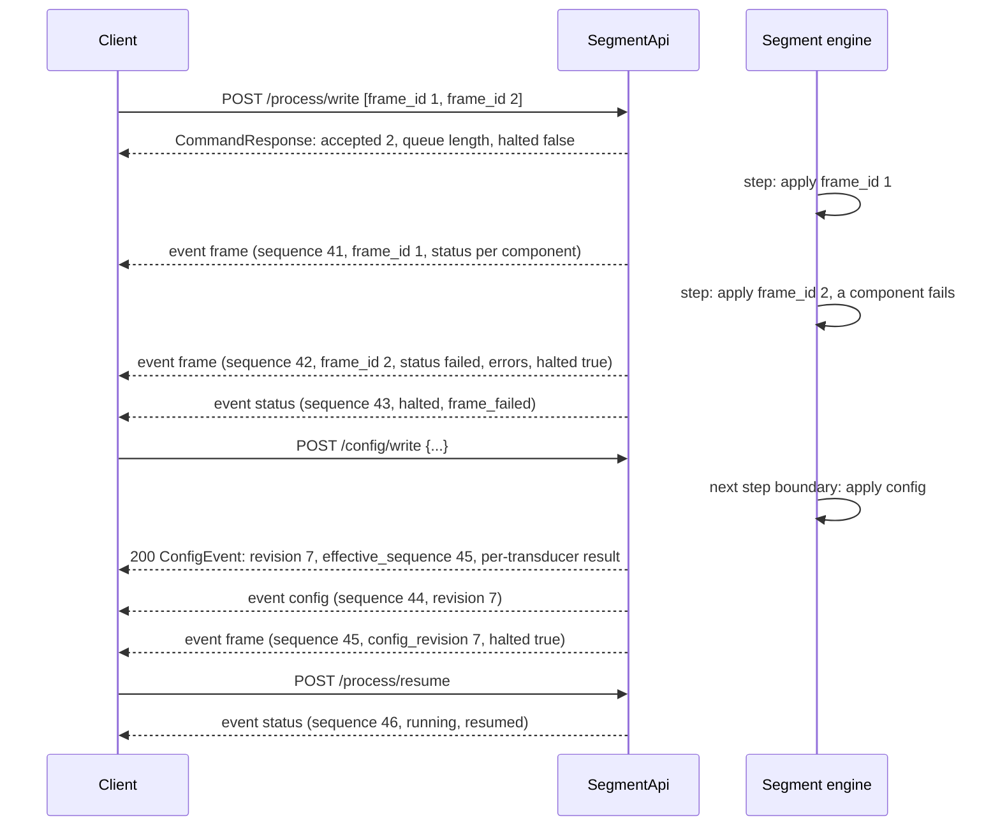

# Segment protocol

> **Abstract.** The technical design of the segment and its APIs (`SegmentEngine`, `SegmentApi`,
> `CoreApi`): the names, how process data and configuration are acknowledged, the halt-on-failure policy,
> step monitors, the stop policy, stream events, sequence numbers, and the retransmission buffer. Reflects
> the implementation in `lib/src/amt/dtp/ise/lib/control/`. Backs the user docs page
> Asset Development › "Segments and the Control APIs". Verify against the code; may lag.

**Status:** implemented; this page describes what the code does (`Reference/control-apis.md` is the as-built
record). Decision status:
- Accepted and implemented: the names (ADR-0005, ADR-0006, ADR-0007), the engine/API split (ADR-0006), sequence
  numbers and the retransmission buffer (ADR-0008), a failed frame halts the queue (ADR-0021; its details are
  not yet confirmed by the user).
- **Deferred and hidden**: [pause](#pause-without-clearing-deferred)
  and [optimistic writes](#optimistic-writes-deferred) are built but served only by an API constructed
  with `preview_features=True` (off by default). Step monitors stay (engine-level; the RobotAPI's tolerances,
  deferred but built, use them), and so does `resume` (it releases halts).
- Open: wire units (ADR-0022: meters and degrees for now; the general decision is open). Not built: timing modes, a
  reactive/lockstep mode, target timestamps, a watchdog, a per-component or per-frame halt policy
  ([Planned](#planned-not-built)).

## Names

The names in the code and on the wire (ADR-0005, ADR-0006, ADR-0007).

**Decided by the user:**

| Name | What | Source |
|---|---|---|
| `AutomationComponent` (extension), `AutomationComponentBase` (lib) | a machine or cell: sensors and actuators under one name | ADR-0007 (the lib name chosen by Claude to follow it) |
| `SegmentEngine` (queue, process image, `step()`) + `SegmentApi` (HTTP) | the segment | ADR-0006 |
| `CoreApi` / `CoreClient` / `CoreApiError` / `CoreInfo` | the base API layer | ADR-0007 |
| `SegmentClient`, `SegmentStream` | the client and its stream | the user |
| `sensor_read` / `actuator_read` / `actuator_write` | transducer and component reads and writes | ADR-0007 |
| `actual_model_type` / `command_model_type` (transducer); `actual_model` / `command_model` (component) | the model types | ADR-0007 |
| joint command fields `position` / `velocity` | the same names as the actual values | ADR-0007 |
| `/api/segment/process/read\|write\|clear\|execute\|resume` (`pause` only with `preview_features=True`) | the process routes | ADR-0005, the user |
| `/api/segment/stream`, `/api/segment/info`, `/api/segment/models.py`; `/api/core/...` | the other routes | the user |
| frame key `components`; component state `actuals` / `commands` | frame contents | the user |
| `{Name}Actuals` / `{Name}Commands`; `{Transducer}_Commands` / `_Actuals` | per-component and per-transducer models | the user |
| `CommandFrame` / `ResponseFrame` / `CommandResponse`; `ComponentCommands` / `ComponentStates` | the generated module's fixed aliases | the user |
| `SchemaMismatch`, `ComponentDefinitionError`, `ComponentWriteError` | errors | the user |
| modules `lib.control.core.*`, `lib.control.segment.*`, `lib.control.component` | where the code lives | the user |
| component state `status`, `errors: list[SegmentError]` | per-component outcome of a step | the user (design below) |

**Chosen by Claude, implemented as listed (not separately confirmed by the user):**

| Name | What | Why |
|---|---|---|
| `CommandFrameBase`, `ResponseFrameBase`, `ComponentStateBase`, `CommandResponseBase`, `ConfigurationBase` | the library generics that per-API classes subclass | a `Base` suffix, so they don't collide with a generated module's fixed aliases (`CommandFrame` …) |
| `ComponentConfigs`, `Configuration` | two more fixed aliases: the configuration by component id (`config/write` body), and the `config/read` answer | configuration is on the wire |
| `CoreInfo.layers` | the API layers, base first, e.g. `["CoreApi", "SegmentApi"]` | names the API layers a server stacks (ADR-0007) |
| `API_TITLE`, `API_DESCRIPTION`, `API_VERSION`, `SCHEMA_FINGERPRINT`, `COMPONENTS` | generated module constants | same |
| `SegmentApi(subscriber_queue_size=)` | events queued per stream subscriber | "buffer" means the retransmission buffer (`buffer_size`) |
| `SegmentClient(base_url, commands_model, states_model, *, configs_model=)`; class attributes `commands_model`, `states_model`, `configs_model`, `configuration_model`, `command_frame_model`, `response_frame_model`, `command_response_model` | the client's models | follow the model names |
| `MtConnectClientConfiguration.commands_model` | the component's commands model | follows `command_model` |
| `IKUnreachableError` (a `ValueError`, `error_code = "IK_UNREACHABLE"`) in `transducer.robot`; `PhysicsViewUnavailable.error_code` | exceptions with codes | typed errors |
| `to_class_name` prefixes a leading digit with `Component` | `3-Axis Mill` → `Component3AxisMill` | a class name can't start with a digit |
| the default `model_prefix` gets a `Segment` suffix when it would collide with a component's class names | `JointPaloozaComponent` + a segment titled "Joint Palooza" → `JointPaloozaSegmentComponentCommands` | a declarative class named `{Name}Component` is common |

## Process data, configuration, and acknowledgements

Process data is cyclic; configuration is acyclic (see
[Cyclic and Acyclic Data](../../Asset Development/050-Segments-and-Control-APIs.md#cyclic-and-acyclic-data)). They also differ
in **how a write is acknowledged**.

### Fieldbus precedents

- **Cyclic data is not confirmed write by write.** It is checked by status that travels with every
  frame:
  - EtherCAT's **working counter**: "Every node that is addressed by the Datagram and whose memory is
    accessible increments the Working Counter". If the count is wrong, the MainDevice doesn't pass the
    data to the application ([ETG §1.6](https://www.ethercat.org/en/technology.html)).
  - PROFINET's provider status: a device "will not accept the data" unless it is GOOD
    ([CODESYS](https://content.helpme-codesys.com/en/CODESYS%20PROFINET/_pnio_edt_device_ioxs.html)).
- **Acyclic writes are confirmed services.** A CANopen SDO transfer is confirmed, or aborted with an
  abort code ([CiA](https://www.can-cia.org/can-knowledge/sdo-protocol)).

### Commands: accepted, then applied

- `POST /process/write` **accepts** frames: it validates the whole batch and queues it (all or nothing,
  422 naming the frame index; 413 if the batch would exceed `max_queue_length`, default 10,000). The
  `CommandResponse` says how many were `accepted`, the `queue_length`, and whether the segment is `halted`
  (accepted frames then wait for a resume). A write with `?expected_revision=` answers 400 unless the API
  serves the [preview features](#optimistic-writes-deferred).
- A frame is **applied** on a later step. Its response frame carries its `frame_id`, in `read` and on the
  stream.
- `POST /process/execute?timeout=` (default 30 s) appends one frame and waits for the response frame of the
  step that applies it: 409 `HALTED` while halted (see below), 409 if a clear removed it first, 413 when the
  queue is full, 503 if the API stopped first, 504 on timeout (the frame is withdrawn from the queue).
- `GET /process/read` returns the latest response frame (503 before the first step). `DELETE /process/clear`
  returns the removed frames.
- **Per-component status** in every response frame (`ComponentStateBase.status`), the role of the EtherCAT
  working counter: proof that each addressed component processed the frame, so "no error" never stands
  in for "applied".
  - `applied`: the frame had commands for the component and writing them succeeded.
  - `failed`: writing them raised (see `errors`).
  - `not_addressed`: no frame was applied this step, or the frame had nothing (or null) for it.
  - A **read** failure doesn't change the status: it adds a `READ_FAILED` error and makes `actuals` and
    `commands` null.
- **Typed errors** (`SegmentError`): `{code, message, component, transducer, sequence}`. `sequence` is that of the event that carries the
  error. `code` is a string, so new codes don't break old clients.

  | Code | Raised when |
  |---|---|
  | `WRITE_FAILED` | an actuator write raised (the default for write failures) |
  | `READ_FAILED` | reading a component raised |
  | `IK_UNREACHABLE` | a robot target has no inverse-kinematics solution (`raise_when_unreachable=True`) |
  | `PHYSICS_VIEW_UNAVAILABLE` | the articulation's physics view is gone |
  | `CONFIG_WRITE_FAILED` | a configuration write raised (in a `config` event) |
  | `STREAM_OVERFLOW` | a stream subscriber fell too far behind (an `error` event, then the stream ends) |
  | `OUT_OF_RANGE` | a resume or retransmit point is outside the retransmission buffer |
  | `INSTANCE_CHANGED` | the `instance_id` a client passed is not the current one (the segment restarted) |
  | `HALTED` | `execute` while the segment is halted (HTTP 409) |
  | `QUEUE_CHANGED` | a write with `expected_revision` after the queue changed (HTTP 409; a preview feature, and the RobotAPI's internal check) |
  | `PATH_TOLERANCE`, `GOAL_TOLERANCE` | a step monitor (the RobotAPI's tolerances) halted the segment |

  The codes are the constants of `ErrorCode` (`segment/models.py`). An exception chooses its code with an
  `error_code` class attribute (e.g. `PhysicsViewUnavailable`, `IKUnreachableError`); any other exception
  is `WRITE_FAILED` (or `READ_FAILED`, `CONFIG_WRITE_FAILED`). A `ComponentWriteError` contributes one
  error per failed transducer, with `transducer` set. HTTP errors with a code (`HALTED`, `QUEUE_CHANGED`,
  `OUT_OF_RANGE`, `INSTANCE_CHANGED`) have `detail = {code, message}` (plus `header` for the last two).

### A failed frame halts the queue (ADR-0021)

ADR-0021 is accepted. Its details (clear releases the halt, `execute` fails fast with 409, read failures
don't halt, resume is idempotent, no policy switch) are implemented as described here but **not yet
confirmed by the user**.

When any component fails to apply its part of a frame (status `failed`), the segment:

1. finishes that step as usual: the other components of the frame are still written (writes are not
   transactional), every component is read, and the response frame records the failure with
   `halted: true`;
2. **stops draining the queue.** The remaining frames stay queued; actuators hold their last commands (so
   velocity-driven actuators keep moving). Steps keep running and publishing response frames (with
   `halted: true`, every component `not_addressed`), and configuration writes are still applied;
3. emits a `status` event (`state: "halted"`, `reason: "frame_failed"`, and `halt` (`HaltInfo`): the failed
   frame's `sequence`, `frame_id`, and its write errors; read errors are not included);
4. reports `halted` and `halt` in `GET /api/segment/info`, and `halted` in every response frame (so in
   `process/read` too).

The client then either:
- **resumes**: `POST /api/segment/process/resume` releases the halt and answers the `SegmentStatus`; the next
  step applies the next queued frame. A `status` event (`state: "running"`, `reason: "resumed"`) is emitted.
  Resuming when not halted is a no-op (idempotent, no event).
- **clears**: `DELETE /api/segment/process/clear` removes the queued frames and also releases the halt
  (`status` event, `reason: "cleared"`; a clear always emits it). Clearing is the "abandon the rest" answer
  to a failure, so it doesn't leave the segment halted with an empty queue.

While halted, `POST /process/write` still accepts frames (they run after a resume), but
`POST /process/execute` answers **409 `HALTED`** at once: it would otherwise wait for a frame that can't
run until someone resumes. Read failures do not halt (they aren't a failure to apply a command, and a
missing physics view would otherwise halt on every step); they are logged once per failing component until
reading works again. There is no per-component or per-frame policy switch (see ADR-0021, "Revisit if").

### Pause without clearing (deferred)

**Deferred:** built, but not offered yet: served only by an API constructed
with `SegmentApi(..., preview_features=True)` (off by default), which the tests use. Without it the route is
absent (404) and `SegmentApi.pause()` raises `RuntimeError`. A decelerating pause is deferred too. Without the
preview features, `resume` releases only a halt, the state and reason `paused` never occur, and `paused` in
`SegmentStatus` and status events is always `false` (the fields and enum values are in the schema regardless).

Industrial robot controllers' remote-motion interfaces commonly let a client hold the controller's motion queue and
continue it later without discarding the queued motion. An emulator of such an interface on top of the segment
needs the same capability, which is why the segment has a pause that keeps the queue.

As built (preview only):
- `POST /api/segment/process/pause` → `SegmentStatus`: from the next step on, **no frame is applied** (actuators hold
  their last commands) and the queued frames wait. Steps keep running and publishing response frames; configuration
  writes still apply; `write` still queues; `execute` **waits** (not 409: a pause is the client's choice, not a
  failure). A `status` event (`state: paused`, `reason: paused`) the first time; idempotent.
- `POST /api/segment/process/resume` releases a pause **and** a halt (one "continue"); `status` event `resumed`.
- `DELETE /process/clear` releases a halt but **not** a pause.
- `SegmentStatus.paused` is true while paused (also while halted, when `state` is `halted`); `/api/segment/info`
  (`SegmentPreviewInfo`) has `paused`. **Response frames are unchanged** (no fingerprint change): their
  `halted` still means a failure.
- Pausing holds: a robot mid-move stops at its current target.

### Step monitors

Built and in use (only pause and optimistic writes are deferred, not the monitors): they have no public
surface (engine-level only, no route and no preview flag). The RobotAPI registers one for its tolerance checks
(deferred but built; off unless a `RobotBinding` sets `path_tolerance` or `goal_tolerance`).

`SegmentEngine.add_monitor(monitor)` / `remove_monitor`: after each step's reads, on the simulation thread and
without the engine's lock, `monitor(frame, readings)` (the frame applied this step or `None`, and every component's
`(actuals, commands)`) returns errors (`SegmentError` with `component`). The errors go into that component's
`errors` in the step's response frame. If the segment isn't halted already and no frame failed this step, they halt
it like a failed frame (ADR-0021): `halted: true`, `halt` holds them, and a `status` event has
`reason: monitor_failed`. (A frame failure in the same step wins: `frame_failed`; while already halted, monitor
errors are only reported in the frame.) A monitor must be quick; its exceptions are logged and ignored. Codes
used by the RobotAPI: `PATH_TOLERANCE`, `GOAL_TOLERANCE`.

### Stop policy (declared)

Part of the execution semantics (deferred, but built and served). What `clear`, a halt, and (with the preview features) `pause`
do to the actuators: **hold** (they keep their last commands: position targets hold, velocity-driven actuators
keep moving), declared in `/api/segment/info` as `stop_policy: "hold"` (the only value), separate from any safety
function. The RobotAPI adds a decelerating clear for robots (`DELETE /api/robot/process/clear?stop=decelerate`,
`Specs/robot-control.md`), built on `SegmentEngine.clear(replacement=)`, which queues replacement frames (a ramp
to rest) in the same atomic step as the clear. A zero-velocity policy needs per-component knowledge and is not
implemented.

### Optimistic writes (deferred)

**Deferred:** built, but not offered yet: served only by an API constructed
with `preview_features=True` (off by default), which the tests use. Without it the query parameter and
`queue_revision` are absent from the schema (`/info` answers `SegmentInfo`, not `SegmentPreviewInfo`), and a
write with `?expected_revision=` is refused with **400** rather than silently appended. The engine-level check
stays in use: the RobotAPI's `write` and `execute` pass `expected_revision` to `SegmentEngine.enqueue` /
`submit_many` internally (up to 3 compiles, then 409 `QUEUE_CHANGED`), so a predicted start can't race the queue.

As built (preview only): `POST /process/write?expected_revision=N` appends only if the queue's `queue_revision` is
still `N` (409 `QUEUE_CHANGED` otherwise). `queue_revision` increments whenever frames are added or removed other
than by a step (write, execute, clear, withdrawal). `/info` reports it, and the RobotAPI's compile answer (also
preview only) carries the one its start state was predicted from, so rows merged from compiled frames
([compile-then-merge](robot-control.md); `merge_frames` in `segment/merge.py`) are appended only
to the queue they were compiled for.

### Configuration: a confirmed service

- `GET /api/segment/config/read` returns the configuration (`{Prefix}Configuration`: `instance_id`,
  `config_revision`, and `components`, one optional field per configurable component). The values are a
  snapshot taken when the segment is created and after every configuration write; changes a script makes
  directly (not through `config_write`) appear after the next write.
- `POST /api/segment/config/write` takes `{Prefix}ComponentConfigs` (partial: only what is sent changes).
  It validates the body (422), then **waits** until the next step boundary applies it (at the start of
  `step()`, before that step's frame, even while frames are queued or the segment is halted) and returns
  the outcome, a `ConfigEvent`:
  - `config_revision`: incremented when at least one transducer's configuration was applied;
  - `components`: per component, `status` (`applied` or `failed`), the transducer ids `applied`, and typed
    `errors` (`CONFIG_WRITE_FAILED`, with `transducer`);
  - `sequence` (of the `config` event) and `effective_sequence`: the first response frame produced with
    the new configuration.
  - 504 if no step runs within `?timeout=` (default 10 s; the write is withdrawn, not applied); 503 if the
    API stopped first.
- Every response frame carries `config_revision`; the stream emits the same `ConfigEvent` as an
  `event: config`, so every observer sees the change and from which frame it applies.
- Configuration writes are applied at the next step boundary even while frames are queued. Waiting until
  the queue empties was rejected: writes arriving in the meantime make the order ambiguous, and a busy
  client could postpone the change indefinitely.

### Stream events

| Event | Sequenced and buffered | Data |
|---|---|---|
| `frame` | yes | a `ResponseFrame`, every step (the only events filtered by `every` and `executed_only`) |
| `config` | yes | a `ConfigEvent`, when a configuration write is applied |
| `status` | yes | a `StatusEvent`: `instance_id`, `sequence`, `state` (`running`, `halted`, `stopped`), `reason` (`frame_failed`, `monitor_failed`, `resumed`, `cleared`, `stopped`), `halt`, `queue_length`, `paused`, `wall_timestamp`. With the [preview features](#pause-without-clearing-deferred) only: state and reason `paused`, and `paused: true`; otherwise `paused` is always `false` |
| `error` | no (about this connection) | `{errors: [SegmentError], header}`; `STREAM_OVERFLOW` (the subscriber fell more than `subscriber_queue_size` events behind, default 256), after which the stream ends |
| `reset` | no | `{code, message, header, lost_from, lost_to}`: the stream could not continue exactly where asked (`INSTANCE_CHANGED`, or `OUT_OF_RANGE` with `clamp=true`, naming the lost range) and starts afresh |
| `heartbeat` | no | `{instance_id, next_sequence}`, after 15 s without an event |

Errors caused by a frame stay **inside** that frame, so outcome and data are one atomic message. A
`stopped` status event (`state` and `reason` `stopped`) is the last event before the API closes its streams;
waiting `execute` and `config/write` requests then fail with 503.

## Sequence numbers and the retransmission buffer

**Decided by the user (ADR-0008), implemented as below:**
- Every event the segment produces (`frame`, `config`, `status`) carries a server-assigned
  **`sequence`** and the segment's **`instance_id`**.
- `sequence` is **outbound only**; it is distinct from `frame_id`, which the client chooses when it
  writes.
- **The stream is the primary way to get data.** A small, fixed-size (configurable) buffer of recent
  events, keyed by `sequence`, exists **only to repair or resume a stream**, when events were dropped
  or the connection was lost and the client needs to continue exactly where it left off. It is not a
  data-acquisition interface and not a historian, and it doesn't "replay" history.

**How this differs from MTConnect.** MTConnect is built the other way round. Clients primarily
*acquire* data by repeatedly querying `sample` by sequence number, and streaming a `sample` is a
secondary mode. Here, streaming is primary, and querying by sequence exists only to repair or resume
the stream. The closest match in intent is OPC UA's **retransmission queue**: a server keeps
notifications so a client can **Republish** ones it missed, and an empty `availableSequenceNumbers` means
the server keeps none. Hence the name **retransmission buffer**.

**How other protocols number and recover** (V = read in the source):

| Protocol | Sequence numbers | Buffer and recovery | Gaps beyond the buffer |
|---|---|---|---|
| MTConnect | "monotonically increasing unsigned 64-bit", first is 1, unique per `instanceId`, which changes when the sequence restarts (V) | an optional fixed-size buffer: the agent "MAY implement a buffer"; `sample?from=&count=&to=` reads a range (default count 100); streaming with `interval`; the header has `instanceId`, `bufferSize`, `firstSequence`, `lastSequence`, `nextSequence` (V) | `from` outside the buffer: 404 `OUT_OF_RANGE` (V) |
| OPC UA subscriptions | per subscription, starting at 1; a keep-alive carries the *next* number without using it (V) | a retransmission queue; each Publish response lists `availableSequenceNumbers`; **Republish** re-requests one specific number (V) | `Bad_MessageNotAvailable`; an empty list means no queue at all (V) |
| OPC UA PubSub | optional, increments by one, wraps (V) | none | — |
| Server-Sent Events | the `id` field per event (V) | the client resends the last id as `Last-Event-ID` when reconnecting; how the server resumes is up to the server (V) | — |
| ROS 2 / DDS | per writer ❓ | QoS history (keep last *N*); durability `transient_local` delivers up to *N* to late joiners (V); reliable delivery re-sends missed samples ❓ | — |
| Redis Streams | the entry ID | `XRANGE start end COUNT n` (inclusive range); `XREAD` returns IDs "greater than" one given (V) | — |

Sources: [MTConnect Part 1 v2.5](https://docs.mtconnect.org/MBSD_MTConnect_Part_1_2-5-0.pdf),
[OPC UA Part 4 §5.14.1.1](https://reference.opcfoundation.org/Core/Part4/v105/docs/5.14.1.1) and
[§5.14.6 Republish](https://reference.opcfoundation.org/Core/Part4/v105/docs/5.14.6),
[OPC UA Part 14 §7.2.3](https://reference.opcfoundation.org/Core/Part14/v105/docs/7.2.3),
[WHATWG SSE](https://html.spec.whatwg.org/multipage/server-sent-events.html),
[ROS 2 QoS design](https://design.ros2.org/articles/qos.html),
[Redis XRANGE](https://redis.io/docs/latest/commands/xrange/), [XREAD](https://redis.io/docs/latest/commands/xread/).

**The design:**

- **Numbering.** `sequence` is an integer starting at 1, never reset while the segment engine exists. An
  **`instance_id`** (a random hex string) identifies the engine; a new engine is built on every play, so
  numbering restarts with a new `instance_id`. Without it, a stale sequence from a previous run would
  alias a new one (as in MTConnect).
- **The header** (`BufferHeader`), with MTConnect's field names in snake case: `instance_id`,
  `buffer_size`, `first_sequence`, `last_sequence` (null while the buffer is empty), `next_sequence`.
  Reported by `GET /api/segment/info` (`buffer`), by `GET /api/segment/retransmit`, and in every
  `OUT_OF_RANGE` / `INSTANCE_CHANGED` error. A response frame carries its own `instance_id` and `sequence`.
- **Resuming a stream (the main use).**
  - Each sequenced SSE event's `id` is `instance_id:sequence`. Unsequenced events (`error`, `reset`,
    `heartbeat`) have no `id`, so they don't move a browser's last event id.
  - A stream accepts the standard **`Last-Event-ID`** header, so browsers' `EventSource` reconnects
    without losing data, and an equivalent **`resume_after=<sequence>`** parameter (with an optional
    `instance_id=`) for other clients; the parameter wins over the header.
  - Buffered events after that point are sent first (through the same `every` / `executed_only`
    filters), then the stream continues live, without duplicates. Without a resume point, the stream is
    live only and starts with the latest response frame.
  - An `instance_id` mismatch (or an unparsable `Last-Event-ID`) means the segment restarted: the stream
    sends a `reset` event (`INSTANCE_CHANGED`) and continues live.
  - A resume point outside the buffer (evicted, or later than the last event, `next_sequence - 1`) is
    answered with **HTTP 404** and `{"detail": {"code": "OUT_OF_RANGE", "message", "header"}}`, so the
    client must resync (from `process/read`). `clamp=true` opts into "resume from `first_sequence`": the
    stream starts with a `reset` event (`OUT_OF_RANGE`, `lost_from`..`lost_to`) and then every buffered
    event. Resuming never quietly skips.
- **Repairing gaps in a running stream:** `GET /api/segment/retransmit` returns buffered events
  (`{event, sequence, data}`) with the header, in two shapes:
  - **a list** (`sequences=4,8,15`) for scattered drops; this is OPC UA's Republish, batched. It
    returns what it found plus an explicit **`missing`** list rather than failing the whole request.
  - **a range** (`from`, `to`, inclusive; `to` defaults to `last_sequence`) for one contiguous outage,
    capped at `count` events (default 1000; `truncated: true` when capped). A `from` older than
    `first_sequence`, or later than `next_sequence`, is 404 `OUT_OF_RANGE`; `clamp=true` starts at
    `first_sequence` instead (the header's `first_sequence` shows where the loss ends; evicted sequences
    are not enumerated, since a range can be long).
  - An optional `instance_id=` makes a mismatch 409 `INSTANCE_CHANGED`. Passing both or neither of
    `sequences` and `from` is 400.
- **Heartbeats** carry `next_sequence` without consuming a number (as OPC UA keep-alives), so an idle
  stream still shows that nothing was missed.
- **Sizing and configuration.** The buffer is sized for **outages to ride through**, not for history:
  steps per second × the longest disconnection to tolerate. The default is 600 events (60 Hz × 10 s); it
  is set in the constructor (`buffer_size`), and `buffer_size=0` disables it (MTConnect and OPC UA both
  allow that). Sequence numbers are still assigned and reported, and resuming then only works without a
  gap. The buffer keeps each event's model and serializes it once.

## Engine and API split (ADR-0006)

- **`SegmentEngine`** (`lib.control.segment.engine`, no fastapi): the components, the models, the frame
  queue, the halt (and pause) state, configuration writes, `step()`, step monitors, sequence numbering, and
  the retransmission buffer. Constructor: `SegmentEngine(components, name=None, model_prefix=None,
  max_queue_length=10_000, buffer_size=600)`. It notifies listeners (`add_listener`) of every sequenced event
  (on the thread that emitted it, under the engine's lock, so listeners see events in sequence order). Usable
  on its own (e.g. in tests or by an adapter that isn't HTTP). Besides the queue methods behind the routes
  (`enqueue`, `submit`, `clear`, `resume`, `config_write`, …) it offers what the RobotAPI builds on:
  `submit_many` (several frames, one future for the last), `withdraw`, `prediction_snapshot` (the latest
  response frame, the frames not yet reflected in it, and `queue_revision`, atomically), and
  `clear(replacement=)`.
- **`SegmentApi(CoreApi)`** (`lib.control.segment.server`; `CoreApi` is an `ApiHost`, ADR-0024): the HTTP routes
  over one engine, under `/api/segment`. It accepts components (and builds the engine) or a `SegmentEngine`;
  `step()` and the queue methods delegate to the engine. Constructor: `SegmentApi(components, title=None,
  description=None, version="0.1.0", port=8020, host="0.0.0.0", assets=None, model_prefix=None,
  max_queue_length=10_000, buffer_size=600, subscriber_queue_size=256, preview_features=False)`. Stream
  subscribers live on the server's event loop; a listener schedules each event there. The generated client
  module is served at `/api/segment/models.py` (with the schema fingerprint as its `ETag`).
- Execute and configuration requests wait on `concurrent.futures.Future`s that the engine resolves in
  `step()`, so the engine has no asyncio dependency.

## Planned (not built)

!!! info "Planned"
    Not built and not decided, or recorded as a decision's "Revisit if". Nothing in the code
    implements these yet.

    - Wire units (ADR-0022): meters and degrees for now; the general decision is open.
    - Timing modes a segment should support (lockstep, as fast as possible, paced) and their declaration as
      capabilities (proposed), a reactive/lockstep mode for external clients (today an HTTP client
      can only queue), target timestamps, and a watchdog (not decided).
    - A per-component or per-frame halt policy (ADR-0021, "Revisit if").
    - A decelerating pause, and offering pause and optimistic writes by default (deferred).
