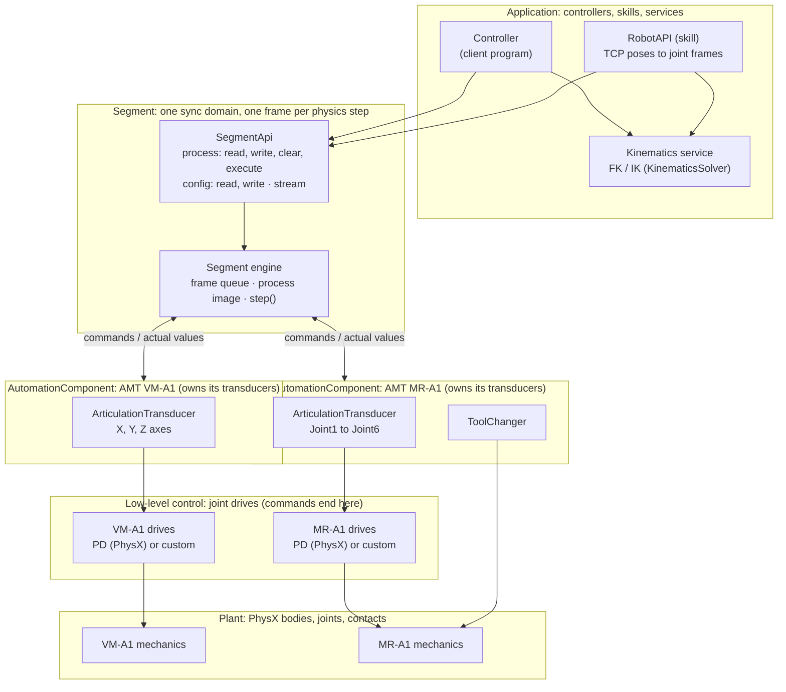
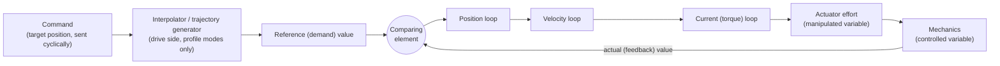
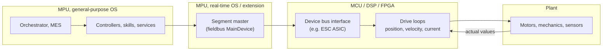
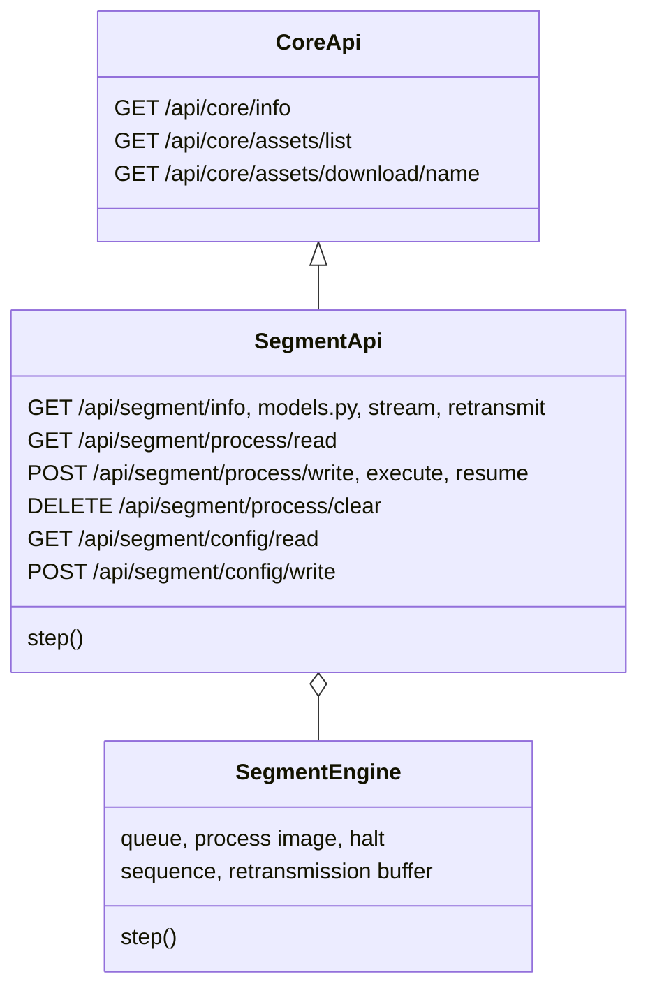
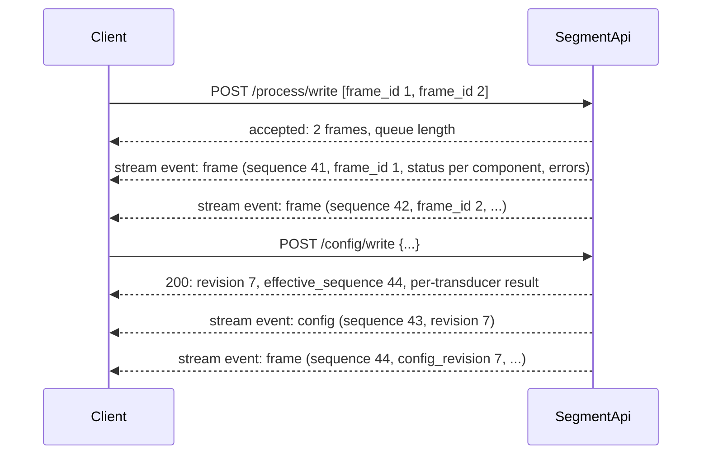

# Segments and the Control APIs

!!! info "In this chapter"

    How a machine is controlled remotely. First the architecture (the layers from a client program down
    to the simulated motors, and how they correspond to real control hardware), then the **segment**: one
    frame of commands for every component per physics step. Then the control APIs, the Python client,
    acknowledgements and stream recovery, and the reference.

    **Builds on:** [Automation Components](040-Automation-Components.md). If you only control existing
    assets, [Models](010-Models.md) is enough background.

## Layers

The backbone is a **cyclic, synchronized exchange of process data**, the way a fieldbus such as
EtherCAT or Sercos works, with **acyclic configuration** beside it and **application services**
(motion, kinematics) above it.



| Layer | What it does | Today |
|---|---|---|
| Application | Decides what each cycle should do: client programs, skills (the RobotAPI), and services (kinematics). | Client programs; the RobotAPI and the kinematics service ([Robot Control](070-Manipulator-Robots.md#robot-control)) |
| Segment | One synchronization domain: applies one frame of commands to every device per physics step and collects every device's state. | `SegmentEngine` (queue, process image, `step()`) and `SegmentApi` (HTTP) |
| Automation component | Owns a set of transducers exclusively, with a fixed process-data layout and optional configuration. | `AutomationComponent` (see [Terminology](910-Terminology.md#decided-terms)) |
| Transducer | A group of I/O points on a prim: sensors, actuators, or both. | `Sensor`, `Actuator`, e.g. `ArticulationTransducer` |
| Low-level control | Closes the loops that make the mechanics follow the commands: joint drives. | PhysX joint drives (an implicit PD) |
| Plant | The mechanics: bodies, joints, contacts. | PhysX |

### Ownership

**A device's transducers belong to that device alone.** Only the device reads and writes them, and only
the segment it belongs to writes to the device, once per cycle.
- **Machines don't write to each other's transducers.** Coordination between machines happens above,
  in the application or segment layer: a frame holds commands for several devices, applied on the
  same step.
- **Each device belongs to exactly one segment,** so it has exactly one writer per cycle. EtherCAT has
  the same rule: "The EtherCAT MainDevice is the only node within a segment allowed to actively send" a
  frame ([ETG](https://www.ethercat.org/en/technology.html)).

**Granularity is a design choice, not an architectural one.** Today a whole machine is one device. In a
flatter cyber-physical production system, every smart sensor or actuator could be its own device, owning
one transducer. The segment then has more members, but the rules stay the same.

## Low-Level Control: Where a Command Ends

A command doesn't drive a motor directly. In a servo drive it passes through a chain:



The terms come from the IEC control vocabulary
([IEC 60050-351](https://www.electropedia.org/iev/iev.nsf/display?openform&ievref=351-48-09)):
- The **command variable** is "not influenced by the control but is introduced into the control system
  from outside".
- The **reference variable** is the input to the comparing element
  ([351-48-02](https://www.electropedia.org/iev/iev.nsf/display?openform&ievref=351-48-02)).
- The **feedback variable** "represents the controlled variable and is returned to the comparing
  element" ([351-48-03](https://www.electropedia.org/iev/iev.nsf/display?openform&ievref=351-48-03)).
- The **manipulated variable** is the output of the controlling system that drives the plant
  ([351-48-07](https://www.electropedia.org/iev/iev.nsf/display?openform&ievref=351-48-07)).

**A command ends at the comparing element of the outermost loop the drive closes.** The inner loops
receive internally generated references, not commands. In CiA 402's cyclic synchronous modes, "the
master handles trajectory planning, while the drive executes the local control loops"
([Synapticon](https://www.synapticon.com/en/motion-control-academy/zyklisch-synchrone-betriebsarten-csp-csv-cst)):

| Drive mode | The command enters at | Drive-side interpolation |
|---|---|---|
| Cyclic synchronous position (CSP) | position loop | none: the host sends a target every cycle |
| Cyclic synchronous velocity (CSV) | velocity loop | none |
| Cyclic synchronous torque (CST) | no loop: the command is the manipulated variable | none |
| Profile position (PP) | the drive's own trajectory generator, whose output (the *demand* value) enters the position loop | yes: "the output of the trajectory generator" ([Kollmorgen 60FCh](https://webhelp.kollmorgen.com/AKD/English/Content/CANopen/Object%2060FCh%20Position%20Demand%20Internal%20Value%20(DS402).htm)) |

**Our frames work like CSP.** A client sends one position (or velocity) target per physics step, and the
simulated drive only closes the loop.

### In the simulation: PhysX joint drives

A USD/PhysX joint drive computes "Force or acceleration = stiffness * (targetPosition - position) +
damping * (targetVelocity - velocity)"
([UsdPhysicsDriveAPI](https://openusd.org/release/api/class_usd_physics_drive_a_p_i.html)), capped by
`maxForce`. PhysX solves it implicitly, "with respect to the end of the time step"
([PhysX 5.6.1](https://nvidia-omniverse.github.io/PhysX/physx/5.6.1/docs/Articulations.html)).

| Control element | PhysX equivalent |
|---|---|
| Command / reference | the drive's `targetPosition` / `targetVelocity`, written from our frames |
| Comparing element + controller | the stiffness and damping terms: one PD, solved within the physics step |
| Manipulated variable | the drive effort, capped by `maxForce` (or PhysX 5.6's performance envelope, maximum effort vs velocity) |
| Controlled / actual variable | the joint's position and velocity |

What PhysX does **not** model: a drive-side trajectory generator, separate velocity and current loops,
motor dynamics, and bus timing. Its PD folds the position and velocity loops into one implicit step.

### A path to custom low-level controllers (future)

Better fidelity (a real PID with integral action, motor torque-speed curves, delays) would replace
PhysX's PD with an **explicit** controller that computes the joint effort every step:
- Isaac Sim's effort control: "stiffness and damping must be set to zero"
  ([Isaac Sim](https://docs.isaacsim.omniverse.nvidia.com/6.0.0/robot_setup/ext_isaacsim_robot_setup_gain_tuner.html)),
  then the efforts are applied.
- Isaac Lab already structures this as **actuator models**:
  - implicit actuators (PhysX's PD);
  - explicit ones: `IdealPDActuator`, which computes τ = kp(q_des − q) + kd(q̇_des − q̇) + τ_ff and clips
    it; `DCMotor`, with a torque-speed curve; `DelayedPDActuator`; and learned actuator networks.
  - [Isaac Lab actuators](https://isaac-sim.github.io/IsaacLab/main/source/overview/core-concepts/actuators.html)

In this architecture, such a controller lives in the **low-level control** layer, between a device's
transducers and the plant. Commands would still end at its comparing element, and the process-data
contract wouldn't change.

## Hardware Cross-Section

In a real machine these layers run on different classes of processor, chosen for what each can
guarantee. What they are called (PLC, edge gateway, industrial PC, drive) matters less than what they
can do:

| | MPU, general-purpose OS | MPU, real-time OS or extension | MCU / DSP / FPGA |
|---|---|---|---|
| Examples | Arm A-profile or x86 running Linux or Windows: edge gateways, servers, HMIs | the same hardware with PREEMPT_RT Linux, or TwinCAT's real-time extension: industrial PCs, soft PLCs | Arm M- and R-profile, TI C2000, FPGAs: drives, I/O modules, bus interfaces |
| Strengths | Rich OS, networking, storage, heavy computation (planning, GPU) | Bounded latency with a rich OS | "Low-latency, highly deterministic operation" ([Arm M-profile](https://www.arm.com/architecture/cpu/m-profile)); "real-time deterministic control" ([Arm R-profile](https://www.arm.com/architecture/cpu/r-profile)) |
| Limits | Caches, virtual memory, and scheduling cause latency jitter | Caches, SMIs, firmware, and power management still cause latency the kernel can't control ([kernel.org](https://docs.kernel.org/core-api/real-time/hardware.html)) | Little memory, no rich OS |
| Typical role | Orchestration, controllers, skills, services | Fieldbus master: TwinCAT runs EtherCAT in kernel mode to "access the network ports directly" ([Beckhoff](https://infosys.beckhoff.com/content/1033/te1010_tc3_realtime_monitor/6828869003.html)) | Device bus interface: the ET1100 "processes the EtherCAT protocol in the hardware" ([Beckhoff](https://www.beckhoff.com/en-en/products/i-o/ethercat-development-products/elxxxx-etxxxx-fbxxxx-hardware/et1100.html)). Drive loops: e.g. a C2000 core runs the current, speed, and position loops while an Arm Cortex-M4 on the same chip handles EtherCAT ([TI SPRACM9B](https://www.ti.com/lit/an/spracm9b/spracm9b.pdf)) |
| Typical timing | milliseconds and up | fieldbus cycles; EtherCAT is designed for "short cycle times (≤ 100 µs)" ([ETG](https://www.ethercat.org/en/technology.html)) | current loops of 62.5 µs at 8 kHz switching ([Beckhoff AX8000](https://www.beckhoff.com/en-us/products/motion/servo-drives/ax8000-multi-axis-servo-system/)), reacting "within 1 µs" in hardware |

Linux's PREEMPT_RT "reduces the latency between a high-priority task becoming runnable and its actual
execution" ([kernel.org](https://docs.kernel.org/core-api/real-time/theory.html)). It was merged into
mainline Linux in 6.12 (2024) ❓.



### How the simulation maps onto this

In the simulation, every layer runs on one MPU (the Isaac Sim host), so wall-clock real time can't be
guaranteed. **Lockstep logical time** replaces it:
- The segment's `step()` runs in the behavior script's `on_physics`, once per physics step.
- The drives (PhysX) run inside the physics step.

So the "hard real-time" layers are deterministic in **simulation time**, whatever the host's load. The
HTTP side runs on its own thread in soft real time, and the **frame queue** is what bridges the two: the
client fills it at its own pace, and the segment drains one frame per step. A CNC's look-ahead buffer
does the same job between a soft-real-time planner and a hard-real-time interpolator ❓.

| Layer | Real hardware | In the simulation |
|---|---|---|
| Controllers, skills, services | MPU, general-purpose OS | client processes, anywhere on the network; the RobotAPI and the kinematics service (KinematicsSolver) in Isaac Sim's process |
| Segment master | MPU with real-time OS or extension | the segment engine, stepped in `on_physics` (logical time) |
| Device bus interface | ASIC / MCU | the device (`AutomationComponent`) reading and writing its transducers within `step()` |
| Drive loops | MCU / DSP / FPGA | PhysX joint drives (implicit PD), or a future explicit controller |
| Plant | mechanics | PhysX |

## Segments (Sync Domains)

A segment is one synchronization domain:
- one frame per cycle;
- one writer per device;
- one queue;
- one clock (the physics step).

Several segments can coexist, e.g. one per cell. Synchronization *across* segments, or with other
systems, happens above them, through orchestration, skills, and services. For example, the planned
"compile, then merge" flow assembles synchronized rows for several machines and writes them to one
segment ([Robot Control Architecture](070-Manipulator-Robots.md#several-robots-and-machines-in-one-segment)).
That is where the flexibility of distributed, cyber-physical control comes from: composing segments and
services, not loosening the cycle inside a segment.

## Cyclic and Acyclic Data

Industrial fieldbuses separate two kinds of data, and automation components follow the same split:

- **Cyclic data** (process data) is exchanged every cycle in a frame whose layout is fixed: sensor
  values in, commands out. Here, the cycle is the physics step, the frames are the segment API's
  request and response frames, and the layout is the AutomationComponent's sensors and actuators models.
- **Acyclic data** (parameters, configuration) is read and written on request, in between the cyclic
  exchange, without disturbing it. Here, that is the AutomationComponent's configuration.

| Protocol | Cyclic | Acyclic |
|---|---|---|
| EtherCAT | Process data (PDOs), mapped before the device enters Operational ([Beckhoff: state machine](https://infosys.beckhoff.com/content/1033/el3204-0162/1036980875.html)) | Mailbox (e.g. CoE SDOs), sent "in the intervals between the cyclic data" ([Beckhoff](https://infosys.beckhoff.com/content/1033/ethercatsystem/2469087755.html)) |
| CANopen | PDOs, only in the Operational state ([CiA](https://www.can-cia.org/can-knowledge/pdo-protocol)) | SDOs, access to the device's object dictionary ([CiA](https://www.can-cia.org/can-knowledge/sdo-protocol)) |
| PROFINET | IO data, with a cycle counter and per-submodule status | Record data: read/write by index ([PI System Description](https://se.profibus.com/fileadmin/media/downloadsection/technical_description_%26_books/PROFINET_System_Description_engl_2018_Update.pdf)) |
| EtherNet/IP | Implicit messaging (UDP), a format both sides "know and agree on" | Explicit messaging (TCP), request/reply ([ODVA PUB213](https://www.odva.org/wp-content/uploads/2020/05/PUB00213R0_EtherNetIP_Developers_Guide.pdf)) |
| IO-Link | Process data (at most 32 bytes) | On-request data, kept separate so it doesn't affect the process data ([IO-Link spec §A.2.1](https://io-link.com/fileadmin/user_upload/Downloads/Package_2020/IOL-Interface-Spec_10002_V113_Jun19.pdf)) |
| Universal Robots RTDE | Output and input recipes, fixed for the session (e.g. `actual_TCP_pose`) ([RTDE guide](https://docs.universal-robots.com/tutorials/communication-protocol-tutorials/rtde-guide.html)) | Script commands, e.g. `set_tcp` ([script manual](https://www.universal-robots.com/manuals/EN/HTML/SW5_24/Content/prod-scriptmanual/all_scripts/set_tcp_pose.htm)) |

The design rules that follow from them:

1. **The contract is fixed while playing.** In every protocol above, the cyclic layout is fixed for the
   life of a connection and changes only through a reconfiguration state (e.g. EtherCAT's Pre-Op). Here,
   the sensors, actuators, and configuration *models* are built when the AutomationComponent is created and never
   change while the simulation plays; the schema fingerprint identifies them, like RTDE's recipe id or
   OPC UA's ConfigurationVersion ([OPC 10000-14 §5.2.3](https://reference.opcfoundation.org/specs/OPC-10000-14/5.2.3)).
   Configuration *values* can change while playing.
2. **Configuration is per device, not per direction.** None of these protocols has a "sensor
   configuration" and an "actuator configuration": a device has one parameter set (an object
   dictionary, records, a configuration assembly). Here, each transducer has at most one configuration
   model.
3. **Configuration is optional.** Many devices have none, so `config_model_type` defaults to `None`.
4. **Large or irregular data has its own channel.** Files, video, and other bulk data never ride in the
   cyclic frame (EtherCAT moves files through its mailbox, PROFINET sends non-real-time traffic in a
   separate phase), so they can't stretch the cycle. Here, assets are served by the
   [CoreApi](050-Segments-and-Control-APIs.md#coreapi), and cameras or other large sensors will get their own endpoints
   rather than fields in the frames.

Configuration on the wire: `GET /api/segment/config/read`, `POST /api/segment/config/write` (a confirmed
write, see [acknowledgements](#acknowledgements-and-errors)), and `config` events on the stream. In Python,
components and transducers have `config_read()` and `config_write()`.

## The Control APIs

The control APIs are layered: each layer is a subclass that adds its own endpoints to the ones below it.



### CoreApi

`CoreApi` (`amt.dtp.ise.lib.control.core.server`) is the base: a FastAPI app served by uvicorn on its
own thread, so requests never block the simulation. It serves:

| Endpoint | Description |
|---|---|
| `GET /api/core/info` | Title, description, version, and the API's layers (`layers`, e.g. `["CoreApi", "SegmentApi"]`). |
| `GET /api/core/assets/list` | The files given to the constructor's `assets`: name, size, media type, and SHA-256. |
| `GET /api/core/assets/download/{name}` | Download one of them (404 for an unknown name). |

**Assets** are files clients may need, such as a robot's URDF/XRDF descriptions or the asset's USD file.
Pass a list of paths (each served under its file name) or a `{name: path}` mapping; every file must
exist when the API is created.

To build a new controller on top, subclass it and add routes with `add_router()` (before the API starts).
`run_coro_on_main_loop(coro)` runs a coroutine on the event loop of the thread that called `start()`
(Isaac Sim's main loop when started from a behavior script) and returns its result, for request
handlers that must touch the simulation directly:

```python
from fastapi import APIRouter
from amt.dtp.ise.lib.control.core.server import CoreApi

class LightsApi(CoreApi):

    def __init__(self, light, **kwargs):
        super().__init__("Lights", **kwargs)
        router = APIRouter(prefix="/api/lights", tags=["Lights"])

        @router.post("/toggle")
        async def toggle():
            async def on_main():
                light.toggle()             # runs on Isaac Sim's main thread
                return light.is_on
            return {"on": await self.run_coro_on_main_loop(on_main())}

        self.add_router(router)
```

On the client side, `CoreClient` (`amt.dtp.ise.lib.control.core.client`) provides `info()`,
`assets()`, `asset_bytes(name)`, and `download_asset(name, destination)`; `SegmentClient` builds on it.

### Segment API

`SegmentApi` (`amt.dtp.ise.lib.control.segment.server`) controls **one or more components**. Clients write
**command frames** into a queue; every simulation step, one frame is taken from the queue and applied, then
every component is read and published as a **response frame**. The work is done by a **segment engine**
(`SegmentEngine`, `amt.dtp.ise.lib.control.segment.engine`): the components, the queue, `step()`, sequence
numbers, and the retransmission buffer. `SegmentApi` builds one from the components you pass (or takes one
you built) and serves it over HTTP; its `step()` is the engine's.

Each frame is **one row holding every component**, like a fieldbus frame (e.g. EtherCAT) that
passes through every machine on each cycle: a command frame's commands for all machines are applied on
the same simulation step, for synchronized motion across machines, and a response frame holds the state
of every machine after that step.

```json title="A command frame (two machines)"
{
  "frame_id": 42,
  "components": {
    "mill": {"axes": {"X_Axis": {"position": 0.41}, "Y_Axis": {"position": 0.80}}},
    "robot": {"joints": {"Joint1": {"position": 12.5}}}
  }
}
```

```json title="The response frame of the step that applied it"
{
  "instance_id": "8c1e…", "sequence": 1834, "config_revision": 0, "halted": false,
  "physics_timestamp": 30.5, "timeline_timestamp": 30.5, "wall_timestamp": 1792161234.56, "frame_id": 42,
  "components": {
    "mill": {"status": "applied", "actuals": {"axes": {"X_Axis": {"position": 0.41, "velocity": 0.1, ...}}},
             "commands": {...}, "errors": []},
    "robot": {"status": "applied", "actuals": {...}, "commands": {...}, "errors": []}
  }
}
```

A component's **state** in a response frame holds its **actual** values (what was measured), the readback
of its **commands** (the targets in effect), its **status** for this frame (`applied`, `failed`, or
`not_addressed`), and any typed **errors**; see [acknowledgements](#acknowledgements-and-errors).

**Frames carry only what changes.** Every level above a single command is optional: a command frame may
omit `components`, any component, any actuator, and any joint of an articulation, and whatever
it omits (or sets to `null`) is left unchanged. A frame with no `components` at all (`{"frame_id": 7}`)
changes nothing and still takes one step, so it works as a **delay**: N empty frames hold the current
commands for N physics steps before the next frame runs.

A single command is atomic: a joint position, a velocity, a pose, or a color is sent whole (e.g. a
pose always has its position and orientation).

```python title="Behavior script"
from amt.dtp.ise.lib.control.segment.server import SegmentApi

class MachiningCellScript(BehaviorScript[MachiningCellConfig]):

    def on_play(self):
        self._api = SegmentApi(
            {"mill": AmtVmA1(prim=f"{self.prim_path}/Mill"), "robot": AmtMrA1(prim=f"{self.prim_path}/Robot")},
            title="Machining Cell",
            port=8020,                                # http://localhost:8020/api/docs
            assets=[Path(__file__).parent / "AMT MR-A1.urdf"],
        )
        self._api.start()

    def on_physics(self, current_time: float, delta_time: float):
        self._api.step(physics_time_step=delta_time, timeline_time=current_time)    # one command frame per physics step

    def on_stop(self):
        self._api.stop()
```

With a single component, pass it directly (`SegmentApi(AmtVmA1(prim=...))`): the
title then defaults to the component's name, and its id is its name as an identifier (`AMT_VM_A1`).

!!! warning "Call `step()` once per physics step, from one place"

    `step()` applies one frame per call. Call it from `on_physics` (once per physics step), not
    `on_update` (once per app update, which can span zero or several physics steps). With several
    components in one API, call it from one behavior script only (e.g. the cell's), not from
    each machine's. Construct the components and the API in `on_play`, not `on_init`: the config editor
    also constructs behavior scripts while the simulation is stopped, when articulations can't be built.

```python title="Models (simplified, from amt.dtp.ise.lib.control.segment.models)"
class CommandFrameBase(BaseModel, Generic[TC]):
    """One frame of commands for every component, applied on one physics step."""
    model_config = ConfigDict(extra="forbid")
    frame_id: Optional[int] = None        # chosen by the client, echoed in the response frame
    components: Optional[TC] = None       # by component id; omitted or null means unchanged

class ComponentStateBase(BaseModel, Generic[TA, TC]):
    """One component's state after a step."""
    status: Literal["applied", "failed", "not_addressed"]
    actuals: Optional[TA]                 # measured values; null if reading failed
    commands: Optional[TC]                # readback of the targets in effect
    errors: List[SegmentError] = []       # typed errors (code, message, component, transducer, sequence)

class ResponseFrameBase(BaseModel, Generic[TS]):
    """The state of every component after one physics step."""
    instance_id: str                      # changes when numbering restarts (every play)
    sequence: int                         # server-assigned, outbound only
    config_revision: int                  # the configuration this step ran with
    halted: bool                          # a failed frame halted the queue
    physics_timestamp: float
    timeline_timestamp: Optional[float]
    wall_timestamp: float
    frame_id: Optional[int]               # the frame applied this step, if any
    components: TS                        # by component id
```

Each API gets named subclasses: e.g. `MachiningCellCommandFrame` (with `components:
MachiningCellComponentCommands`, one optional field per component id) and
`MachiningCellResponseFrame` (with `components: MachiningCellComponentStates`, one field per
component id, typed with that component's state model, e.g. `AmtVmA1State`). The library classes end in
`Base`, so their names never collide with the fixed aliases below.

**Naming.** Models that hold every component belong to the API and are named after its title
(`Machining Cell` → `MachiningCellCommandFrame`, `MachiningCellComponentCommands`,
`MachiningCellComponentStates`, `MachiningCellComponentConfigs`, `MachiningCellClient`, `machining_cell.py`; all-caps words are
capitalized, so `AMT VM-A1` → `AmtVmA1`). Models of one component are named after the
component (`AmtVmA1Actuals`, `AmtVmA1Commands`, `AmtVmA1State`), and models of one transducer after the
transducer's name (`Mill_Commands`, `Mill_X_Axis_Commands`).

**Fixed aliases.** The generated client module also gives the API-level classes names that are the same
for every API, so client code doesn't change when the API's title does: `Client`, `CommandFrame`,
`ResponseFrame`, `CommandResponse`, `ComponentCommands`, `ComponentStates`, `ComponentConfigs`, and
`Configuration`. To use several APIs in one program, import each module under its own name (`import
machining_cell as cell`, then `cell.CommandFrame`) rather than with `*`.

**Timestamps.** Each response frame has three, because they measure different clocks:

| Field | Clock |
|---|---|
| `physics_timestamp` | Physics simulation time: the sum of the physics time steps since the simulation started playing (or the exact time, if the owner passes `physics_time=` to `step()`). |
| `timeline_timestamp` | The timeline's time, which advances once per app update; several physics steps in one update share it. |
| `wall_timestamp` | Wall-clock time, in seconds since the Unix epoch. |

`/api/segment/info` reports `physics_time_step` (one command frame is applied per physics step) and
`timeline_time_step` (how far the timeline advances per update).

| Endpoint | Description |
|---|---|
| `GET /api/segment/info` | Title, version, schema fingerprint, the components (ids, names, versions, sensor/actuator ids, whether configurable), step size, queue length, `halted` and `halt`, `config_revision`, and the retransmission buffer's header (`buffer`). |
| `GET /api/segment/models.py` | The generated [client module](050-Segments-and-Control-APIs.md#python-client). |
| `GET /api/segment/process/read` | The response frame of the latest step (503 before the first step). |
| `GET /api/segment/stream` | A stream of events ([Server-Sent Events](https://html.spec.whatwg.org/multipage/server-sent-events.html)): a `frame` event (response frame) per step, `config` and `status` events. Each has the `id` `instance_id:sequence`, so a gap reveals missed events. `?every=N` sends every Nth frame; `?executed_only=true` only frames of steps that applied a frame. Resume after a disconnect with `Last-Event-ID` or `?resume_after=` (see [resuming](#sequence-numbers-and-resuming-a-stream)). |
| `POST /api/segment/process/write` | Append a list of command frames to the queue. The whole batch is validated first (422 names the frame index); 413 if the queue would exceed its maximum length. Returns a `CommandResponse`: how many frames were accepted, the queue length, and whether the segment is halted. |
| `DELETE /api/segment/process/clear` | Remove the frames waiting in the queue and return them; releases a [halt](#a-failed-frame-halts-the-queue). |
| `POST /api/segment/process/execute` | Append one frame and wait until it has been applied; returns its response frame. 409 (`HALTED`) while the segment is halted. |
| `POST /api/segment/process/resume` | Release a [halt](#a-failed-frame-halts-the-queue): queued frames run again. |
| `GET /api/segment/config/read`, `POST /api/segment/config/write` | Read the configuration; write it as a confirmed service (applied at the next step boundary; returns the outcome per component and transducer and the new `config_revision`). |
| `GET /api/segment/retransmit` | Re-send buffered events by `sequences=` or `from`/`to`, to repair a stream (see [resuming](#sequence-numbers-and-resuming-a-stream)). |

Interactive documentation of every model, field, unit, and limit is at `/api/docs` (Swagger) and `/api/redoc`.

!!! warning "Clearing (or halting) the queue does not stop the machines"

    `DELETE /api/segment/process/clear` only removes frames that haven't run, and a halt only stops the
    queue. Actuators keep their last commands: position-driven joints settle at their last target, and
    **velocity-driven actuators (spindles, conveyors) keep moving**. To stop them, write a frame that sets
    their velocities to 0.

!!! note "Frame timing and errors"

    - Frames are applied one per physics step, so a trajectory should be written at the simulation's
      step rate (`physics_time_step` in `/api/segment/info`). A step takes longer in real time when the
      simulation runs slower than real time.
    - `frame_id` is chosen by the client and echoed in the response frame of the step that applied the
      frame. Several clients writing to the same queue may use the same ids.
    - Each component fails on its own: if writing its commands or reading it raises, its
      state's `errors` say why (with `null` actuals/commands if the read failed), and the other components
      are still written and read. A failed write then [halts the queue](#a-failed-frame-halts-the-queue).
      See [what is validated, and when](050-Segments-and-Control-APIs.md#what-is-validated-and-when).
    - While the simulation is paused, the queue doesn't drain; `wall_timestamp` in the response frame
      shows how fresh the state is. Stopping the simulation stops the API and discards the queue.

!!! note "Identical machines"

    Several instances of the same declarative AutomationComponent class (e.g. two AMT VM-A1 mills) have
    same-named model classes with the same structure. That's allowed: the generated client module
    defines each class once. In Swagger, pydantic gives the duplicates distinct schema names.

### Python Client

Download the client module for the API, save it in your project, and import it. It contains every model
the API uses and a typed client class:

```bash
curl -o machining_cell.py http://isaac-host:8020/api/segment/models.py
```

or from Python: `download_client_module("http://isaac-host:8020", ".")` (from
`amt.dtp.ise.lib.control.segment.client`).

```python
#! pip install amt-dtp-ise-lib
from machining_cell import *     # Client, CommandFrame, ComponentCommands, ... (fixed aliases)

client = Client("http://isaac-host:8020")                   # checks the schema fingerprint

# Read the latest state
state = client.read()                                       # ResponseFrame
print(state.components.mill.actuals.axes.X_Axis.position)  # actual values keep "position"

# Execute one frame (both machines on the same step) and wait for it
response = client.execute(CommandFrame(
    frame_id=1,
    components=ComponentCommands(
        mill=AmtVmA1Commands(axes=Mill_Commands(X_Axis=PrismaticJointPositionModel(position=0.4))),
        robot=AmtMrA1Commands(joints=Robot_Commands(Joint1=RevoluteJointPositionModel(position=30))),
    ),
))

# Queue a trajectory, a one-second pause (empty frames: nothing changes for 60 steps), and a final move
moves = [
    CommandFrame(frame_id=i, components=ComponentCommands(
        mill=AmtVmA1Commands(axes=Mill_Commands(X_Axis=PrismaticJointPositionModel(position=0.4 + i * 0.001)))))
    for i in range(98)
]
pause = [CommandFrame() for _ in range(60)]                 # at a 60 Hz physics step
last = CommandFrame(frame_id=99, components=ComponentCommands(
    mill=AmtVmA1Commands(axes=Mill_Commands(X_Axis=PrismaticJointPositionModel(position=0.3)))))
client.write(moves + pause + [last])
with client.stream(executed_only=True) as stream:
    for response in stream:
        for error in response.components.mill.errors:
            print(f"frame {response.frame_id}: {error.code} {error.transducer}: {error.message}")
        if response.halted:                   # a frame failed: the rest wait (client.resume() or client.clear())
            break
        if response.frame_id == 99:           # the last frame ran
            break

client.clear()                                    # remove anything still queued (and release a halt)
client.config_write({"mill": {"axes": {...}}})    # a confirmed configuration write (if the mill has configuration)
client.download_asset("AMT MR-A1.urdf", ".")      # assets, from the CoreApi layer
```

The client validates frames before sending them, with the same models (including joint limits and the
rejection of unknown names) as the server. Frames can also be plain dicts:
`client.write({"components": {"mill": {"axes": {...}}}})`.

Built-in models are imported from `amt-dtp-ise-lib` rather than copied, so they keep their methods and
validators; install the `amt-dtp-ise-lib` version that matches the server (the module warns otherwise).

The [AMT VM-A1 and AMT MR-A1 demo assets](050-Segments-and-Control-APIs.md#demo-assets) include complete client examples.

## Acknowledgements and Errors

Process data (commands, actual values) and configuration are acknowledged differently, as on a fieldbus:

- **Commands are not confirmed one by one.** `POST /process/write` **accepts** a batch: it validates every
  frame and queues them, or rejects the whole batch. Each frame is **applied** on a later step, and the
  response frame of that step says how it went:
    - each component has a **`status`**: `applied`, `failed`, or `not_addressed` (no frame ran this step,
      or the frame had nothing for it), so "no error" never has to stand in for "applied";
    - **`errors`** are typed: `{code, message, component, transducer, sequence}`, with codes such as
      `WRITE_FAILED`, `READ_FAILED`, `IK_UNREACHABLE`, `PHYSICS_VIEW_UNAVAILABLE`. A transducer can choose
      the code of its exceptions with an `error_code` class attribute (e.g. `IKUnreachableError`).
- **Configuration writes are confirmed.** `POST /config/write` validates the change, applies it at the next
  step boundary (even while frames are queued), and **returns the outcome** per component and transducer
  (`applied` transducer ids, typed `errors`), with the new `config_revision` and `effective_sequence`, the
  first response frame that runs with it. Every response frame carries `config_revision`, and the stream
  announces the change with a `config` event.
- **Errors that don't belong to a frame** arrive as other stream events: a `status` event when the segment
  halts, resumes, is cleared, or stops, and an `error` event when this stream fell too far behind
  (`STREAM_OVERFLOW`; the stream then ends). Errors caused by a frame stay inside that frame's response.

```python
event = client.config_write({"line": {"belt": {"max_velocity": 0.5}}})   # waits for the next step
print(event.config_revision, event.components["line"].status, event.effective_sequence)
```

### A failed frame halts the queue

When a component fails to apply its part of a frame (status `failed`), the segment finishes that step (the
frame's other commands are still applied, and every component is read), and then **stops taking frames
from the queue**:

- the response frame of that step, and every one after it, has `halted: true`; steps keep running and
  publishing response frames, and configuration writes are still applied;
- the remaining frames stay queued, and the actuators hold their last commands;
- the stream sends a `status` event (`state: "halted"`, and `halt`: the failed frame's `sequence`,
  `frame_id`, and errors), and `GET /api/segment/info` reports `halted` and `halt`;
- `POST /process/write` still queues frames (they run later), but `POST /process/execute` answers 409
  (`HALTED`) right away.

To continue, either **resume** (`POST /api/segment/process/resume`, `client.resume()`): the next step applies
the next queued frame; or **clear** the queue (`DELETE /api/segment/process/clear`), which also releases
the halt. Reading failures don't halt (they don't mean a command was lost).

```python
response = client.execute(frame)
if response.halted:
    print([(e.code, e.message) for e in response.components.robot.errors])
    client.clear()                # or fix the cause and client.resume()
```

A halt can also come from a **step monitor** rather than a failed write: for example, the RobotAPI halts the
segment when a robot strays too far from its commanded path (`PATH_TOLERANCE`, `GOAL_TOLERANCE`; see
[Manipulator Robots](070-Manipulator-Robots.md#moving)). It behaves the same way (`reason: "monitor_failed"` in the
`status` event).

### Resume and the stop policy

`POST /api/segment/process/resume` (`client.resume()`) releases a halt (see above).

!!! info "Planned: pause"

    **Pause will hold the queue without clearing it**, like a robot controller's remote pause and continue
    commands: `POST /api/segment/process/pause` (`client.pause()`) will stop taking frames from the next step on,
    and the actuators will hold their last commands; the queued frames wait. Writes will still be accepted, and `execute`
    will wait until the frame has run. `client.resume()` continues. A `status` event will announce each change
    (`state: "paused"`), and `GET /api/segment/info` will report `paused`. Clearing the queue won't release a pause.

    ```python
    client.pause()                 # e.g. an operator's "hold"
    ...                            # the queued frames wait; write() still queues more
    client.resume()                # continue where the queue left off
    ```

**What stopping does to the actuators** (the segment's stop policy, reported as `stop_policy` in
`GET /api/segment/info`): **hold**. On clear or a halt, every actuator keeps its last command: position
targets hold (a robot stops where its current target is), and velocity-driven actuators keep moving. This is not a
safety function. The RobotAPI can also bring robots to rest smoothly when it clears (`stop=decelerate`).

### Writing only if nothing changed

!!! info "Planned"

    `POST /process/write?expected_revision=N` (`client.write(frames, expected_revision=N)`) will append the frames only
    if the queue is still as it was at revision `N` (`queue_revision` in `GET /api/segment/info`), and otherwise answer
    409 `QUEUE_CHANGED` without queueing anything. Use it when frames were computed from a predicted state, as when
    merging frames compiled by several APIs ([Several Robots and Machines in One
    Segment](070-Manipulator-Robots.md#several-robots-and-machines-in-one-segment)).



## Sequence Numbers and Resuming a Stream

**The stream is the way to get data.** Every response the segment produces carries a server-assigned
**`sequence`** (1, 2, 3, …), and an **`instance_id`** that changes whenever the numbering restarts (every
time the simulation plays). `sequence` is outbound only; `frame_id` is your own label, echoed back.

If your client drops events or loses its connection, it can continue exactly where it left off:

- **Resume** a stream after the last event you received: browsers do it automatically (each event's `id`
  is `instance_id:sequence`, and `EventSource` sends it back as `Last-Event-ID`); other clients pass
  `?resume_after=<sequence>`. Buffered events are sent first, then the stream continues live.
- **Repair** gaps without reconnecting: `GET /retransmit?sequences=4,8,15` (scattered drops) returns what
  the buffer still holds plus an explicit `missing` list; `?from=&to=` (one outage) returns a range.
- The buffer is small and fixed-size (`buffer_size` when the API is created, 600 events by default; 0 turns
  it off), sized to ride through short outages, not to store history. A sequence that has been evicted
  gives 404 `OUT_OF_RANGE` with the buffer's header (`first_sequence`, `last_sequence`, `next_sequence`),
  and the client resynchronizes from `process/read` (or passes `clamp=true` to continue from the oldest
  buffered event). An `instance_id` that changed means the segment restarted: the stream sends a `reset`
  event and continues live.
- Heartbeats on an idle stream (`heartbeat` events) carry `next_sequence`, so silence still shows that
  nothing was missed.

```python
from amt.dtp.ise.lib.control.core.client import CoreApiError

stream = client.stream()
try:
    for frame in stream:
        ...
except (CoreApiError, OSError):                    # e.g. STREAM_OVERFLOW, or the network dropped
    pass
with client.stream(resume_after=stream.last_sequence, instance_id=stream.instance_id) as stream:
    for frame in stream:                           # the missed frames first, then live
        ...
repair = client.retransmit(sequences=[4, 8, 15])   # repair.events, repair.missing, repair.header
```

## Segment API Reference

Reference for the segment API: what is validated and when, Swagger examples, versions and fingerprints, and the demo assets. The concepts are in [Segments and the Control APIs](050-Segments-and-Control-APIs.md).

### What is validated, and when

A batch is checked in two places, and only the first is all-or-nothing:

1. **When it is written (all or nothing).** `POST /process/write` and `POST /process/execute` validate the whole body
   against the API's request model before anything is queued. A frame that breaks any rule in the schema
   rejects the **whole batch** with a 422 whose `loc` names the frame and field (e.g.
   `["body", 3, "components", "mill", "axes", "X_Axis", "position"]`), and nothing is queued. Every frame
   that is queued is already a validated model instance, so a batch can never be half-queued.
2. **When each frame runs (per step, per component).** Some failures can only happen against the
   live simulation. They are reported in that step's response frame: the component's `status` is
   `failed`, and its `errors` name each transducer that failed and why. The other actuators of that
   component are still written, the other components are still written, and then the queue
   [halts](#a-failed-frame-halts-the-queue).

Checked at write time (the schema): types, required fields, joint limits from USD
(`physics:lowerLimit`/`upperLimit`), ranges such as color components in `[0, 1]`, which axes of a D6 joint
are driven, "exactly one of position or velocity" for an axis command, and **unknown names**: a
misspelt component id, actuator id, joint name, or field is rejected (`extra_forbidden`) rather than
ignored. This matters because every level is optional: an ignored typo would make the frame a valid
no-op (a delay), and the intended command would silently never be applied.

!!! note "Custom models"

    The built-in models and every container the AutomationComponent and the API build forbid unknown fields
    ([pydantic `extra="forbid"`](https://pydantic.dev/docs/validation/2.11/api/pydantic/config/#pydantic.config.ConfigDict.extra)).
    A model you write yourself for a custom transducer should too; if it doesn't, the API logs a warning
    when it is created, naming the model:

    ```python
    class GripperModel(BaseModel):
        model_config = ConfigDict(extra="forbid")
        width: float = Field(ge=0, le=0.1, title="Width", description="Jaw opening in meters.")
    ```

**Only checked when the frame runs** (so a valid batch can still fail partway through):

| Failure | Why it can't be checked earlier |
|---|---|
| A robot pose the IK solver can't reach | Through the RobotAPI it is checked when written: the whole batch is rejected (422 `IK_UNREACHABLE`) and nothing is queued. Through the segment, reachability depends on the robot's state when the frame runs: `ManipulatorRobotLulaActuator` and `ManipulatorRobotCuMotionActuator` ignore an unreachable pose by default (the robot holds its last target) unless created with `raise_when_unreachable=True`, which reports it as an error (and halts the queue). |
| The physics view isn't available (e.g. the articulation was removed) | Simulation state. |
| Tool changer: attaching when no tool is seated | Simulation state. |
| A D6 axis written in the other mode than its drive (position vs velocity) | The per-axis drive mode isn't in the schema yet. |
| USD and material operations (e.g. a color on a prim without a material binding) | Stage state. |
| AutomationComponent-specific checks in custom transducers | Whatever `actuator_write` raises. |

!!! warning "Writes are not transactional"

    A frame's commands are applied one actuator at a time and are not rolled back: if one actuator of a
    frame fails, the others in that frame are still applied. The queue then halts, so the next frame
    doesn't run until the client resumes or clears it.

### Swagger examples

Swagger's "Try it out" builds a sample request body from the schema. For an OpenAPI 3.1 schema (what
FastAPI generates), a field's first `examples` entry wins, then its `default`
([Swagger UI `core/example.js`](https://github.com/swagger-api/swagger-ui/blob/master/src/core/plugins/json-schema-2020-12-samples/fn/core/example.js));
without either, a number is 0 adjusted to its limits, and a non-zero `minimum` wins
([`types/number.js`](https://github.com/swagger-api/swagger-ui/blob/master/src/core/plugins/json-schema-2020-12-samples/fn/types/number.js)).
That is why a joint limited to [-180, 180] showed -180.

Joints with limits therefore carry an example: 0 when 0 is within the limits, else the middle of the
range (or the nearest bound, for a one-sided limit). Verified with the Swagger UI served by FastAPI
0.120.4: in the same request, a joint with the example showed `0` and a joint without one showed `-180`.
The example only appears in the documentation; fields have no default, and a joint omitted from a frame
is left unchanged.

### Versions and Fingerprints

There are two version markers:

- **`version`**, set by the author of the controller (and of each component, default
  `0.1.0`), to communicate intent.
- **The fingerprint**, computed by the API: a hash of the structure of its command and response frames
  and its configuration (every component's fields, types, constraints, defaults, class names), ignoring
  documentation (titles, descriptions, examples).

The generated client module embeds both, and the client compares fingerprints when it connects. If the
components changed, it raises:

```text
SchemaMismatch: The segment API 'Machining Cell' changed since its client models were generated:
  generated: v0.2.0 sha256:9f2c...
  server:    v0.2.0 sha256:41ab... (the version was not bumped)
Download fresh client models from http://isaac-host:8020/api/segment/models.py
```

Pass `strict=False` to warn instead, or `verify=False` to skip the check.

### Demo Assets

The alpha testbeds repository has two assets that serve a segment API, each with a client example in
its `client` folder:

| Asset | Script | AutomationComponent | API |
|---|---|---|---|
| AMT VM-A1 (3-axis mill) | `AMT_VM_A1.py` | `AmtVmA1`: `axes` (X/Y/Z target positions in meters, with limits) | port 8020 (default); serves the USD file |
| AMT MR-A1 (6-axis robot) | `AMT_MR-A1.py` | `AmtMrA1`: `joints` (Joint1-6 in degrees); a RobotAPI robot `arm` (cuMotion) | port 8020 (default); also `/api/robot` and `/api/kinematics` (its robot, read-only); serves the URDF, XRDF, Lula YAML, and USD files |

Every asset defaults to port 8020. **Ports are assigned at the testbed level**, through each script's configuration (`api_port`): a testbed with several assets gives each a different port.
