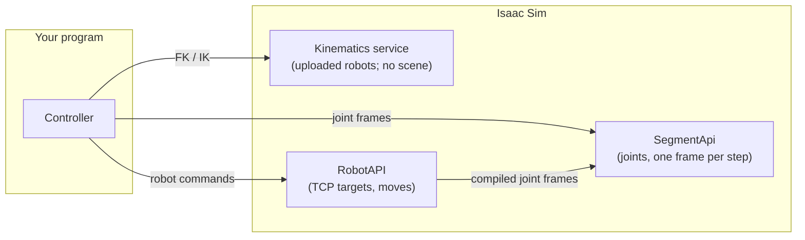

# Manipulator Robots

!!! info "In this chapter"

    How robot assets work: robot control above the segment (TCP poses, motion, end effectors), rigging a
    robot in USD, kinematics, tool changers, Isaac Sim's library robots, then building the AMT MR-A1 with
    more left to you, and packaging end effectors.

    **Builds on:** [Machines](060-Machines.md).

## Robot Control

**The segment carries joints; robot APIs compile to it.** A TCP pose is a higher-level idea and is never
part of the segment's frames. Two services sit above the segment:

- **The [kinematics service](#kinematics-service)** (`/api/kinematics/...`, port 8014): robot kinematics
  over the web, without a scene. Upload a robot's URDF and XRDF, then compute forward and inverse
  kinematics, Jacobians, sampled moves, and self-collision. It is independent of the segment and of the
  simulation, so it can serve any controller, even one driving a real robot: compute joints here, then write
  them wherever you like.
- **The RobotAPI** (`/api/robot/...`): the segment API with robot data. You write TCP targets and moves;
  the RobotAPI solves the whole batch, turns it into joint frames (one per physics step), and queues them
  in the segment, so robot motion shares the segment's clock with every other machine. **If any target in
  a batch can't be reached, nothing is queued.**



You can mix them: use the kinematics service (or your own solver, such as MoveIt) and write joints to the
segment yourself, or let the RobotAPI do both. A `RobotApi` *is* a segment API with more routes: one
server and one port serve `/api/segment/...`, `/api/robot/...`, and `/api/kinematics/...` (the kinematics
routes for its own robots, by robot id; they can't be created, deleted, or configured there).

### Serving a Robot

In the behavior script, give the RobotAPI each robot's kinematics solver and the component whose joints it
drives:

```python
from amt.dtp.ise.robot.kinematics import CuMotionKinematicsSolver
from amt.dtp.ise.lib.control.robot.compiler import RobotBinding
from amt.dtp.ise.lib.control.robot.server import RobotApi

solver = CuMotionKinematicsSolver("AMT MR-A1.urdf", "AMT MR-A1.xrdf")    # cuMotion, from URDF + XRDF
api = RobotApi(
    {"robot": AmtMrA1(prim=self.prim_path)},                 # the segment's components, by id
    robots={"arm": RobotBinding(solver, component="robot",   # its joints: the "joints" transducer
                                velocity_limits={f"Joint{i}": 180.0 for i in range(1, 7)})},  # deg/s
    port=8020,
)
api.start()          # and api.step(...) in on_physics, api.stop() in on_stop, as for a SegmentApi
```

The component only needs its joints (an `ArticulationTransducer` with position-driven joints): the
RobotAPI does the kinematics. `GET /api/robot/info` shows each robot's joints, limits, frames, and tool
frames.

### Moving

A **robot command** is one row of a robot program: one move per robot, optional commands for other
components, and an optional dwell. The RobotAPI offers these moves:

| Move | Does | Avoids obstacles |
|---|---|---|
| `set` (set TCP) | one target, reached on the next step | no |
| `ptp` | point-to-point: all joints start and stop together, timed by their velocity, acceleration, and (where the robot description has them) jerk limits; the goal is joint values or a TCP pose | no |
| `lin` | linear: the TCP moves along a straight line (orientation by slerp), timed by a speed in m/s and deg/s (and optionally a jerk limit) | no |
| `circ` | circular: the TCP moves along the arc from where it is, through a `via` point, to the target | no |
| `plan` | **plan and move**: a collision-free path to a joint or TCP target from the robot's motion planner, around the obstacles in the scene | yes |

**Blending.** A move normally ends at rest (termination `fine`). With `termination="cnt"` (and `cnt` from 1 to 100,
as on a FANUC controller), it flows into the next command's move without stopping: the next move starts while this
one slows down, so the corner is rounded and the target itself is not reached. Blending works between `ptp` moves,
and between `lin` and `circ` moves, of the same robot, when both commands move only that robot and the first has no
dwell; otherwise the move simply ends at rest. The answer to a write marks each command that blended.

```python
client.robot_write([
    RobotCommand(frame_id=1, robots={"arm": LinMove(target=corner, velocity=0.1, termination="cnt", cnt=50)}),
    RobotCommand(frame_id=2, robots={"arm": LinMove(target=goal, velocity=0.1)}),
])
```

```python
from amt_mr_a1 import *          # the generated client module: Client, RobotCommand, PtpMove, LinMove, Pose, ...

client = Client("http://isaac-host:8020")
client.robot_write([
    RobotCommand(frame_id=1, robots={"arm": PtpMove(joints={"Joint2": -20, "Joint3": 60, "Joint5": 50})}),
    RobotCommand(frame_id=2, robots={"arm": LinMove(target=Pose(position=Vector3(x=-0.17, y=-0.1, z=0.49),
                                                                orientation=Quaternion(w=0, x=-0.7071, y=0, z=0.7071)),
                                                    velocity=0.05)},
                 components={"gripper": {"jaws": {"position": 0.0}}}),   # other machines: first step
])
```

- **Every frame of a command carries its `frame_id`**; the answer says how many steps each command took.
  `robot_execute` writes one command and waits for its last step. Clear and resume with the segment routes.
- `compile` returns the joint frames without queueing them, ready for `/api/segment/process/write`.
- Targets are in the robot base frame (`reference="base"`); `reference="world"` works when the robot was
  given a base pose provider (`usd_base_pose(prim)` for a fixed base).
- **Units** on the wire: meters, degrees, m/s, deg/s (inside, the solvers use radians).
- **Stopping:** `client.robot_clear(stop="decelerate")` clears the queue and brings moving robots to rest at their
  acceleration limits; a plain clear (or a pause) holds every robot at its current target.
- **Execution checks** you can switch on in the robot's binding: `start_tolerance` (a write is refused with 409
  `START_TOLERANCE` if the robot isn't where it was commanded to be, e.g. after a collision), and `path_tolerance` /
  `goal_tolerance` with `goal_time` (the segment halts with `PATH_TOLERANCE` or `GOAL_TOLERANCE` if the measured
  joints stray too far from the commanded ones while moving, or don't settle afterwards). Values are degrees (or
  meters) per joint.

**What is checked, all or nothing, when a command is written:** every IK solution (`IK_UNREACHABLE`), the
joint limits (`JOINT_LIMIT`), and **joint jumps** (`JOINT_JUMP`): a straight Cartesian line through a
singularity can flip the arm, so no joint may change by more than its velocity limit × the physics step in
one step. The velocity limits come from the URDF, or from `velocity_limits` in the robot's binding; a URDF
limit of 1000 rad/s or more counts as a placeholder (exported URDFs often carry one), and then a fallback
of 5° (or 1 cm) per step applies. A rejected write returns HTTP 422 with `{code, message, command, robot,
step, joint}`, and nothing moves or halts. A `plan` move is also checked for collisions at every step
(`PATH_IN_COLLISION`, `START_IN_COLLISION`, `GOAL_IN_COLLISION`, `PLAN_FAILED`, `NO_PLANNER`).

### Planning Around Obstacles

Give the robot a **motion planner** and the obstacles of the scene, and `plan` moves find their way around them:

```python
from amt.dtp.ise.robot.planning import CuMotionMotionPlanner, stage_obstacles
from amt.dtp.ise.robot.base import usd_base_pose

base = usd_base_pose(robot_prim)                                  # where the robot stands
planner = CuMotionMotionPlanner(solver)
planner.set_obstacles(stage_obstacles(stage, exclude=[self.prim_path]), base_pose=base())   # in on_play
binding = RobotBinding(solver, component="robot", planner=planner, base_pose=base)
```

`stage_obstacles` reads the scene's colliders (cubes, spheres, cylinders, capsules, meshes with a collision API),
skipping the robot itself; call it again when the cell changes. Set the planner up in `on_play` and let its errors
raise: if it can't be set up, playing stops and the error window says why, instead of the robot answering
`NO_PLANNER` later. Then:

```python
client.robot_write([RobotCommand(frame_id=3, robots={"arm": PlanMove(target=pick_pose)})])
plan = client.robot_plan("arm", PlanMove(joints={"Joint1": 90}))     # inspect a plan without moving
```

The planned path is timed like a chain of `ptp` moves (blended through its corners when `smooth`, the default) and
checked for collisions with the obstacles and the robot itself at every physics step before anything is queued; if a
check fails, the RobotAPI tries again (`attempts`, default 3). The robot's collision spheres come from its XRDF.

### Pose Models

Libraries disagree on quaternion order (USD, Isaac Sim, and cuMotion use w, x, y, z; ROS, Warp, and SciPy
use x, y, z, w), so poses are never bare arrays. They use named classes:

```python
pose = Pose(
    position=Vector3(x=0.4, y=0.0, z=0.3),
    orientation=Quaternion(w=1.0, x=0.0, y=0.0, z=0.0),   # validated and normalized; zero is rejected
)
pose.orientation.to_xyzw()     # for ROS, SciPy, Warp
pose.orientation.to_wxyz()     # for Isaac Sim, cuMotion
Quaternion.from_rotvec([0, 3.1416, 0])                    # from a UR rotation vector (radians)
```

The robot actuators' `ManipulatorRobotActuatorPose` uses them too (`position: Vector3`, `orientation:
Quaternion`); build one from numpy arrays with `ManipulatorRobotActuatorPose.from_numpy(position, wxyz)`.

### End Effectors and TCPs

The **TCP** is a tool frame defined relative to the flange (`tool0`). Set it, and choose which tool frame
targets refer to, with the robot configuration (`POST /api/robot/config/write`,
`client.robot_config_write({"arm": {"tcp_offset": Pose(...)}})`), like Universal Robots' `set_tcp`; a move
can also name its `tool_frame`. Frames already queued are joint frames, so they are not affected.

A robot can carry different end effectors (a pointer, a gripper, a tool changer plus a gripper). Each
**combination** has its own tool frames and collision model, prepared when the simulation starts (one solver
each); switching the active end effector is a configuration change:

```python
client.robot_config_write({"arm": {"combination": "gripper"}})    # its TCP becomes the active tool frame
```

How end effectors are packaged and combined: [Package an End Effector](#package-an-end-effector).

!!! info "Planned"

    A part held in a gripper will be attached to the collision model without switching combinations.

### The Robot Stream

The RobotAPI's stream (`GET /api/robot/stream`, `client.robot_stream()`) carries, in **one message** per
step, the segment's response frame (`frame`) and each robot's kinematic state (`robots`): the target TCP
pose (from the commanded joints), the actual TCP pose (from the measured joints), and the active tool
frame. They are synchronized by construction. It resumes like the segment stream.

### Several Robots and Machines in One Segment

One RobotAPI serves every robot in a segment, and other machines pass through: a command can carry a TCP
move for the robot and axis targets for the mill in the same row, and several robots in one command start
on the same step. Every high-level API (the RobotAPI, a future CNC API) also offers **`compile`**, which
returns joint frames without queueing them (`client.robot_compile(commands)`, from the end of the queue).

!!! info "Planned: compile-then-merge"

    A **cell controller** will be able to line up frames from several APIs step by step, merge them into rows, and
    write the rows to the segment:

    ```python
    from amt.dtp.ise.lib.control.segment.merge import merge_frames

    robot_part = client.robot_compile(robot_commands)                              # from the end of the queue
    next_part = client.robot_compile(more_commands, start=robot_part.end)          # continue from where it ends
    rows = merge_frames([*robot_part.frames, *next_part.frames], mill_frames, offsets=[0, 30])  # the mill starts 30 steps in
    client.write(rows, expected_revision=robot_part.queue_revision)                # only if the queue didn't change
    ```

    `merge_frames` will refuse two sources setting the same joint or setpoint on the same step. The write will be
    rejected (409 `QUEUE_CHANGED`) if something else was queued since the compile: compile again and retry.

    ```mermaid
    sequenceDiagram
        participant C as Cell controller
        participant R as RobotAPI
        participant M as Mill API (future)
        participant S as SegmentApi
        C->>R: compile(TCP targets)
        R-->>C: joint frames (robot)
        C->>M: compile(toolpath)
        M-->>C: joint frames (mill)
        C->>C: align by step, merge into rows
        C->>S: process/write(merged rows)
    ```

### Kinematics Service

The extension starts a **kinematics service** with Isaac Sim: robot kinematics behind a REST API, in the
spirit of MoveIt's kinematics services, for controllers that don't use the simulation at all. It runs on
port **8014** (set `kinematics_service_port` in the [configuration](../Getting Started/050-Configure.md) to
change it), with its API documentation at
[http://localhost:8014/api/docs](http://localhost:8014/api/docs). If it can't start (for example, another program
uses the port), an error window says so, and the rest of the extension keeps working.

You upload a robot's URDF and XRDF and get a **solver** (one robot, with its end effector as described in the
XRDF), then call it by id:

| Group | What you can do |
|---|---|
| Solvers | create (upload the URDF and XRDF), list, describe (joints, limits, frames, tool frames, capabilities), delete, download the uploaded files |
| Kinematics | forward kinematics, inverse kinematics, reachability, and Jacobians, each for a batch of configurations or poses |
| Trajectories | sample a `set`, `ptp`, or `lin` move from a start configuration at your time step, exactly as the RobotAPI would compile it (timing, IK per sample, joint limits, the joint-jump check), and check a joint path of your own |
| Tool Frames | list the frames, choose the active tool frame, define a TCP offset (like `set_tcp`) |
| Collision | check configurations or a path against the robot's **own** collision spheres from the XRDF (self-collision), and get the spheres' positions |
| World | send **obstacles** (boxes, spheres, cylinders, capsules, meshes, each with a pose) to a solver, check configurations against them, and sample `plan` moves around them |

**The service doesn't use Isaac Sim's scene.** It works with no stage open and no simulation running, and knows
nothing about the cell unless you tell it: you describe obstacles with plain shapes (as in MoveIt's collision
objects), in the robot's base frame or in a frame of your own with the robot's pose. Obstacles from the simulation's
scene are for the RobotAPI. Solvers and their obstacles stay in memory until you delete them or the extension stops
(their uploaded files are deleted with them).

```python
from amt.dtp.ise.lib.control.motion.planning import CuboidObstacle
from amt.dtp.ise.lib.control.robot.models import PlanMove

table = CuboidObstacle(name="table", pose=Pose(position=Vector3(x=0.5, y=0, z=-0.05), orientation=Quaternion.identity()),
                       size=Vector3(x=1.0, y=1.0, z=0.1))
kinematics.set_world(arm, [table])                                            # in the robot's base frame
path = kinematics.sample_trajectory(arm, ready, PlanMove(target=target), dt=1 / 60)   # around the table
``` Units are the same as
the RobotAPI's: joint values in degrees (revolute) or meters (prismatic), keyed by joint name, positions in
meters, angular speeds in degrees per second.

```python
from amt.dtp.ise.lib.control.motion.client import KinematicsClient
from amt.dtp.ise.lib.control.robot.models import LinMove
from amt.dtp.ise.lib.control.transducer.models import Pose, Vector3

kinematics = KinematicsClient("http://isaac-host:8014")
arm = kinematics.create_solver("AMT MR-A1.urdf", "AMT MR-A1.xrdf", name="arm").id   # uploads both files

ready = {"Joint1": 0, "Joint2": -20, "Joint3": 60, "Joint4": 0, "Joint5": 50, "Joint6": 0}   # degrees
tcp = kinematics.fk(arm, [ready]).poses[0]                     # the tool frame, in the robot base frame
answer = kinematics.ik(arm, [tcp], seed=ready)                 # back to joints
assert answer.success and answer.results[0].joints is not None

# sample a 10 cm linear move at 60 Hz (nothing moves: you get the joint values for each step)
target = Pose(position=Vector3(x=tcp.position.x, y=tcp.position.y + 0.1, z=tcp.position.z),
              orientation=tcp.orientation)
move = kinematics.sample_trajectory(arm, ready, LinMove(target=target, velocity=0.1), dt=1 / 60,
                                    velocity_limits={f"Joint{i}": 180.0 for i in range(1, 7)})   # deg/s
print(move.steps, "steps,", move.duration, "s; last:", move.joints[-1])

# is any step of the path in self-collision (the robot's own collision spheres)?
check = kinematics.self_collision(arm, move.joints)
print("collision-free" if check.collision_free else f"self-collision at step {check.first_collision}")

kinematics.delete_solver(arm)
```

- **Errors** are coded like the RobotAPI's: an unknown solver is a 404 `UNKNOWN_SOLVER`; a robot description
  that can't be loaded is a 422 `INVALID_DESCRIPTION`; a sampled move that can't be followed is a 422 naming
  the step and joint (`IK_UNREACHABLE`, `JOINT_LIMIT`, `JOINT_JUMP`, `DURATION_TOO_SHORT`). An unreachable IK
  target is not an HTTP error: its result says `success: false`.
- **Uploads** are multipart files (as above) or, with `upload="json"`, the files' text. Files are limited to
  256 MiB each, and the service holds at most 1024 solvers; one request takes at most 1 000 000 poses or
  configurations, and a sampled move at most 10 000 000 steps. `GET /api/kinematics/info` lists the limits.
- **Self-collision needs collision spheres in the XRDF** (`self_collision` and `geometry`, added with
  Isaac Sim's robot description editor, see [CuMotion Solver](#cumotion-solver)); a robot without spheres
  is always collision-free.
- Requests are handled **one at a time**, on the service's own thread (not on Isaac Sim's), so the simulation
  isn't slowed down by them; a long request (a large batch, a plan) delays the next one.
- **End effectors:** create a solver with `fragments=[...]` and a `combination` (see [Package an End
  Effector](#package-an-end-effector)), and the service assembles the robot with its end effectors first.

## Rig a Manipulator Robot

How to rig a robot asset (and its end effectors) in USD so the robot transducers can drive it.

### Guidelines

Guidelines when modeling manipulator robots:

- Model the robot in the pose where all joint positions have a value of `0` (zero).
- When creating a robot from scratch, every body must be an Isaac Sim `Mesh` and can not be a `Shape`.
- If a link has multiple bodies, wrap them in a Xform.
- For each link Xform, position the origin of the Xform where the prior link and current link meet. This makes setting the joint position trivial; otherwise, you will have to manually adjust X/Y/Z positions of each joint.
- For each link, make sure the link is orthogonal to the world axes. This makes setting the joint 'axis' (X/Y/Z) trivial; otherwise, you will have to manually adjust the joint orientations to match the link orientations.

This section will walk you through the steps to rig a manipulator robot from scratch.

### Manipulator Robot (AMT MR-A1)

1. Open `AMT MR-A1.usda`.
1. Select all links prims (`BaseLink` through `Link6`) and `Add > Physics > Rigid Body with Colliders Preset`. This makes each link into a `Rigid Body` and adds a `Collider` to each sub-prim.
1. Select the `Robot` prim and `Add > Physics > Articulation Root`. This adds an `Articulation Root` which encapsulates all joints in the robot.
1. Select `BaseLink` and `Create > Physics > Joint > Fixed Joint`, name: `FixedJoint`
1. For each link pair: `Create > Physics > Joint > Revolute Joint`
    1. Select `Base Link` then `Link1`, name: `Joint1`
    1. Select `Link[i]` then `Link[i+1]`, name: `Link[i]` (for `Joint1` to `Joint6`), named `Joint<i>` (e.g., `Joint2`)
1. `Create > Scope`, rename it to `Joints` and move it into `/Robot` to create `/Robot/Joints`, then move all joints into the scope.

- For `Joint6` only, adjust the position so that it is at the tip of the final link by setting the properties:
  - `Joint > Local Position 0 > Z`: `0.11`
  - `Joint > Local Position 1 > Z`: `0.06`
  - TODO: remove this and leave at the base of the link? TODO TODO TODO

1. For each `Revolute Joint`, adjust the joint `Axis` to be `Y` or `Z`:

    | Joint  | Axis |
    |--------|------|
    | Joint1 | Z    |
    | Joint2 | Y    |
    | Joint3 | Y    |
    | Joint4 | Z    |
    | Joint5 | Y    |
    | Joint6 | Z    |

1. Select `Joint1` through `Joint6` (excluding `FixedJoint`), add an angular drive, and set the following properties:
    - `Add > Physics > Angular Drive`

    | Name                                    | Value            |
    |-----------------------------------------|------------------|
    | `Break Force`                           | Reset (to `inf`) |
    | `Break Torque`                          | Reset (to `inf`) |
    | `Revolute Joint > Lower Limit`          | `-180`           |
    | `Revolute Joint > Upper Limit`          | `180`            |
    | `Revolute Joint > Advanced > Damping`   | `10e3`           |
    | `Revolute Joint > Advanced > Sfiffness` | `50e3`           |
    | `Drive > Angular > Damping`             | `10e3`           |
    | `Drive > Angular > Sfiffness`           | `50e3`           |

1. Select `Robot`, press `Play`, open `Tools > Physics > Physics Inspector`, and click the refresh button.
    - Adjust max and min limits as needed (`-180` and `180` limits are fine for testing).
    - Drag the blue `Drive Target or Joint State Position` bar to test joint motion.
1. Select `Joint1` through `Joint6` (excluding `FixedJoint`), and set `Drive > Target Position`: `0.0`. This resets the robot to the default position.
1. Save and close `AMT MR-A1.usda`.

### Pointer (AMT MR-A1-P1)

1. Open `AMT MR-A1-P1.usda`.
1. Select the `Pointer` prim and `Add > Physics > Rigid Body with Colliders Preset`. This makes the pointer into a `Rigid Body` and adds a `Collider` to each sub-prim.
1. Save and close `AMT MR-A1-P1.usda`.

### Gripper (AMT MR-A1-G1)

1. Open `AMT MR-A1-G1.usda`
1. Select the `Base`, `Left` and `Right` prims and `Add > Physics > Rigid Body with Colliders Preset`. This makes each part into a `Rigid Body` and adds a `Collider` to each sub-prim.
1. Select the `Gripper` prim and `Add > Physics > Articulation Root`. This adds an `Articulation Root` which encapsulates all joints in the gripper.
1. Select the `Base` prim then select the `Left` prim and `Create > Physics > Joint > Prismatic Joint` and rename it `LeftJaw`, then select `LeftJaw` and `Add > Physics > Linear Drive`. Repeat the same for `Right` creating `RightJaw`. Then, select both joints and set the following parameters:

    | Name                                    | Value            |
    |-----------------------------------------|------------------|
    | `Axis`                                  | `Y`              |
    | `Break Force`                           | Reset (to `inf`) |
    | `Break Torque`                          | Reset (to `inf`) |
    | `Linear Joint > Advanced > Damping`     | `10e3`           |
    | `Linear Joint > Advanced > Sfiffness`   | `50e3`           |
    | `Drive > Angular > Damping`             | `10e3`           |
    | `Drive > Angular > Sfiffness`           | `50e3`           |

    Then per joint:

    | Name                                    | LeftJaw Value    | RightJaw Value   |
    |-----------------------------------------|------------------|------------------|
    | `Revolute Joint > Lower Limit`          | `-0.02`          | `0`              |
    | `Revolute Joint > Upper Limit`          | `0`              | `0.02`           |

1. Save and close `AMT MR-A1-G1.usda`

### Notes from the original tutorial

#### Tutorial

- Can't use shapes with Lula generator, have to use meshes. But, meshes only needed to generate `.yaml` (and `.urdf`?) files. You can switch back to shapes outside of generating those files.

- Rename `robot_meshes.usda` to `robot.usda`
- Select `BaseLink` and all Link prims: `Add > Physics > Rigid Body with Colliders Preset`
- Select `Robot`: `Add > Physics > Articulation Root`
- Select `BaseLink`: `Create > Physics > Joint > Fixed Joint`, name: `FixedJoint`
- For each link pair: `Create > Physics > Joint > Revolute Joint`
  - Select `Base Link` then `Link1`, name: `FixedJoint`
  - Select `Link[i]` then `Link[i+1]`, name: `Link[i]` (`Joint1` to `Joint6`)
- `Create > Scope`, rename it to `Joints` and move it into `/Robot` to create `/Robot/Joints`, then move all joints into the scope.
- For each joint, adjust the joint `Axis` to be `Y` or `Z`:
  - Joint1: Z
  - Joint2: Y
  - Joint3: Y
  - Joint4: Z
  - Joint5: Y
  - Joint6: Z
- For `Joint6` only, adjust the position so that it is at the tip of the final link by setting the properties:
  - `Joint > Local Position 0 > Z`: `0.11`
  - `Joint > Local Position 1 > Z`: `0.06`
- Select `Joint1` through `Joint6` (excluding `FixedJoint`), and set the following properties:
  - `Add > Physics > Angular Drive`
  - `Break Force`: Reset (to `inf`)
  - `Break Torque`: Reset (to `inf`)
  - `Revolute Joint > Lower Limit`: `-180`
  - `Revolute Joint > Upper Limit`: `180`
  - `Revolute Joint > Advanced > Damping`: `10e3`
  - `Revolute Joint > Advanced > Sfiffness`: `50e3`
  - `Drive > Angular > Damping`: `10e3`
  - `Drive > Angular > Sfiffness`: `50e3`
- Select `Robot`, press `Play`, open `Tools > Physics > Physics Inspector`, click the refresh button
  - Adjust max and min limits as needed
- Select `Joint1` through `Joint6` (excluding `FixedJoint`), and:
  - `Drive > Target Position`: `0.0`
- Open `Tools > Robotics > Lula Robot Description Editor`, press `Play`, then:
  - `Select Articulation`: `Robot`
  - For all joints: `Joint Status`: `Active Joint`
  - To generate collision spheres, at the top select `Select Link` to set the active link, then in `Link Sphere Editor` add spheres which cover the current link.
  - `Export To File > Export to Lula Robot Description File`: `robot.yaml` then click `Save`
- With `Isaac Sim USD to URDF Exporter` extension enabled: `File > Export to URDF`: `robot.urdf`
  - You can delete the generated `meshes` directory.
  - In `robot.urdf`, for each joint, find and replace `velocity="0."` to `velocity="1000."`
  - In `robot.urdf`, you can remove link collisions and geometry tags for links, leaving:
  
    ```
    ...
    <link name="BaseLink">
    </link>
    <link name="Link1">
    </link>
    <link name="Link2">
    </link>
    <link name="Link3">
    </link>
    <link name="Link4">
    </link>
    <link name="Link5">
    </link>
    <link name="Link6">
    </link>
    <link name="Robot"/>
    ...
    ```

Have to add effort and velocit if not already in urdf file.

    ```
    <joint name="Joint4" type="revolute">
      ..
      <limit lower="-3.12413936" upper="3.12413936" effort="10000000." velocity="1000000."/>
      ..
    </joint>
    ```

#### Gain Tuner

- Add Robot Schema
  - Right click articulation root prim > Add > Edit API Schema > Add `IsaacRobotAPI`
  - Add schema to each link: `IsaacLinkAPI`
  - Add schema to each joint: `IsaacJointAPI`

  - Property > IsaacRobotAPI > isaac:physics:robotJoints > Select Joints
  - Property > IsaacRobotAPI > isaac:physics:robotLinks > Select Links

- Open Gain Tuner: Tools > Robotics > Asset Editors > Gain Tuner
  - Press play before running test

- Old, not tested
  - Add schema to each attachment point: `IsaacReferencePointAPI`
  - Property > IsaacRobotAPI > isaac:physics:robotType > Manipulator

#### Old

- Window > Robot Wizard
  - If not visible, enable the `Isaac Sim Robot Wizard` extension

- Create geometry with articulation root, joints, rigid bodies, and colliders
- Make sure joints work: Tools > Physics > Physics Inspector

  
  
- Tools > Robotics > Lula Robot Description Editor
  - This tool has to be playing for it to work
  - Geometry prims must be "Mesh"es and can not be "Shape"s for this to work.
    - Tools > Robotics > Asset Editors > Mesh Merge Tool
  - Tip: At the top of the window, there is a `Open Source Code` button and you can step through
  		the process in the vscode debugger if needed.
  		
 - Save Robot USD as URDF
 - With `Isaac Sim USD to URDF Exporter` (isaacsim.asset.exporter.urdf) extension enabled, File > Export to URDF

## Set Up Robot Kinematics (cuMotion, Lula)

How to generate a robot's kinematics descriptions (URDF, XRDF, Lula YAML) and drive it with the `ManipulatorRobotCuMotionActuator` (recommended) or the deprecated `ManipulatorRobotLulaActuator`.

### CuMotion Solver

This section describes how to use the cuMotion solver. cuMotion is the successor to Lula: Isaac Sim 6.0 deprecates the Lula extensions, and the [Isaac Sim 6.0 robot motion migration guide](https://docs.isaacsim.omniverse.nvidia.com/latest/migration_guides/isaac_sim_6_0/robot_motion_to_experimental_motion_generation.html) points `isaacsim.robot_motion.motion_generation.lula` users to `isaacsim.robot_motion.cumotion` ("cuMotion is the updated version of Lula"). The cuMotion solver is available from Isaac Sim version 6.0.0.

The `ManipulatorRobotCuMotionActuator` has the same interface as the `ManipulatorRobotLulaActuator`, but uses a different robot description file:

| Lula Solver                               | cuMotion Solver                                         |
|-------------------------------------------|---------------------------------------------------------|
| `AMT MR-A1.yaml` (Lula robot description) | `AMT MR-A1.xrdf` (cuMotion XRDF robot description)      |
| `AMT MR-A1.urdf`                          | `AMT MR-A1.urdf` (the same file can be used for both)   |

The `isaacsim.robot_motion.cumotion` extension is a dependency of the AMT extension, so it does not need to be enabled manually.

1. Open `AMT MR-A1.usda`

#### Generate XRDF File

1. Open `Tools > Robotics > cuMotion/Lula Robot Description Editor`, then:
    1. Press `Play`
    1. Set `Select Articulation` to `/Robot`.
    1. For all joints, set `Joint Status` to be `Active Joint`.
    1. Optional: To generate collision spheres, at the top select `Select Link` to set the active link, then in `Link Sphere Editor` add spheres which cover the current link. Collision spheres are not used by the inverse kinematics solver, only by cuMotion's collision-aware planners.
    1. When done, expand `Export To File > Export to cuMotion XRDF`, set the output file to `AMT MR-A1.xrdf`, set `XRDF Version` to `2.0`, then click `Export`, and check that the file was created as expected.

#### Add Tool Frames

Tool frames are required: the `ManipulatorRobotCuMotionActuator` raises an error if the XRDF file has no `tool_frames`. They define the frame that inverse kinematics solves for, and cuMotion's motion planners, trajectory optimizer, and RMPflow controller all require one (see `Tool Frame Capabilities` below). Tool frames replace the `final_link_offset` and `end_effector_offset` arguments of the `ManipulatorRobotLulaActuator`.

Tool frames come from two places:

| Tool Frame | Defined In                          | Property Of      | Description |
|------------|-------------------------------------|------------------|-------------|
| `tool0`    | The XRDF file                       | The robot        | The flange face: the tool frame when no end effector is attached. Always present. |
| `flange_override` | The behavior script, at runtime | The robot's tooling (e.g., a tool changer) | Replaces `tool0` as the flange tool frame while set, e.g., at the face of a tool changer mounted on the flange: set with `set_flange_frame()` (relative to `tool0`) and reset with `clear_flange_frame()`. |
| `tcp`      | The behavior script, at runtime     | The end effector | The tool center point of the attached end effector, set with `set_tcp()` (relative to the flange tool frame: `tool0`, or `flange_override` while set) and removed with `clear_tcp()`. While set, it is the active tool frame. |

The robot description editor does not write tool frames, so `tool0` is added to the XRDF file by hand:

1. Open `AMT MR-A1.xrdf` in a text editor.
1. Add a `tool0` frame at the flange face of the robot using an `add_frame` modifier, and list it in `tool_frames`:

    ```yaml title='AMT MR-A1.xrdf'
    modifiers:
      # Flange face (tip of Link6), +Z out of the flange: the tool frame with no end effector attached
      - add_frame:
          frame_name: "tool0"
          parent_frame_name: "Link6"
          joint_name: "tool0_joint"
          joint_type: FIXED
          fixed_transform:
            position: [0.0, 0.0, 0.06]
            orientation: {w: 1.0, xyz: [0.0, 0.0, 0.0]}

    tool_frames: ["tool0"]
    ```

    - `tool0` is the pose of the flange face relative to `Link6` (`0.06` is the length of `Link6` from `Joint6`). It replaces `final_link_offset`.
    - `fixed_transform` is in meters, with the orientation given as a quaternion (`w` and `xyz`).
    - The first entry of `tool_frames` is the default (active) tool frame. Each tool frame must be a URDF link or a frame added with `add_frame` ([XRDF specification](https://nvidia-isaac-ros.github.io/concepts/manipulation/xrdf.html)).

1. If the XRDF file is exported again from the editor, check `Merge With Existing XRDF` to keep the `modifiers` and `tool_frames`. Otherwise they are overwritten.

The end effector's tool center point is set in the behavior script when the end effector is attached (see `Tool Changer` below). For the `AMT MR-A1-G1` gripper, the tool center point is `0.1` along `+Z` from `tool0` (the length of the gripper), with its axes aligned with `tool0` (see [Conventions](070-Manipulator-Robots.md#robot-conventions)). It replaces `end_effector_offset`:

```py
self._robot.set_tcp(np.array([0.0, 0.0, 0.1]))
```

??? info "Why the Name `tool0`"

    `tool0` is the established name for the tool frame with no tool attached:

    - ABB RAPID: "The tool tool0 defines the wrist coordinate system, with the origin being the center of the mounting flange. tool0 can always be accessed from the program, but can never be changed" (RAPID Instructions, Functions and Data types, RobotWare 7.21, 3HAC065038-001).
    - ROS-Industrial: `tool0` "shall match exactly an all-zeros TCP as defined by the robot controller" ([REP-199 (Draft)](https://gavanderhoorn.github.io/rep/rep-0199.html)), and is used by the Universal Robots, Fanuc, and ABB robot descriptions.
    - NVIDIA cuMotion: the UR10 robot configuration bundled with Isaac Sim uses `tool_frames: ["tool0"]`.

    A name like `flange` is avoided because in REP-199 the `flange` frame is a different frame (`+X` out of the flange, not `+Z`).

??? info "Tool Frame Capabilities"

    Inverse kinematics for a full pose (position and orientation) does not need a tool frame: the same result can be computed for `Link6` and offset to the tool center point. The following capabilities are defined on the tool frame itself, so they require one. This is why tool frames are required.

    | Capability                         | What It Means                                                                                       | Example Uses |
    |------------------------------------|-----------------------------------------------------------------------------------------------------|--------------|
    | Position-only targets              | Move the tool center point to a position, with any orientation. The solver can reach many more positions because it does not also have to match an orientation. | Probing, pointing, touch-off, reachability checks |
    | Free rotation about the tool axis  | Point the tool in a direction, with any rotation about its own `+Z` axis. The freed rotation lets the solver pick a wrist rotation that avoids joint limits and collisions. | Drilling, suction cups, round parts, welding torches, dispensing |
    | Straight-line and arc TCP paths    | The tool center point travels along a straight line or circular arc, like an industrial robot's linear and circular moves (e.g., `MoveL`/`MoveC`). Without them, the tool center point follows a curved path between poses. | Insertion, approach and retreat moves, welding, dispensing, deburring |
    | Reactive control (RMPflow)         | The tool center point is continuously pulled toward a target that may be moving, while the robot is pushed away from obstacles and joint limits. | Following a moving target, teleoperation, conveyor tracking |
    | Collision-aware planning           | Plan a collision-free motion to a target, including the end effector's collision geometry.          | Moving around fixtures, reaching into bins |

    Position-only targets and free rotation about the tool axis work with no obstacles. Measured with cuMotion on the `AMT MR-A1` with an empty world: a position-only target succeeded where the full pose was unreachable, and a free rotation target returned 4 solutions with the tool's `+Z` matching the target axis.

??? info "Comparison: Motion Planning Libraries and Robot Controllers"

    Capabilities of cuMotion compared with popular open-source motion planning libraries and industrial robot controllers. `yes`: supported. `partial`: supported with limitations (see notes). `no`: not supported (not found in the source code or manuals). `?`: not verified. `option`: requires a paid software option.

    | #  | Capability                               | cuMotion  | cuRobo       | MoveIt 2  | Tesseract | Drake        | Pinocchio + PINK | ABB RAPID   | FANUC       | KUKA KRL    | UR URScript |
    |----|------------------------------------------|-----------|--------------|-----------|-----------|--------------|------------------|-------------|-------------|-------------|-------------|
    | 1  | Full pose targets (IK)                   | yes       | yes          | yes       | yes       | yes          | yes              | yes         | yes         | yes         | yes         |
    | 2  | Position-only targets                    | yes       | yes          | yes       | yes       | yes          | yes              | no          | no          | partial     | partial     |
    | 3  | Free rotation about the tool axis        | yes       | partial      | yes       | yes       | yes          | yes ❓            | partial     | partial     | partial     | no          |
    | 4  | Straight-line / arc TCP motion           | yes / yes | partial / no | yes / yes | yes / no  | partial / no | no / no          | yes / yes   | yes / yes   | yes / yes   | yes / yes   |
    | 5  | Reactive control with obstacle avoidance | yes       | yes          | partial   | partial   | yes          | partial          | no          | no          | no          | no          |
    | 6  | Collision-free path planning             | yes       | yes          | yes       | yes       | partial      | no               | no          | no          | no          | no          |
    | 7  | Trajectory optimization                  | yes       | yes          | yes       | yes       | yes          | no               | no          | no          | no          | no          |
    | 8  | Time-optimal / jerk-limited trajectories | yes       | partial      | yes       | yes       | yes          | no               | yes         | ?           | partial     | yes         |
    | 9  | Multiple tools / change TCP at runtime   | partial   | yes          | yes       | yes       | yes          | yes              | yes         | yes         | yes         | yes         |
    | 10 | Payload (mass, center of gravity)        | no        | yes          | no        | no        | yes          | yes              | yes         | yes, option | yes         | yes         |
    | 11 | Attach collision geometry at runtime     | partial   | yes          | yes       | yes       | yes          | yes              | partial     | ?           | partial     | partial     |
    | 12 | User / work object frames                | no        | no           | partial   | yes       | yes          | yes              | yes         | yes         | yes         | yes         |
    | 13 | Blending between moves                   | partial   | no           | yes       | no        | no ❓         | no ❓             | yes         | yes ❓       | yes         | yes         |
    | 14 | Conveyor tracking                        | no        | no           | no        | no        | no ❓         | no ❓             | yes, option | yes         | yes, option | yes         |
    | 15 | Force control                            | no        | no           | no        | no        | partial      | no               | yes, option | yes         | yes, option | yes         |
    | 16 | GPU acceleration / batch planning        | yes       | yes          | partial   | no        | no           | no               | no          | no          | no          | no          |

    Notes on `partial` cells:

    - cuMotion (9): `solve_ik` takes the tool frame per call, but the planners, trajectory optimizer, and RMPflow bind one tool frame when they are created; changing tools means rebuilding them. (11): there is no attach API; the robot description (XRDF) is rebuilt with the new collision spheres instead (measured: 0.19 ms). (13): `blend_radius` blends segments within one task-space path, not separate moves.
    - cuRobo (3): per-axis rotation weights, not a dedicated axis constraint. (4): a linear motion cost along one goal axis, not a linear move primitive. (8): minimum-jerk optimization, not time-optimal timing through waypoints.
    - MoveIt 2 (5): MoveIt Servo slows to a stop near collisions, but does not steer around them. (12): frames come from TF and scene objects; there is no work object concept. (16): GPU only through NVIDIA's cuMotion plugin.
    - Tesseract (5): only an online planning example program.
    - Drake (4): linear pose interpolation, no arc primitive. (6): no RRT/PRM; Graphs of Convex Sets (GCS) with IRIS regions instead. (15): joint-space stiffness control only.
    - Pinocchio + PINK (5): barriers for self-collision and frame distances; no dedicated obstacle barrier.
    - ABB (3): `SingArea \Wrist` lets the tool orientation "differ somewhat to avoid wrist singularity". (5): Externally Guided Motion (EGM) streams targets in real time but "does not provide any path planning". (11): SafeMove and Collision Avoidance model the tool to monitor zones and stop the robot; they do not plan around obstacles.
    - FANUC (3): a `WRISTJOINT` orientation type exists; its behavior is not documented in the KAREL manual. (5): Dynamic Path Modification adapts paths in real time, with no obstacle avoidance. (10): Auto Payload Identification option. (13): `CNT` termination (e.g., `L PR[1] 100mm/sec CNT100`); its blending behavior was not verified in a teach pendant manual.
    - KUKA (2, 3): `$ORI_TYPE = #IGNORE` ignores the orientation of intermediate spline points, and `#JOINT` interpolates the wrist axes instead of the orientation. (5): Robot Sensor Interface (RSI) streams corrections, with no obstacle avoidance. (8): jerk can be modified; time-optimality was not verified. (11): SafeOperation models the tool with up to six spheres for safety monitoring.
    - UR (2): `movec` uses only the position of its via point (and of its target, in fixed orientation mode). (5): `servoj` streams joint targets in real time, with no obstacle avoidance. (6): collisions are avoided by placing waypoints by hand. (11): up to two safety tools modeled as spheres, for safety limits only.

    Capabilities other systems have that cuMotion does not:

    - **Payload**: cuRobo (`update_link_inertial`), Drake, Pinocchio, and the industrial controllers (ABB `loaddata`, KUKA payload data, UR `set_target_payload`) model the payload's mass and center of gravity.
    - **Attaching collision geometry at runtime**: cuRobo (`AttachmentManager`), MoveIt 2 (`AttachedCollisionObject`), Tesseract (environment commands), Drake, and Pinocchio attach and detach geometry directly. cuMotion requires rebuilding the robot description; NVIDIA's Isaac ROS object attachment node does exactly this.
    - **Changing the TCP without rebuilding the solver**: cuRobo, MoveIt 2 (`end_effector_link` per request), Tesseract (per instruction), Drake (any frame per query), and the industrial controllers (tool data per move).
    - **User / work object frames**: Tesseract (`working_frame`), Drake, Pinocchio, and the industrial controllers (ABB `wobjdata`, FANUC `$UFRAME`, KUKA `BASE_DATA`, UR frames). cuMotion works in the robot base frame only, so targets are transformed by the caller (as `ManipulatorRobotCuMotionActuator` does).
    - **Blending separate moves, conveyor tracking, and force control**: industrial controllers (ABB `zonedata`, FANUC termination types, KUKA approximate positioning, UR blend radius; ABB and KUKA conveyor tracking options, FANUC Line Tracking, UR `track_conveyor_linear`; ABB and KUKA force control options, FANUC Force Control, UR `force_mode`). MoveIt 2 blends sequences with the Pilz planner.

    Sources (checked October 2026):

    - cuMotion: the installed `cumotion` 1.1.0a2 Python API (`isaacsim.robot_motion.cumotion/pip_prebundle/_cumotion.pyi`), measurements on the `AMT MR-A1`, the [cuMotion documentation](https://nvidia-isaac.github.io/cumotion/), and the [XRDF specification](https://nvidia-isaac-ros.github.io/concepts/manipulation/xrdf.html).
    - cuRobo: [NVlabs/curobo](https://github.com/NVlabs/curobo) at commit `78fd485` (cuRobo v2), e.g. `curobo/_src/cost/tool_pose_criteria.py`, `curobo/_src/motion/motion_planner.py`, `curobo/_src/collision/attachment_manager.py`.
    - MoveIt 2: [moveit/moveit2](https://github.com/moveit/moveit2/tree/a9004a43151b7d1fd50d462b8db6d4d280b0cc21) and [moveit2_tutorials](https://github.com/moveit/moveit2_tutorials/tree/e1b3727d4bbd22a57f17120ec423a4171f4bdc66), e.g. the Pilz industrial motion planner, MoveIt Servo (`collision_monitor.cpp`: "If collision detected scale velocity to 0"), and the KDL `position_only_ik` parameter.
    - Tesseract: [tesseract](https://github.com/tesseract-robotics/tesseract/tree/e8d58a0090954276ed7d0190f0624da2d9b85ae0) and [tesseract_planning](https://github.com/tesseract-robotics/tesseract_planning/tree/07219db642988dc5c46d98308b67631d37740f05) (the `CIRCULAR` move type is defined but not used by any planner).
    - Drake: [RobotLocomotion/drake](https://github.com/RobotLocomotion/drake/tree/f6cf96082b0b15e69931d67eb26e3c3cc4d2eb7d), e.g. `inverse_kinematics.h`, `differential_inverse_kinematics_system.h`, `kinematic_trajectory_optimization.h`, `toppra.h`.
    - Pinocchio + PINK: [stack-of-tasks/pinocchio](https://github.com/stack-of-tasks/pinocchio) and [pink-kinematics/pink](https://github.com/pink-kinematics/pink), e.g. `pink/tasks/frame_task.py` (per-axis costs), `pink/barriers/`.
    - ABB: [RAPID Instructions, Functions and Data types, RobotWare 7.21 (3HAC065038-001)](https://search.abb.com/library/Download.aspx?DocumentID=3HAC065038-001&LanguageCode=en&DocumentPartId=&Action=Launch), and the ABB manuals Controller software OmniCore RW7 (3HAC066554-001), Externally Guided Motion (3HAC073318-001), Conveyor tracking (3HAC066561-001), Force Control (3HAC050377-001, IRC5 edition), and Functional safety and SafeMove (3HAC066559-001).
    - FANUC: the KAREL programming documentation and the HandlingTool datasheet (customer documentation, summarized, not reproduced), and the FANUC America [Dynamic Path Modification](https://techtransfer.fanucamerica.com/tech-transfer/dynamic-path-modification), [Line Tracking](https://www.fanucamerica.com/products/software/line-tracking), [Force Control](https://www.fanucamerica.com/products/software/robot/force-control), and [Collision Guard](https://www.fanucamerica.com/products/software/robot/collision-guard) pages.
    - KUKA: the KUKA System Software programming documentation for system integrators (customer documentation, summarized, not reproduced), and the [KUKA.SafeOperation](https://www.kuka.com/en-de/products/robot-systems/software/hub-technologies/kuka_safeoperation), [KUKA.ConveyorTech](https://kuka.com/en-de/products/robot-systems/software/application-software/kuka-conveyortech), [KUKA.RobotSensorInterface](https://www.kuka.com/en-de/products/robot-systems/software/application-software/kuka_robotsensorinterface), and [KUKA.ForceTorqueControl](https://www.kuka.com/en-us/products/robotics-systems/software/application-software/kuka-forcetorquecontrol) page.
    - UR: [PolyScope 5 Software Handbook](https://www.universal-robots.com/manuals/latest/en/pdf/ps5/sw-handbook/), [URScript Directory, PolyScope 5.26](https://www.universal-robots.com/manuals/EN/PDF/SW5_26/scriptmanualG5/script_directory_Poly5.pdf).

??? example "Full XRDF File Example"

    The values written by the editor may differ (e.g., default acceleration and jerk limits), but the file will have this structure:

    ```yaml title='AMT MR-A1.xrdf'
    format: xrdf
    format_version: 2.0
    default_joint_positions:
      Joint1: 0.0
      Joint2: 0.0
      Joint3: 0.0
      Joint4: 0.0
      Joint5: 0.0
      Joint6: 0.0
    cspace:
      joint_names: [Joint1, Joint2, Joint3, Joint4, Joint5, Joint6]
      acceleration_limits: [10.0, 10.0, 10.0, 10.0, 10.0, 10.0]
      jerk_limits: [10000.0, 10000.0, 10000.0, 10000.0, 10000.0, 10000.0]
    modifiers:
      - add_frame:
          frame_name: "tool0"
          parent_frame_name: "Link6"
          joint_name: "tool0_joint"
          joint_type: FIXED
          fixed_transform:
            position: [0.0, 0.0, 0.06]
            orientation: {w: 1.0, xyz: [0.0, 0.0, 0.0]}
    tool_frames: ["tool0"]
    world_collision:
      geometry: default
    self_collision:
      geometry: default
      ignore: {}
    geometry:
      default:
        spheres: {}
    ```

#### Generate URDF File

If `AMT MR-A1.urdf` was already generated for the Lula solver, it can be reused as-is.

1. With the `Isaac Sim USD to URDF Exporter` extension enabled: `File > Export to URDF`: `AMT MR-A1.urdf`
    - Optional: You can delete the generated `meshes` directory.

1. Open the `AMT MR-A1.urdf` file in a text editor.
    1. For each joint, find and replace `velocity="0."` to `velocity="1000."`

        This step is required: cuMotion refuses to load a robot with a zero velocity limit (`Joint 'Joint1' specifies velocity limit as [0]. Velocity limit must be positive.`).

        !!! warning
            Inverse kinematics does not use velocity limits, so any positive value works for following a target. cuMotion's trajectory generation does use them (velocity limits from the URDF, acceleration and jerk limits from the XRDF), so placeholder values produce unrealistically fast trajectories. Use the robot's real limits before generating trajectories.

    1. Optional: Remove the `<material name="Dark"/>` line. It is harmless, but causes the URDF parser to print `Error: Material [Dark] color has no rgba` and `Error: Material [Dark] not defined in file` each time the robot is loaded.

    1. Optional: You can remove link collisions and geometry tags for links, leaving:

        ```xml title='AMT MR-A1.urdf'
        ...
        <link name="BaseLink">
        </link>
        <link name="Link1">
        </link>
        <link name="Link2">
        </link>
        <link name="Link3">
        </link>
        <link name="Link4">
        </link>
        <link name="Link5">
        </link>
        <link name="Link6">
        </link>
        ...
        ```

        The link collisions and geometry tags are not needed for the cuMotion solver.

    1. Every joint limit must have a non-zero `effort` and `velocity` value. If an `effort` or `velocity` attribute is missing, the `ManipulatorRobotCuMotionActuator` fills it in when loading (the URDF file is not modified), but a value of zero must be fixed in the file.

        ```xml title='AMT MR-A1.urdf'
        <joint name="Joint4" type="revolute">
        ..
        <limit lower="-3.12413936" upper="3.12413936" effort="10000000." velocity="1000000."/>
        ..
        </joint>
        ```

??? example "Full URDF File Example"

    ```xml title='AMT MR-A1.urdf'
    <?xml version="1.0" encoding="utf-8"?>
    <robot name="Robot">
    <link name="BaseLink">
    </link>
    <link name="Link1">
    </link>
    <link name="Link2">
    </link>
    <link name="Link3">
    </link>
    <link name="Link4">
    </link>
    <link name="Link5">
    </link>
    <link name="Link6">
    </link>
    <joint name="Joint1" type="revolute">
        <origin xyz="0 0 0.1" rpy="0 0 3.14159265"/>
        <parent link="BaseLink"/>
        <child link="Link1"/>
        <axis xyz="0 0 1"/>
        <limit lower="-3.14159265" upper="3.14159265" effort="10000000." velocity="1000000."/>
    </joint>
    <joint name="Joint2" type="revolute">
        <origin xyz="0 0.05 0.1" rpy="0 0 0"/>
        <parent link="Link1"/>
        <child link="Link2"/>
        <axis xyz="0 1 0"/>
        <limit lower="-3.14159265" upper="3.14159265" effort="10000000." velocity="1000000."/>
    </joint>
    <joint name="Joint3" type="revolute">
        <origin xyz="0 -0 0.2" rpy="0 0 0"/>
        <parent link="Link2"/>
        <child link="Link3"/>
        <axis xyz="0 1 0"/>
        <limit lower="-3.14159265" upper="3.14159265" effort="10000000." velocity="1000000."/>
    </joint>
    <joint name="Joint4" type="revolute">
        <origin xyz="0 -0.05 0.1" rpy="0 0 0"/>
        <parent link="Link3"/>
        <child link="Link4"/>
        <axis xyz="0 0 1"/>
        <limit lower="-3.14159265" upper="3.14159265" effort="10000000." velocity="1000000."/>
    </joint>
    <joint name="Joint5" type="revolute">
        <origin xyz="0 0.05 0.1" rpy="0 0 0"/>
        <parent link="Link4"/>
        <child link="Link5"/>
        <axis xyz="0 1 0"/>
        <limit lower="-3.14159265" upper="3.14159265" effort="10000000." velocity="1000000."/>
    </joint>
    <joint name="Joint6" type="revolute">
        <origin xyz="0 0.05 0.05" rpy="0 0 0"/>
        <parent link="Link5"/>
        <child link="Link6"/>
        <axis xyz="0 0 1"/>
        <limit lower="-3.14159265" upper="3.14159265" effort="10000000." velocity="1000000."/>
    </joint>
    </robot>
    ```

#### Behavior Script

1. Create a new behavior script named `follow_pendant_cumotion.py`.
1. Add the following content. The robot follows the pendant with `tool0` (no end effector attached):

??? example "Behavior Script Example"

    ```py title='follow_pendant_cumotion.py'
    import os
    import numpy as np
    from pathlib import Path
    from typing import Optional, Tuple, Type
    from pydantic import BaseModel, Field

    import isaacsim.core.experimental.prims

    from amt.dtp.ise.scripting import BehaviorScript
    from amt.dtp.ise.isaac5_compatibility import PhysicsViewUnavailable
    from amt.dtp.ise.transducer.robot import ManipulatorRobotCuMotionActuator, ManipulatorRobotActuatorPose

    class RobotConfig(BaseModel):
        enabled: bool = Field(
            True,
            title="Enabled",
        )

    class AssetRobot(BehaviorScript[RobotConfig]):

        @property
        def config_type(self) -> Optional[Type[RobotConfig]]:
            return RobotConfig

        def on_play(self):
            self._pendant_xform = isaacsim.core.experimental.prims.XformPrim("/Pendant")

            # Assume XRDF and URDF files are stored alongside behavior script
            file_name = str(Path(__file__).parent) + os.sep + "AMT MR-A1"
            # Robot: the XRDF defines tool0 (flange face, the tool frame with no end effector attached)
            self._robot = ManipulatorRobotCuMotionActuator(self.prim_path, f"{file_name}.xrdf", f"{file_name}.urdf")

        def get_pendant_pose(self) -> Tuple[np.ndarray, np.ndarray]:
            """Pose of the pendant frame {P} in the world frame {W}: (p_W_P (3,), q_W_P (4,) wxyz)."""
            # Batched API: (N,3) positions, (N,4) wxyz quaternions as Warp arrays; N=1 here
            pos, ori = self._pendant_xform.get_world_poses()
            return pos.numpy()[0].astype(np.float64), ori.numpy()[0].astype(np.float64)

        def on_update(self, current_time: float, delta_time: float):
            # Move tool0 to the pendant
            pos, ori = self.get_pendant_pose()
            try:
                self._robot.actuator_write(ManipulatorRobotActuatorPose.from_numpy(pos, ori, "global"))
            except PhysicsViewUnavailable:
                pass  # physics views are not ready yet; retry next update
    ```

The `ManipulatorRobotCuMotionActuator` differs from the `ManipulatorRobotLulaActuator` in the following ways:

- Tool frames are required, and replace the `final_link_offset` and `end_effector_offset` arguments. Poses written and read are poses of the active tool frame.
- The TCP can be changed at runtime, like Universal Robots' `set_tcp()`: `set_tcp(position, orientation=None)` sets the TCP relative to `tool0` (position in stage units, orientation as a `[w, x, y, z]` quaternion) and makes it the active tool frame, and `clear_tcp()` removes it (`tool0` becomes the active tool frame). `tcp` returns the current TCP and `tool_frame` the active tool frame.
- The flange tool frame can be overridden at runtime, e.g., when a tool changer is mounted on the flange (statically, or picked up at runtime): `set_flange_frame(position, orientation=None)` sets it relative to `tool0`, and `clear_flange_frame()` resets it to `tool0`. `flange_frame` returns the flange tool frame (`flange_override` while it is set), and `flange_frame_world_pose()` its world pose. The TCP is relative to the flange tool frame, so it moves with it: `set_tcp()` on top of `set_flange_frame()` puts the TCP on the tool changer. A tool changer that is always mounted can instead be added to the XRDF's `tool0` frame.
- Joints are matched to the articulation by name, so the joint order in the XRDF file does not need to match the articulation. Only the XRDF `cspace` joints are driven. If the articulation has extra joints (e.g., a gripper attached with a fixed joint that is not excluded from the articulation), a warning is logged and the extra joints are left untouched.
- `actuator_read()` always returns the pose relative to the robot base (`frame_of_reference="local"`).
- The actuator takes the robot's prim, and finds the articulation root at or under it (like Isaac Sim's `Articulation`), since robot assets put it in different places: on the robot's root prim (`AMT MR-A1`), its root link, or its fixed root joint (Isaac Sim's UR10: `ur10/root_joint`).
- For `frame_of_reference="global"`, the robot base's world pose is the robot asset's root frame (the articulation root prim, or the Xform containing it), following the root link while simulating. Link frames are not used, because a URDF link frame can differ from its USD prim: the `AMT MR-A1`'s `BaseLink` prim is rotated 180 degrees about `Z` from its URDF frame (its exported URDF moves that rotation into `Joint1`), and Isaac Sim's UR10 `wrist_3_link` is rotated and offset from its URDF frame.
- The inverse kinematics settings (e.g., `position_tolerance` in meters, default `0.001`, and `orientation_tolerance`, default `0.01`) can be changed through `ik_config`, and the result of the last solve (e.g., `success`, `position_error`) is available through `last_ik_results`.
- If no solution is found within the tolerances, the joint targets are not changed, the same as the `ManipulatorRobotLulaActuator`. Solutions always respect the URDF joint limits.
- Pass `raise_when_unreachable=True` (both actuators) to make `actuator_write()` raise an `IKUnreachableError` (a `ValueError`) instead, when a write must report failure: e.g. in an AutomationComponent served by a [segment API](050-Segments-and-Control-APIs.md#what-is-validated-and-when), where that step's response frame then reports the component as `failed` with an `IK_UNREACHABLE` error, and the segment [halts its queue](050-Segments-and-Control-APIs.md#a-failed-frame-halts-the-queue). The default stays silent, because routines like the [ball routine](070-Manipulator-Robots.md#demo-ball-routine) rely on unreachable targets being skipped.

#### Environment Setup

The robot follows the pendant with no end effector attached. If `robot.usda` was already set up for the Lula solver, delete the gripper (`/World/AMT_MR_A1_G1`) or move it off the robot (and delete its fixed joint), and change the script path (the last step).

1. Create a new scene via `File > New`, and save it as `robot.usda`.
1. Insert a ground plane via right click then `Create > Physics > Ground Plane`.
1. Drag and drop `AMT MR-A1.usda` into the scene (path `/World/AMT_MR_A1`) and set its translate values:

    | Axis | Value |
    |------|-------|
    | X    | 0     |
    | Y    | 0     |
    | Z    | 0     |

1. Drag and drop `AMT MR-A1-G1.usda` into the scene (path `/World/AMT_MR_A1_G1`) and set its translate values:

    | Axis | Value |
    |------|-------|
    | X    | 0     |
    | Y    | -0.1  |
    | Z    | 0.71  |

1. Select `/World/AMT_MR_A1/Link6`, then select `/World/AMT_MR_A1_G1/Base`, then right click and `Add > Physics > Joint > Fixed Joint` to connect the gripper to the robot.
1. Select the newly added `/World/AMT_MR_A1_G1/Base/FixedJoint` and set `Physics > Joint > Exclude from Articulation` to `true`. If the fixed joint is not excluded, the gripper joints will be appended to the robot articulation. Excluding the fixed joint keeps the robot and gripper articulations separate.

1. Create a pointer via `Create > AMT > Pointer`, rename it to `Pendant` (path `/Pendant`) and sets the following values:

    | Axis | Translate Value | Orientation Value |
    |------|-----------------|-------------------|
    | X    | 0.2             | 0.0               |
    | Y    | 0.0             | 70.0              |
    | Z    | 0.55            | 180.0             |

1. Open `AMT > Entity Editor`
    1. Select the `/World/AMT_MR_A1` prim
    1. Expand `Behavior` and set a Script Path of `follow_pendant_cumotion.py`.
    1. Press `Play`.

### Lula Solver

This section describes how to use the Lula solver. The Lula solver is only available up to Isaac Sim version 6.1.0, and has been depricated and removed in Isaac Sim version 7.0.0.

1. Open `AMT MR-A1.usda`

#### Generate Lula Yaml File

1. Open `Tools > Robotics > cuMotion/Lula Robot Description Editor`, then:
    1. Press `Play`
    1. Set `Select Articulation` to `.Robot`.
    1. For all joints, set `Joint Status` to be `Active Joint`.
    1. Optional: To generate collision spheres, at the top select `Select Link` to set the active link, then in `Link Sphere Editor` add spheres which cover the current link.
    1. When done, expand `Export To File > Export to Lula Robot Description File`, set the output file to `AMT MR-A1.yaml`, then click `Save`, and check that the file was created as expected.

#### Generate URDF File

1. With the `Isaac Sim USD to URDF Exporter` extension enabled: `File > Export to URDF`: `AMT MR-A1.urdf`
    - Optional: You can delete the generated `meshes` directory.

1. Open the `AMT MR-A1.urdf` file in a text editor.
    1. For each joint, find and replace `velocity="0."` to `velocity="1000."`

    1. Optional: You can remove link collisions and geometry tags for links, leaving:
  
        ```xml title='AMT MR-A1.urdf'
        ...
        <link name="BaseLink">
        </link>
        <link name="Link1">
        </link>
        <link name="Link2">
        </link>
        <link name="Link3">
        </link>
        <link name="Link4">
        </link>
        <link name="Link5">
        </link>
        <link name="Link6">
        </link>
        <link name="Robot"/>
        ...
        ```

        The link collisiosn and geometry tags are not needed for the Lula solver.

    1. Every joint limit must have a non-zero `effort` and `velocity` value. For each joint limit, set a `effort` and `velocity` value if zero or not already set.

        ```xml title='AMT MR-A1.urdf'
        <joint name="Joint4" type="revolute">
        ..
        <limit lower="-3.12413936" upper="3.12413936" effort="10000000." velocity="1000000."/>
        ..
        </joint>
        ```

??? example "Full URDF File Example"

    ```xml title='AMT MR-A1.urdf'
    <?xml version="1.0" encoding="utf-8"?>
    <robot name="Robot">
    <material name="Dark"/>
    <link name="BaseLink">
    </link>
    <link name="Link1">
    </link>
    <link name="Link2">
    </link>
    <link name="Link3">
    </link>
    <link name="Link4">
    </link>
    <link name="Link5">
    </link>
    <link name="Link6">
    </link>
    <joint name="Joint1" type="revolute">
        <origin xyz="0 0 0.1" rpy="0 0 3.14159265"/>
        <parent link="BaseLink"/>
        <child link="Link1"/>
        <axis xyz="0 0 1"/>
        <limit lower="-3.14159265" upper="3.14159265" effort="10000000." velocity="1000000."/>
    </joint>
    <joint name="Joint2" type="revolute">
        <origin xyz="0 0.05 0.1" rpy="0 0 0"/>
        <parent link="Link1"/>
        <child link="Link2"/>
        <axis xyz="0 1 0"/>
        <limit lower="-3.14159265" upper="3.14159265" effort="10000000." velocity="1000000."/>
    </joint>
    <joint name="Joint3" type="revolute">
        <origin xyz="0 -0 0.2" rpy="0 0 0"/>
        <parent link="Link2"/>
        <child link="Link3"/>
        <axis xyz="0 1 0"/>
        <limit lower="-3.14159265" upper="3.14159265" effort="10000000." velocity="1000000."/>
    </joint>
    <joint name="Joint4" type="revolute">
        <origin xyz="0 -0.05 0.1" rpy="0 0 0"/>
        <parent link="Link3"/>
        <child link="Link4"/>
        <axis xyz="0 0 1"/>
        <limit lower="-3.14159265" upper="3.14159265" effort="10000000." velocity="1000000."/>
    </joint>
    <joint name="Joint5" type="revolute">
        <origin xyz="0 0.05 0.1" rpy="0 0 0"/>
        <parent link="Link4"/>
        <child link="Link5"/>
        <axis xyz="0 1 0"/>
        <limit lower="-3.14159265" upper="3.14159265" effort="10000000." velocity="1000000."/>
    </joint>
    <joint name="Joint6" type="revolute">
        <origin xyz="0 0.05 0.05" rpy="0 0 0"/>
        <parent link="Link5"/>
        <child link="Link6"/>
        <axis xyz="0 0 1"/>
        <limit lower="-3.14159265" upper="3.14159265" effort="10000000." velocity="1000000."/>
    </joint>
    </robot>
    ```

#### Behavior Script

1. Create a new behavior script names `follow_pendant_lula.py`.
1. Add the content 

??? example "Behavior Script Example"

    ```py title='follow_pendant_lula.py'
    import os
    import numpy as np
    from pathlib import Path
    from typing import Optional, Tuple, Optional, Type
    from pydantic import BaseModel, Field

    import isaacsim.core.experimental.prims

    from amt.dtp.ise.scripting import BehaviorScript
    from amt.dtp.ise.transducer.articulation import ArticulationTransducer
    from amt.dtp.ise.transducer.robot import ManipulatorRobotLulaActuator, ManipulatorRobotActuatorPose

    class RobotConfig(BaseModel):
        enabled: bool = Field(
            True,
            title="Enabled",
        )

    class AssetRobot(BehaviorScript[RobotConfig]):

        @property
        def config_type(self) -> Optional[Type[RobotConfig]]:
            return RobotConfig

        def on_play(self):
            self._pendant_xform = isaacsim.core.experimental.prims.XformPrim("/Pendant")

            # Assume YAML and URDF files are stored alongside behavior script
            file_name = str(Path(__file__).parent) + os.sep + "AMT MR-A1"
            # Robot
            self._robot = ManipulatorRobotLulaActuator(
                self.prim_path, f"{file_name}.yaml", f"{file_name}.urdf", 
                final_link_offset=np.array([0.0, 0.0, 0.06]), # offset from final link joint to tip of final link
                end_effector_offset=np.array([0.0, 0.0, 0.1]), # offset from tip of final link to tip of end effector
            )
            # Gripper
            self._gripper = ArticulationTransducer("/World/AMT_MR_A1_G1")
            self._gripper_is_closed = True
            self._gripper_next_toggle_time = 0.0

        def get_pendant_pose(self) -> Tuple[np.ndarray, np.ndarray]:
            """Pose of the pendant frame {P} in the world frame {W}: (p_W_P (3,), q_W_P (4,) wxyz)."""
            # Batched API: (N,3) positions, (N,4) wxyz quaternions as Warp arrays; N=1 here
            pos, ori = self._pendant_xform.get_world_poses()
            return pos.numpy()[0].astype(np.float64), ori.numpy()[0].astype(np.float64)

        def on_update(self, current_time: float, delta_time: float):
            # Move the gripper to the pendant position
            pos, ori = self.get_pendant_pose()
            self._robot.actuator_write(ManipulatorRobotActuatorPose.from_numpy(pos, ori))

            # Toggle the gripper open/closed every second
            if current_time > self._gripper_next_toggle_time:
                self._gripper_is_closed = not self._gripper_is_closed
                self._gripper_next_toggle_time += 1.0
            if self._gripper_is_closed:
                self._gripper.actuator_write({
                    "LeftJaw": {"position": 0.0},
                    "RightJaw": {"position": 0.0},
                })
            else:
                self._gripper.actuator_write({
                    "LeftJaw": {"position": -0.02},
                    "RightJaw": {"position": 0.02},
                })
    
    ```

#### Environment Setup

1. Create a new scene via `File > New`, and save it as `robot.usda`.
1. Insert a ground plane via right click then `Create > Physics > Ground Plane`.
1. Drag and drop `AMT MR-A1.usda` into the scene (path `/World/AMT_MR_A1`) and set its translate values:

    | Axis | Value |
    |------|-------|
    | X    | 0     |
    | Y    | 0     |
    | Z    | 0     |

1. Create a pointer via `Create > AMT > Pointer`, rename it to `Pendant` (path `/Pendant`) and sets the following values:

    | Axis | Translate Value | Orientation Value |
    |------|-----------------|-------------------|
    | X    | 0.2             | 0.0               |
    | Y    | 0.0             | 70.0              |
    | Z    | 0.55            | 180.0             |

1. Open `AMT > Entity Editor`
    1. Select the `/World/AMT_MR_A1` prim
    1. Expand `Behavior` and set a Script Path of `follow_pendant_lula.py`.
    1. Press `Play`.

## Use a Tool Changer

How to attach and detach end effectors at runtime with the `ToolChanger` transducer.

The `ToolChanger` attaches and detaches end effectors at the robot's flange while the simulation runs, so end effectors can be swapped instead of being fixed to the robot in the scene. Like a physical tool changer, it has a lock command and a locked signal, and it does not know which end effectors exist:

| Model              | Used For | Description |
|--------------------|----------|-------------|
| `ToolChangerModel` | Actuator | `attached`: the command, attach (`True`) or detach (`False`). Attaching only succeeds if something is seated at the tool changer; otherwise nothing is attached, and the command can be written again to retry. |
| `ToolChangerModel` | Sensor   | `attached`: whether an end effector is seated at the tool changer (present in the clamp), like a proximity sensor. It does not report whether the clamp is closed. |

The tool changer is created from the robot (`ToolChanger(robot)`), and takes its attachment frame from it: the robot's flange tool frame (`tool0`), on the link it is fixed to (`Link6`). A rigid body (not part of the robot) is seated when:

- its collision geometry is within `position_tolerance` (default `0.01` stage units) of `tool0`,
- its origin is within `position_tolerance` of `tool0`, and
- its `+Z` axis is within `orientation_tolerance` (default `10` degrees) of `tool0`'s `+Z` axis (the approach axis; rotation about it is not checked).

Attaching welds the seated body to the flange link with a fixed joint at their current relative pose (so nothing jumps). The fixed joint excludes itself from articulations, so the robot and end effector articulations stay separate, and it is created on the stage's session layer, so it is never saved into the scene file.

Because the sensor reports whether an end effector is seated, it reads `True` as soon as the robot reaches an end effector (before attaching), and still reads `True` right after detaching, until the robot moves away. An attach or detach is confirmed by moving away and reading the sensor: after retreating from the rack, `True` means the end effector came along (attached) and `False` means it stayed on the rack (detached).

Everything else is up to the behavior script: which end effectors exist, where their homes are, and their TCPs. When it attaches an end effector, the script sets the robot's TCP (`set_tcp()`), and when it detaches, the script clears it (`clear_tcp()`). After each retreat from the rack, it checks the sensor, and stops the sequence with an error if the attach or detach failed.

### Demo: Ball Routine

The `robot-tut` demo (`routine_cumotion.py`) cycles through three end effectors, manipulating a ball in a cradle with each. The scene is `robot.usda`:

| Prim | Asset | Description |
|------|-------|-------------|
| `/World/AMT_MR_A1` | `AMT MR-A1.usda` | The robot, at the origin, with the behavior script |
| `/World/Rack` | `Rack.usda` | The rack, at `(0, 0.25, 0)` |
| `/World/AMT_MR_A1_P1` | `AMT MR-A1-P1.usda` | The pointer, upside down on the rack |
| `/World/AMT_MR_A1_G1` | `AMT MR-A1-G1.usda` | The gripper, upside down on the rack |
| `/World/AMT_MR_A1_S1` | `AMT MR-A1-S1.usda` | The sucker (suction gripper; its cup face is `0.1` from its mounting face), upside down on the rack |
| `/World/AMT_MR_A1_TC1` | `AMT MR-A1-TC1.usda` | A tool changer shim, on the rack. Not used yet (see `Notes` below) |
| `/World/Cradle` | `Cradle.usda` | The cradle, at `(0.2, 0, 0)`: a V shaped trough, with a short ramp rising toward the robot and a long ramp rising away from it (`20` degrees) |
| `/World/Ball` | | A sphere with a rigid body and collider, resting at the bottom of the cradle's V (`(0.2, 0, 0.1)`) |

No end effector is attached to the robot in the scene. Each end effector's home (where it is picked up and set down) would normally be known in a robot cell; here it is taken from where the end effector is when the simulation starts. For each end effector in turn (pointer, gripper, sucker), the behavior script picks it up from the rack, waits until the ball is at rest at the bottom of the cradle, and then:

- **Pointer**: lowers its tip behind the ball (pointing up the ramp, `45` degrees below horizontal) and pushes the ball up the long ramp.
- **Gripper**: lowers its open jaws around the ball (pointing down), closes them, lifts the ball, and opens them over the ramp.
- **Sucker**: lowers its cup onto the top of the ball, turns the suction on, lifts the ball, and turns the suction off over the ramp.

It then puts the end effector back on the rack. Each time, the ball rolls back down to the bottom of the cradle. Moves onto, off, and with the ball are straight lines at a set speed (`_line()`); the others are direct inverse kinematics targets. Each move waits until the robot's joints are within `1` degree of their commands and have stopped moving for `0.25` seconds. After lifting the ball, the script checks that the ball came along, and stops with an error if it did not.

The suction cup (`SuctionCup` in the script) works like the `ToolChanger`: while on, it holds the rigid body touching the cup with a fixed joint, authored on the session layer.

??? example "Ball Routine Behavior Script Example"

    ```py title='routine_cumotion.py'
    import math
    import os
    import numpy as np
    from collections import deque
    from dataclasses import dataclass
    from pathlib import Path
    from typing import Callable, Dict, List, Optional, Tuple, Type
    from pydantic import BaseModel, Field

    import carb
    import isaacsim.core.experimental.prims
    import omni.physx
    import omni.usd
    from pxr import Gf, PhysicsSchemaTools, Sdf, Usd, UsdGeom, UsdPhysics

    from amt.dtp.ise.scripting import BehaviorScript
    from amt.dtp.ise.isaac5_compatibility import PhysicsViewUnavailable
    from amt.dtp.ise.transducer.articulation import ArticulationTransducer
    from amt.dtp.ise.transducer.robot import (
        ManipulatorRobotCuMotionActuator,
        ManipulatorRobotActuatorPose,
        ToolChanger,
        ToolChangerModel,
        invert_pose,
        multiply_poses,
        rigid_body_world_pose,
    )

    # A pose: (position (3,), orientation (4,) wxyz), in the world frame
    Pose = Tuple[np.ndarray, np.ndarray]

    IDENTITY = np.array([1.0, 0.0, 0.0, 0.0])
    UP = np.array([0.0, 0.0, 1.0])

    @dataclass
    class EndEffector:
        """An end effector the robot can pick up from the rack."""
        name: str
        prim: str                    # the end effector's root prim
        mount_body: str              # the rigid body seated against tool0 (attached by the tool changer)
        tool0_orientation: Tuple[float, float, float, float]  # tool0 orientation in the mount body frame when seated, wxyz
        tcp_position: Tuple[float, float, float]              # the TCP, relative to tool0 (+Z approach)

    # The mount body's origin is its mounting face. tool0_orientation aligns the end effector's locating key with tool0 +X.
    POINTER = EndEffector(
        name="pointer",
        prim="/World/AMT_MR_A1_P1",
        mount_body="/World/AMT_MR_A1_P1",
        tool0_orientation=(0.0, 0.0, 0.0, 1.0),  # tool0 is the Pointer frame rotated 180 deg about Z
        tcp_position=(0.0, 0.0, 0.1),            # tip of the pointer
    )
    GRIPPER = EndEffector(
        name="gripper",
        prim="/World/AMT_MR_A1_G1",
        mount_body="/World/AMT_MR_A1_G1/Base",
        tool0_orientation=(1.0, 0.0, 0.0, 0.0),  # the Base frame is aligned with tool0
        tcp_position=(0.0, 0.0, 0.1),            # tip of the jaws (+Y: jaw axis)
    )
    SUCKER = EndEffector(
        name="sucker",
        prim="/World/AMT_MR_A1_S1",
        mount_body="/World/AMT_MR_A1_S1",
        tool0_orientation=(0.0, 0.0, 0.0, 1.0),  # tool0 is the Sucker frame rotated 180 deg about Z
        tcp_position=(0.0, 0.0, 0.1),            # face of the suction cup
    )

    # The ball, and the cradle it rests in
    BALL = "/World/Ball"
    PICK_POSITION = np.array([0.2, 0.0, 0.1])   # where the ball rests: the bottom of the cradle's V
    # Where the ball is pushed to and dropped. The requested (0.65, 0, 0.3) is out of the robot's reach with a 0.1 long
    # end effector (cuMotion IK: at z 0.3, the TCP reaches x 0.6 at most, pointing horizontally, and the pointer can push
    # the ball up the ramp to about x 0.55). The pointer pushes the ball to the closest point on the ramp.
    DROP_POSITION = np.array([0.5, 0.0, 0.3])
    RAMP_ANGLE = 20.0                           # the cradle's ramp (Cradle.usda Long), rising along +X, degrees
    RAMP_DIRECTION = np.array([math.cos(math.radians(RAMP_ANGLE)), 0.0, math.sin(math.radians(RAMP_ANGLE))])  # up the ramp
    RAMP_NORMAL = np.array([-math.sin(math.radians(RAMP_ANGLE)), 0.0, math.cos(math.radians(RAMP_ANGLE))])    # out of the ramp

    def tilted(angle: float) -> np.ndarray:
        """Orientation (wxyz) of a tool frame with +Z (approach) pointing along +X, tilted angle degrees below horizontal, and +Y along world +Y."""
        half = math.radians(90.0 + angle) / 2.0
        return np.array([math.cos(half), 0.0, math.sin(half), 0.0])

    TOP_DOWN = tilted(90.0)           # +Z (approach) pointing down, +Y (the gripper's jaw axis) across the cradle's V
    POINTER_ORIENTATION = tilted(45.0)  # pointing up the ramp: reaches further up it than pointing down
    DROP_ORIENTATION = tilted(15.0)   # pointing nearly horizontally: reaches further than pointing down

    APPROACH_DISTANCE = 0.10          # distance to approach/retreat from the rack, along tool0 -Z
    BALL_APPROACH_DISTANCE = 0.08     # distance to approach/retreat from the ball
    POINTER_GAP = 0.01                # gap between the pointer's tip and the ball before pushing
    POINTER_LIFT = 0.005              # the pointer's tip above the ball's center (out of the ramp), so it pushes the ball into the ramp
    GRIP_DEPTH = 0.005                # the jaw tips below the ball's center when gripping
    JAW_OPEN = 0.02                   # each jaw's travel when open (the jaw joint limits): the open jaws are 0.04 apart
    SUCTION_PRESS = 0.001             # how far the suction cup is pressed into the ball
    SUCTION_TOLERANCE = 0.005         # how close to the suction cup a body must be to be held
    MOVE_SPEED = 0.2                  # TCP speed for moves carrying the ball, per second
    SLOW_SPEED = 0.05                 # TCP speed for moves onto and off the ball, per second
    PUSH_SPEED = 0.1                  # TCP speed for pushing the ball up the ramp, per second
    BALL_TOLERANCE = 0.03             # how close to PICK_POSITION the ball must be to pick it up
    BALL_SETTLED_MOTION = 0.002       # ball motion over BALL_SETTLED_TIME to consider it at rest
    BALL_SETTLED_TIME = 0.5           # how long the ball must stay within BALL_SETTLED_MOTION to consider it at rest, seconds
    PAUSE = 1.0                       # pause after attaching, detaching, and gripping or releasing the ball, seconds
    SETTLED_POSITION_TOLERANCE = 1.0  # joint position error to consider a move done, degrees
    SETTLED_MOTION_TOLERANCE = 0.1    # joint motion over SETTLED_TIME to consider a joint stopped, degrees
    SETTLED_TIME = 0.25               # how long the joints must stay within the tolerances to consider a move done, seconds
    STEP_TIMEOUT = 10.0               # warn if a step takes longer than this, seconds

    @dataclass
    class Step:
        name: str
        target: Optional[Callable[[], Pose]] = None   # pose of the active tool frame to move to (evaluated every update)
        action: Optional[Callable[[], bool]] = None   # called every update until it returns True
        check: Optional[Callable[[], bool]] = None    # checked once the step is done; if False, the sequence stops
        check_error: str = ""                         # logged if the check fails
        pause: float = 0.0                            # pause after the step is done, seconds

    class SuctionCup:
        """A suction cup: while on, holds the rigid body touching the cup, with a fixed joint to the end effector.

        Like the ToolChanger, it does not know what it picks up, and the fixed joint is authored on the stage's
        session layer, so it is never saved into the scene file.
        """

        JOINT_NAME = "SuctionCupFixedJoint"

        def __init__(self, body: str, cup_position: Tuple[float, float, float], tolerance: float):
            self._body = body                                      # the end effector's rigid body
            self._cup_position = np.array(cup_position, dtype=np.float64)  # the face of the cup, in the body frame
            self._tolerance = tolerance
            self._held: Optional[str] = None
            self._remove_joint()  # left over from a previous run (e.g., stopped while holding)

        @property
        def held_body(self) -> Optional[str]:
            return self._held

        def on(self) -> bool:
            """Turn the suction on: hold the rigid body touching the cup, if any. Returns whether something is held."""
            if self._held is not None:
                return True
            body_position, body_orientation = rigid_body_world_pose(self._body)
            cup, _ = multiply_poses(body_position, body_orientation, self._cup_position, IDENTITY)
            touching: List[str] = []
            def report(hit) -> bool:
                if hit.rigid_body and hit.rigid_body not in touching and not Sdf.Path(hit.rigid_body).HasPrefix(self._body):
                    touching.append(hit.rigid_body)
                return True  # keep looking
            omni.physx.get_physx_scene_query_interface().overlap_sphere(self._tolerance, carb.Float3(*cup.tolist()), report, False)
            if not touching:
                return False

            # Hold the body at its current pose relative to the end effector, so nothing jumps
            held = touching[0]
            position, orientation = multiply_poses(*invert_pose(body_position, body_orientation), *rigid_body_world_pose(held))
            stage = omni.usd.get_context().get_stage()
            with Usd.EditContext(stage, stage.GetSessionLayer()):
                joint = UsdPhysics.FixedJoint.Define(stage, self._joint_path())
                joint.CreateBody0Rel().SetTargets([Sdf.Path(self._body)])
                joint.CreateBody1Rel().SetTargets([Sdf.Path(held)])
                joint.CreateLocalPos0Attr().Set(Gf.Vec3f(*position.tolist()))
                joint.CreateLocalRot0Attr().Set(Gf.Quatf(float(orientation[0]), *orientation[1:].tolist()))
                joint.CreateLocalPos1Attr().Set(Gf.Vec3f(0.0, 0.0, 0.0))
                joint.CreateLocalRot1Attr().Set(Gf.Quatf(1.0, 0.0, 0.0, 0.0))
                joint.CreateCollisionEnabledAttr().Set(False)
            self._held = held
            return True

        def off(self) -> None:
            """Turn the suction off: release the held body."""
            self._remove_joint()
            self._held = None

        def _joint_path(self) -> str:
            return f"{self._body}/{self.JOINT_NAME}"

        def _remove_joint(self) -> None:
            stage = omni.usd.get_context().get_stage()
            if stage.GetPrimAtPath(self._joint_path()).IsValid():
                with Usd.EditContext(stage, stage.GetSessionLayer()):
                    stage.RemovePrim(self._joint_path())

    class RobotConfig(BaseModel):
        enabled: bool = Field(
            True,
            title="Enabled",
        )

    class AssetRobot(BehaviorScript[RobotConfig]):
        """Cycles through the end effectors on the rack, manipulating the ball in the cradle with each.

        The pointer pushes the ball up the cradle's ramp, and the gripper and the sucker pick it up and drop it over
        the ramp. Each time, the ball rolls back down to the bottom of the cradle's V (PICK_POSITION).
        """

        @property
        def config_type(self) -> Optional[Type[RobotConfig]]:
            return RobotConfig

        def on_play(self):
            # Assume XRDF and URDF files are stored alongside behavior script
            file_name = str(Path(__file__).parent) + os.sep + "AMT MR-A1"
            # Robot: the XRDF defines tool0 (flange face, the tool frame with no end effector attached)
            self._robot = ManipulatorRobotCuMotionActuator(self.prim_path, f"{file_name}.xrdf", f"{file_name}.urdf")
            # Tool changer at the robot's flange (tool0 on Link6). It attaches whatever is seated at tool0; which end
            # effector to pick up, and its TCP, is up to this script.
            self._tool_changer = ToolChanger(self._robot)
            # Gripper jaws, and the sucker's suction cup
            self._gripper = ArticulationTransducer(GRIPPER.prim)
            self._gripper_is_closed = True
            self._suction = SuctionCup(SUCKER.mount_body, SUCKER.tcp_position, SUCTION_TOLERANCE)

            # Each end effector's home on the rack: where tool0 must be to pick it up and set it down. In a real cell
            # these would be known; here they are taken from where the end effectors are when the simulation starts.
            end_effectors = [POINTER, GRIPPER, SUCKER]
            positions, orientations = isaacsim.core.experimental.prims.XformPrim([e.mount_body for e in end_effectors]).get_world_poses()
            self._homes: Dict[str, Pose] = {
                e.prim: multiply_poses(
                    positions.numpy()[i].astype(np.float64), orientations.numpy()[i].astype(np.float64),
                    np.zeros(3), np.array(e.tool0_orientation, dtype=np.float64),
                )
                for i, e in enumerate(end_effectors)
            }

            # The ball: its size, and where it was last found at rest at the bottom of the cradle
            ball = omni.usd.get_context().get_stage().GetPrimAtPath(BALL)
            if not ball.IsValid():
                raise ValueError(f"no ball at '{BALL}'")
            size = UsdGeom.BBoxCache(Usd.TimeCode.Default(), [UsdGeom.Tokens.default_]).ComputeWorldBound(ball).ComputeAlignedRange().GetSize()
            self._ball_radius = float(max(size)) / 2.0
            if self._ball_radius >= JAW_OPEN:
                self.logger.warning(
                    f"the ball ({2 * self._ball_radius:.3f} across) does not fit between the gripper's open jaws "
                    f"({2 * JAW_OPEN:.3f} apart): the gripper cannot pick it up"
                )
            self._ball_position = PICK_POSITION.copy()
            self._ball_history: deque = deque()  # recent (time, position) of the ball

            self._steps: List[Step] = (
                self._pick_up_steps(POINTER) + self._push_steps() + self._put_back_steps(POINTER)
                + self._pick_up_steps(GRIPPER) + self._grip_steps() + self._put_back_steps(GRIPPER)
                + self._pick_up_steps(SUCKER) + self._suction_steps() + self._put_back_steps(SUCKER)
            )
            self._cycle = 1
            self._step_index = 0
            self._step_start_time: Optional[float] = None
            self._step_done_time: Optional[float] = None
            self._step_warned = False
            self._action_done = False  # whether the current step's action has succeeded
            self._stopped = False  # set when a step's check fails
            self._settled_since: Optional[float] = None  # when the joints last came within the settled tolerances
            self._joint_history: Dict[str, deque] = {}    # recent (time, position, error, velocity) per joint
            self._current_time = 0.0                      # simulation time of the current update

        def on_stop(self):
            # Release the ball and detach the end effector, so the fixed joints (authored on the session layer) are removed
            if getattr(self, "_suction", None) is not None:
                self._suction.off()
            if getattr(self, "_tool_changer", None) is not None:
                self._detach()

        # ---- Sequences ----

        def _pick_up_steps(self, end_effector: EndEffector) -> List[Step]:
            rack = lambda distance: (lambda: self._rack_target(end_effector, distance))
            return [
                Step(f"approach {end_effector.name}", target=rack(APPROACH_DISTANCE)),
                Step(f"move to {end_effector.name}", target=rack(0.0)),
                Step(f"attach {end_effector.name}", target=rack(0.0), action=lambda: self._attach(end_effector), pause=PAUSE),
                Step("retreat from rack", target=rack(APPROACH_DISTANCE),
                     check=self._end_effector_present, check_error=f"the {end_effector.name} did not come along: attaching failed"),
            ]

        def _put_back_steps(self, end_effector: EndEffector) -> List[Step]:
            rack = lambda distance: (lambda: self._rack_target(end_effector, distance))
            return [
                Step("approach rack", target=rack(APPROACH_DISTANCE)),
                Step(f"place {end_effector.name}", target=rack(0.0)),
                Step(f"detach {end_effector.name}", target=rack(0.0), action=self._detach, pause=PAUSE),
                Step(f"retreat from {end_effector.name}", target=rack(APPROACH_DISTANCE),
                     check=lambda: not self._end_effector_present(), check_error=f"the {end_effector.name} came along: detaching failed"),
            ]

        def _push_steps(self) -> List[Step]:
            """Push the ball up the ramp with the pointer's tip, to the point on the ramp closest to DROP_POSITION."""
            def start() -> Pose:
                # Behind the ball (down the ramp), at its center
                offset = -(self._ball_radius + POINTER_GAP) * RAMP_DIRECTION + POINTER_LIFT * RAMP_NORMAL
                return self._ball_position + offset, POINTER_ORIENTATION
            def end() -> Pose:
                position, orientation = start()
                return position + float(np.dot(DROP_POSITION - self._ball_position, RAMP_DIRECTION)) * RAMP_DIRECTION, orientation
            above = lambda: self._offset(start(), BALL_APPROACH_DISTANCE * UP)
            return [
                Step("move above ball", target=above),
                Step("wait for ball", target=above, action=self._ball_ready),
                Step("lower pointer behind ball", target=self._line(above, start, SLOW_SPEED)),
                Step("push ball up ramp", target=self._line(start, end, PUSH_SPEED), pause=PAUSE),
                Step("retreat from ramp", target=lambda: self._offset(end(), BALL_APPROACH_DISTANCE * RAMP_NORMAL)),
            ]

        def _grip_steps(self) -> List[Step]:
            """Pick the ball up with the gripper, and drop it over the ramp."""
            grip = lambda: (self._ball_position - GRIP_DEPTH * UP, TOP_DOWN)  # the jaw tips below the ball's center
            above = lambda: self._offset(grip(), BALL_APPROACH_DISTANCE * UP)
            drop = lambda: self._drop_target(-GRIP_DEPTH)
            return [
                Step("move above ball, open gripper", target=above, action=lambda: self._set_jaws(close=False)),
                Step("wait for ball", target=above, action=self._ball_ready),
                Step("lower gripper around ball", target=self._line(above, grip, SLOW_SPEED)),
                Step("close gripper", target=grip, action=lambda: self._set_jaws(close=True), pause=PAUSE),
                Step("lift ball", target=self._line(grip, above, SLOW_SPEED),
                     check=self._holding_ball, check_error="the ball did not come along: gripping failed"),
                Step("move to drop position", target=self._line(above, drop, MOVE_SPEED)),
                Step("drop ball", target=drop, action=lambda: self._set_jaws(close=False), pause=PAUSE),
                Step("retreat from drop position, close gripper", target=lambda: self._back_off(drop(), BALL_APPROACH_DISTANCE),
                     action=lambda: self._set_jaws(close=True)),
            ]

        def _suction_steps(self) -> List[Step]:
            """Pick the ball up with the sucker, and drop it over the ramp."""
            touch = lambda: (self._ball_position + (self._ball_radius - SUCTION_PRESS) * UP, TOP_DOWN)  # the cup on top of the ball
            above = lambda: self._offset(touch(), BALL_APPROACH_DISTANCE * UP)
            drop = lambda: self._drop_target(self._ball_radius)
            return [
                Step("move above ball", target=above),
                Step("wait for ball", target=above, action=self._ball_ready),
                Step("lower suction cup onto ball", target=self._line(above, touch, SLOW_SPEED)),
                Step("suction on", target=touch, action=self._suction.on, pause=PAUSE),
                Step("lift ball", target=self._line(touch, above, SLOW_SPEED),
                     check=self._holding_ball, check_error="the ball did not come along: suction failed"),
                Step("move to drop position", target=self._line(above, drop, MOVE_SPEED)),
                Step("suction off", target=drop, action=self._suction_off, pause=PAUSE),
                Step("retreat from drop position", target=lambda: self._back_off(drop(), BALL_APPROACH_DISTANCE)),
            ]

        # ---- Targets ----

        def _rack_target(self, end_effector: EndEffector, approach_distance: float) -> Pose:
            """Target pose of the robot's active tool frame for an end effector's home on the rack.

            tool0 at the end effector's home, backed off by approach_distance along tool0 -Z.
            With an end effector attached, the active tool frame is its TCP, so the TCP offset is applied.
            """
            position, orientation = self._homes[end_effector.prim]
            position, orientation = multiply_poses(position, orientation, np.array([0.0, 0.0, -approach_distance]), IDENTITY)
            tcp = self._robot.tcp
            if tcp is not None:
                position, orientation = multiply_poses(position, orientation, tcp[0], tcp[1])
            return position, orientation

        def _drop_target(self, ball_offset: float) -> Pose:
            """TCP pose that puts the ball's center at DROP_POSITION, held ball_offset along the TCP's +Z (approach)."""
            ball_in_world, _ = multiply_poses(np.zeros(3), DROP_ORIENTATION, np.array([0.0, 0.0, ball_offset]), IDENTITY)
            return DROP_POSITION - ball_in_world, DROP_ORIENTATION

        @staticmethod
        def _offset(pose: Pose, offset: np.ndarray) -> Pose:
            """A pose moved by offset (world frame)."""
            return pose[0] + offset, pose[1]

        @staticmethod
        def _back_off(pose: Pose, distance: float) -> Pose:
            """A pose moved back by distance along its -Z (approach) axis."""
            return multiply_poses(pose[0], pose[1], np.array([0.0, 0.0, -distance]), IDENTITY)

        def _line(self, start: Callable[[], Pose], end: Callable[[], Pose], speed: float) -> Callable[[], Pose]:
            """A target moving in a straight line from start to end at speed, from the start of the step; the orientation turns along with it."""
            def target() -> Pose:
                (start_position, start_orientation), (end_position, end_orientation) = start(), end()
                distance = float(np.linalg.norm(end_position - start_position))
                elapsed = self._current_time - self._step_start_time
                fraction = 1.0 if distance < 1e-9 else min(1.0, speed * elapsed / distance)
                return start_position + fraction * (end_position - start_position), _slerp(start_orientation, end_orientation, fraction)
            return target

        # ---- Actions and checks ----

        def _attach(self, end_effector: EndEffector) -> bool:
            """Once the end effector is seated at tool0, attach it and set the robot's TCP to its TCP.

            Returns False (retried next update) until the end effector is seated. Whether it actually attached
            is confirmed after retreating from the rack (see _end_effector_present).
            """
            if not self._end_effector_present():
                return False
            self._tool_changer.actuator_write(ToolChangerModel(attached=True))
            self._robot.set_tcp(np.array(end_effector.tcp_position, dtype=np.float64))
            return True

        def _detach(self) -> bool:
            """Detach the end effector and clear the robot's TCP.

            The end effector stays seated (the sensor reads True) until the robot moves away, so whether it actually
            detached is confirmed after retreating from the rack (see _end_effector_present).
            """
            self._tool_changer.actuator_write(ToolChangerModel(attached=False))
            self._robot.clear_tcp()
            return True

        def set_gripper(self, close: bool) -> None:
            if not isinstance(close, bool):
                raise TypeError("closed must be a bool")
            self._gripper_is_closed = close
            if self._gripper_is_closed:
                self._gripper.actuator_write({
                    "LeftJaw": {"position": 0.0},
                    "RightJaw": {"position": 0.0},
                })
            else:
                self._gripper.actuator_write({
                    "LeftJaw": {"position": -JAW_OPEN},
                    "RightJaw": {"position": JAW_OPEN},
                })

        def _set_jaws(self, close: bool) -> bool:
            """Open or close the gripper's jaws; the step's pause gives them time to move."""
            self.set_gripper(close)
            return True

        def _suction_off(self) -> bool:
            self._suction.off()
            return True

        def _end_effector_present(self) -> bool:
            """Whether the tool changer's sensor reports an end effector seated at tool0."""
            return self._tool_changer.sensor_read().attached

        def _ball_ready(self) -> bool:
            """Whether the ball is at rest at the bottom of the cradle; if so, its position is used to pick it up."""
            position = self._ball_history[-1][1]
            if np.linalg.norm(position - PICK_POSITION) > BALL_TOLERANCE:
                return False
            if self._current_time - self._ball_history[0][0] < BALL_SETTLED_TIME:
                return False  # not watched long enough yet
            recent = [p for t, p in self._ball_history if self._current_time - t <= BALL_SETTLED_TIME]
            if max(float(np.linalg.norm(p - position)) for p in recent) > BALL_SETTLED_MOTION:
                return False
            self._ball_position = position
            return True

        def _holding_ball(self) -> bool:
            """Whether the ball is at the TCP (held by the gripper or the sucker)."""
            tcp_position, _ = multiply_poses(*self._robot.flange_frame_world_pose(), *self._robot.tcp)
            return float(np.linalg.norm(self._ball_history[-1][1] - tcp_position)) <= self._ball_radius + 0.01

        # ---- Step runner ----

        def on_update(self, current_time: float, delta_time: float):
            try:
                self._run_steps(current_time)
            except PhysicsViewUnavailable:
                pass  # physics views are rebuilt after attaching or detaching an end effector; retry next update

        def _run_steps(self, current_time: float) -> None:
            self._current_time = current_time  # simulation time, for the joint and ball motion windows
            self._ball_history.append((current_time, rigid_body_world_pose(BALL)[0]))
            while current_time - self._ball_history[0][0] > 1.0:
                self._ball_history.popleft()
            step = self._steps[self._step_index]
            if self._stopped:
                # A check failed: hold the current target, and do not continue
                if step.target is not None:
                    position, orientation = step.target()
                    self._robot.actuator_write(ManipulatorRobotActuatorPose.from_numpy(position, orientation, "global"))
                return
            if self._step_start_time is None:
                self._step_start_time = current_time
                self.logger.info(f"cycle {self._cycle}, step {self._step_index + 1}/{len(self._steps)}: {step.name}")

            done = True
            if step.target is not None:
                position, orientation = step.target()
                self._robot.actuator_write(ManipulatorRobotActuatorPose.from_numpy(position, orientation, "global"))
                # Done once the joints have stayed within the tolerances for SETTLED_TIME (like an industrial
                # controller's "in position" band), so small oscillations about the commands do not block the step
                if self._robot_settled():
                    if self._settled_since is None:
                        self._settled_since = current_time
                    done = current_time - self._settled_since >= SETTLED_TIME
                else:
                    self._settled_since = None
                    done = False
            if step.action is not None:
                # Run the action until it succeeds, then not again (e.g., during the step's pause)
                if not self._action_done:
                    self._action_done = step.action()
                done = self._action_done and done

            if not done:
                self._step_done_time = None
                if not self._step_warned and current_time - self._step_start_time > STEP_TIMEOUT:
                    self._step_warned = True
                    results = self._robot.last_ik_results
                    self.logger.warning(
                        f"step '{step.name}' not done after {STEP_TIMEOUT} s "
                        f"(IK success: {None if results is None else results.success}, tool changer: {self._tool_changer.sensor_read()}, "
                        f"action done: {self._action_done}, ball at {np.round(self._ball_history[-1][1], 3).tolist()}); "
                        f"joints not settled: {self._unsettled_joints() or 'none'}; "
                        f"robot asleep in the physics simulation: {self._robot_sleeping()}"
                    )
                return
            if self._step_done_time is None:
                self._step_done_time = current_time
                if step.check is not None and not step.check():
                    self._stopped = True
                    self.logger.error(f"step '{step.name}': {step.check_error}; stopping")
                    return
            if current_time - self._step_done_time >= step.pause:
                self._step_index += 1
                if self._step_index == len(self._steps):
                    self._step_index = 0
                    self._cycle += 1
                self._step_start_time = None
                self._step_done_time = None
                self._settled_since = None
                self._action_done = False
                self._step_warned = False

        def _robot_settled(self) -> bool:
            """Whether the last IK solve succeeded and the robot's joints have reached their commands and stopped."""
            results = self._robot.last_ik_results
            if results is None or not results.success:
                return False
            return not self._unsettled_joints()

        def _robot_sleeping(self) -> Optional[bool]:
            """Whether PhysX has put the robot to sleep (stopped simulating it), for diagnostics; None if unknown."""
            try:
                stage_id = omni.usd.get_context().get_stage_id()
                return omni.physx.get_physx_simulation_interface().is_sleeping(stage_id, PhysicsSchemaTools.sdfPathToInt(self._robot.flange_link))
            except Exception:
                return None

        def _unsettled_joints(self) -> str:
            """Joints that have not reached their commands or have not stopped (empty if none), for diagnostics.

            A joint has stopped when its measured position moved less than SETTLED_MOTION_TOLERANCE over the last
            SETTLED_TIME. The reported joint velocity is not used: a joint held by a constraint (e.g., a contact)
            can report a constant velocity while not moving. Each joint's recent samples are kept so the timeout
            warning can report their range over the last second.
            """
            articulation = self._robot.articulation()
            commands = articulation.read_joint_position_targets()  # by joint name, degrees; None if not position-driven
            actuals = articulation.sensor_read()  # one field per joint, in joint order
            now = self._current_time
            unsettled = []
            for name, (_, actual) in zip(articulation.joint_names, actuals):
                command = commands.get(name)
                if command is None:
                    continue
                error = actual.position - command
                history = self._joint_history.setdefault(name, deque())
                history.append((now, actual.position, error, actual.velocity))
                while history and now - history[0][0] > 1.0:
                    history.popleft()
                recent = [position for t, position, _, _ in history if now - t <= SETTLED_TIME]
                motion = max(recent) - min(recent)
                if abs(error) > SETTLED_POSITION_TOLERANCE or motion > SETTLED_MOTION_TOLERANCE:
                    errors = [e for _, _, e, _ in history]
                    velocities = [v for _, _, _, v in history]
                    unsettled.append(
                        f"{name} (command {command:.1f} deg, position {actual.position:.1f} deg, "
                        f"error {error:.2f} deg, motion over {SETTLED_TIME} s {motion:.2f} deg, reported velocity {actual.velocity:.2f} deg/s; "
                        f"over the last 1 s: error {min(errors):.2f} to {max(errors):.2f} deg, "
                        f"reported velocity {min(velocities):.2f} to {max(velocities):.2f} deg/s)"
                    )
            return ", ".join(unsettled)

    def _slerp(start: np.ndarray, end: np.ndarray, fraction: float) -> np.ndarray:
        """Spherical linear interpolation between two wxyz unit quaternions."""
        dot = float(np.dot(start, end))
        if dot < 0.0:
            end, dot = -end, -dot  # the shorter way around
        if dot > 0.9995:
            result = start + fraction * (end - start)
            return result / np.linalg.norm(result)
        theta = math.acos(dot)
        return (math.sin((1.0 - fraction) * theta) * start + math.sin(fraction * theta) * end) / math.sin(theta)
    ```

Notes:

- **Reach**: the requested drop position, `(0.65, 0, 0.3)`, is out of the robot's reach with a `0.1` long end effector, so the script uses `(0.5, 0, 0.3)` (`DROP_POSITION`). Measured with cuMotion inverse kinematics on `AMT MR-A1.xrdf` and `AMT MR-A1.urdf` (TCP `0.1` along `+Z` from `tool0`): at a height of `0.3`, pointing straight down reaches `x = 0.275`, `45` degrees below horizontal `0.475`, and horizontal `0.6`; pushing along the ramp with the pointer `45` degrees below horizontal reaches a ball position of about `x = 0.55`. The gripper and the sucker drop the ball pointing `15` degrees below horizontal, and the pointer pushes the ball to the point on the ramp closest to `DROP_POSITION` (`x` about `0.53`).
- **Ball size**: the gripper's open jaws are `0.04` apart (the `LeftJaw` and `RightJaw` limits are `0.02`), so the ball must be less than `0.04` across. The script logs a warning at `Play` if it is not. A `0.05` ball needs a smaller ball or more jaw travel.
- **Tested with a kinematic test only** ❓: the full sequence was run outside of Isaac Sim with the real actuator, tool changer, suction cup, and cuMotion inverse kinematics, but with simulated physics (joints reach their commands instantly, the ball follows the jaws, the suction cup, or the pointer's tip, and returns to the bottom of the cradle 2 seconds after release). Two full cycles completed with every target reachable. Contact behavior (pushing, gripping, the ball settling in the cradle) has not yet been checked in Isaac Sim.
- **Tool changer shim (`AMT MR-A1-TC1`)**: not used yet. To mount it, attach it with the `ToolChanger` (or fix it to the robot in the scene), then call `set_flange_frame()` with its height (e.g., `(0, 0, 0.02)`): end effectors then seat at its face, and their TCPs are relative to it.
- Moves are direct inverse kinematics targets or straight lines, not planned paths, so the robot does not avoid obstacles between targets (see `Outstanding Issues`).
- Attaching or detaching rebuilds the physics simulation's views for one update, so the script skips updates that raise `PhysicsViewUnavailable`.

## Use Isaac Sim Library Robots

How to drive Isaac Sim's library robots (UR10, Franka Panda) with the cuMotion actuator.

This section describes how to set up a scene with a robot from the Isaac Sim robot library that follows a pendant, using the `ManipulatorRobotCuMotionActuator`. It covers the Universal Robots UR10 and the Franka Robotics Franka Panda, because Isaac Sim includes cuMotion robot configurations (XRDF and URDF files) for both (NVIDIA's cuMotion examples use the same robots and configurations).

For a library robot without an included cuMotion robot configuration, generate the XRDF and URDF files as described in `CuMotion Solver` above, and add a `tool0` tool frame.

Both robots use the same layout, with the robot and its behavior script in one file, and the scene in another:

| File                | Contents |
|---------------------|----------|
| `robot.xrdf`        | The cuMotion robot configuration (XRDF), copied from Isaac Sim |
| `robot.urdf`        | The cuMotion robot configuration (URDF), copied from Isaac Sim |
| `robot.usda`        | The robot: a `World` prim (the default prim) with the behavior script, and the Isaac Sim robot asset under it |
| `follow_pendant.py` | The behavior script |
| `test.usda`         | The scene: `robot.usda` at `/World/robot`, a ground plane, and the `Pendant` |

The behavior script is set on `robot.usda`'s `World` prim (`/World/robot` in the scene), not on the robot asset itself: the actuator searches the prim it is given and its descendants for the articulation root, which the Isaac Sim robot assets put in different places (the UR10's is its fixed root joint, `ur10/root_joint`; the Franka Panda's is its root prim, `panda`).

### UR10

#### Copy the Robot Configuration

1. Create a new directory `robot-tut-ur10` (e.g., next to `robot-tut`).
1. Copy the cuMotion robot configuration for the UR10 from the Isaac Sim installation directory (e.g., `C:\Applications\isaac-sim`), renaming the files:

    | Source (in the Isaac Sim installation directory)                                | Destination                  |
    |---------------------------------------------------------------------------------|------------------------------|
    | `exts/isaacsim.robot_motion.cumotion/robot_configurations/ur10/robot.xrdf`      | `robot-tut-ur10/robot.xrdf`  |
    | `exts/isaacsim.robot_motion.cumotion/robot_configurations/ur10/robot.urdf`      | `robot-tut-ur10/robot.urdf`  |

    The `meshes` directory is not needed. The XRDF file already has a `tool0` tool frame (`tool_frames: ["tool0"]`), real joint limits, and collision spheres, so no changes are needed.

#### Robot

1. Create a new file via `File > New`, and save it as `robot-tut-ur10/robot.usda`.
1. Create an Xform named `World`, and make it the default prim (right click, `Set as Default Prim`).
1. Add the UR10 from the Isaac Sim assets (`/Isaac/Robots/UniversalRobots/ur10/ur10.usd` under the Isaac Sim assets root, e.g., by dragging it from the Isaac Sim asset browser) under `World`, at path `/World/ur10`, with translate `(0, 0, 0)` and no rotation.
    - The UR10 asset has a `Gripper` variant set (`None`, `Short_Suction`, `Long_Suction`). Leave it at `None` (no end effector).
1. Create the behavior script `robot-tut-ur10/follow_pendant.py` with the following content:

??? example "Behavior Script Example"

    ```py title='follow_pendant.py'
    import os
    import numpy as np
    from pathlib import Path
    from typing import Optional, Tuple, Type
    from pydantic import BaseModel, Field

    import isaacsim.core.experimental.prims

    from amt.dtp.ise.scripting import BehaviorScript
    from amt.dtp.ise.isaac5_compatibility import PhysicsViewUnavailable
    from amt.dtp.ise.transducer.robot import ManipulatorRobotCuMotionActuator, ManipulatorRobotActuatorPose

    class RobotConfig(BaseModel):
        enabled: bool = Field(
            True,
            title="Enabled",
        )

    class AssetRobot(BehaviorScript[RobotConfig]):

        @property
        def config_type(self) -> Optional[Type[RobotConfig]]:
            return RobotConfig

        def on_play(self):
            self._pendant_xform = isaacsim.core.experimental.prims.XformPrim("/Pendant")
            # Assume XRDF and URDF files are stored alongside behavior script
            file_name = str(Path(__file__).parent) + os.sep + "robot"
            # The UR10 XRDF defines tool0 (flange face), so no TCP is needed with no end effector attached
            self._robot = ManipulatorRobotCuMotionActuator(self.prim_path, f"{file_name}.xrdf", f"{file_name}.urdf")

        def get_pendant_pose(self) -> Tuple[np.ndarray, np.ndarray]:
            """Pose of the pendant in the world frame: (position (3,), orientation (4,) wxyz)."""
            pos, ori = self._pendant_xform.get_world_poses()
            return pos.numpy()[0].astype(np.float64), ori.numpy()[0].astype(np.float64)

        def on_update(self, current_time: float, delta_time: float):
            pos, ori = self.get_pendant_pose()
            try:
                self._robot.actuator_write(ManipulatorRobotActuatorPose.from_numpy(pos, ori, "global"))
            except PhysicsViewUnavailable:
                pass  # physics views are not ready yet; retry next update
    ```

1. Open `AMT > Entity Editor`, select the `/World` prim, expand `Behavior`, and set a Script Path of `follow_pendant.py`.
1. Save and close `robot.usda`.

#### Environment Setup

1. Create a new scene via `File > New`, and save it as `robot-tut-ur10/test.usda`.
1. Insert a ground plane via right click then `Create > Physics > Ground Plane`.
1. Drag and drop `robot.usda` into the scene, at path `/World/robot`, with translate `(0, 0, 0)` and no rotation.
1. Create a pointer via `Create > AMT > Pointer`, rename it to `Pendant` (path `/Pendant`) and set the following values. This points the pendant's `+Z` (the approach direction) forward and slightly down:

    | Axis | Translate Value | Orientation Value |
    |------|-----------------|-------------------|
    | X    | 0.365           | 180.0             |
    | Y    | 0.2             | -87.4             |
    | Z    | 0.897           | 0.0               |

1. Press `Play`, then move the `Pendant`: the UR10's `tool0` follows it.

### Franka Panda

The Franka Panda asset comes with the Franka Hand gripper attached: its `Gripper` variant set defaults to `Default` (the Franka Hand), and the hand and its two finger joints are part of the robot's articulation.

#### Copy the Robot Configuration

1. Create a new directory `robot-tut-frankapanda` (e.g., next to `robot-tut`).
1. Copy the cuMotion robot configuration for the Franka Panda from the Isaac Sim installation directory, renaming the files:

    | Source (in the Isaac Sim installation directory)                                  | Destination                          |
    |-----------------------------------------------------------------------------------|--------------------------------------|
    | `exts/isaacsim.robot_motion.cumotion/robot_configurations/franka/robot.xrdf`      | `robot-tut-frankapanda/robot.xrdf`   |
    | `exts/isaacsim.robot_motion.cumotion/robot_configurations/franka/robot.urdf`      | `robot-tut-frankapanda/robot.urdf`   |

1. Open `robot.xrdf` in a text editor, and replace `tool_frames: ["panda_leftfingertip"]` with a `tool0` tool frame at the flange (`panda_link8`):

    ```yaml title='robot.xrdf'
    modifiers:
      # Flange face (panda_link8), +Z out of the flange: the tool frame with no end effector attached.
      # The hand's TCP is set at runtime with set_tcp() (see follow_pendant.py).
      - add_frame:
          frame_name: "tool0"
          parent_frame_name: "panda_link8"
          joint_name: "tool0_joint"
          joint_type: FIXED
          fixed_transform:
            position: [0.0, 0.0, 0.0]
            orientation: {w: 1.0, xyz: [0.0, 0.0, 0.0]}

    tool_frames: ["tool0"]
    ```

    `panda_leftfingertip` is a frame on the left finger. The finger joints are not part of the c-space, so cuMotion places the frame with the fingers at their XRDF default position (`0.025` open), which was measured `25` mm from the fingertips of the closed fingers. Instead, the behavior script sets the TCP between the fingertips (see below), which does not move when the fingers open or close.

#### Robot

1. Create a new file via `File > New`, and save it as `robot-tut-frankapanda/robot.usda`.
1. Create an Xform named `World`, and make it the default prim (right click, `Set as Default Prim`).
1. Add the Franka Panda from the Isaac Sim assets (`/Isaac/Robots/FrankaRobotics/FrankaPanda/franka.usd` under the Isaac Sim assets root) under `World`, at path `/World/franka`, with translate `(0, 0, 0)` and no rotation.
1. Create the behavior script `robot-tut-frankapanda/follow_pendant.py` with the following content. It sets the TCP between the fingertips: `0.1034` along `+Z` from `tool0` (the fingertips, from the hand's finger joint origin `0.0584` and fingertip `0.045`), with the hand's axes (the hand is rotated `-45` degrees about `Z` from `panda_link8`), so `+Z` is the approach direction and `+Y` the finger axis (see [Conventions](070-Manipulator-Robots.md#robot-conventions)):

??? example "Behavior Script Example"

    ```py title='follow_pendant.py'
    import os
    import numpy as np
    from pathlib import Path
    from typing import Optional, Tuple, Type
    from pydantic import BaseModel, Field

    import isaacsim.core.experimental.prims

    from amt.dtp.ise.scripting import BehaviorScript
    from amt.dtp.ise.isaac5_compatibility import PhysicsViewUnavailable
    from amt.dtp.ise.transducer.robot import ManipulatorRobotCuMotionActuator, ManipulatorRobotActuatorPose

    class RobotConfig(BaseModel):
        enabled: bool = Field(
            True,
            title="Enabled",
        )

    class AssetRobot(BehaviorScript[RobotConfig]):

        @property
        def config_type(self) -> Optional[Type[RobotConfig]]:
            return RobotConfig

        def on_play(self):
            self._pendant_xform = isaacsim.core.experimental.prims.XformPrim("/Pendant")
            # Assume XRDF and URDF files are stored alongside behavior script
            file_name = str(Path(__file__).parent) + os.sep + "robot"
            # The XRDF defines tool0 (flange face, panda_link8)
            self._robot = ManipulatorRobotCuMotionActuator(self.prim_path, f"{file_name}.xrdf", f"{file_name}.urdf")
            # Hand TCP: between the fingertips, 0.1034 along +Z from tool0 (+Z approach), with the hand's
            # axes (panda_hand is rotated -45 deg about Z from panda_link8), so +Y is the finger axis
            self._robot.set_tcp(
                np.array([0.0, 0.0, 0.1034]),
                np.array([np.cos(-np.pi / 8), 0.0, 0.0, np.sin(-np.pi / 8)]),
            )

        def get_pendant_pose(self) -> Tuple[np.ndarray, np.ndarray]:
            """Pose of the pendant in the world frame: (position (3,), orientation (4,) wxyz)."""
            pos, ori = self._pendant_xform.get_world_poses()
            return pos.numpy()[0].astype(np.float64), ori.numpy()[0].astype(np.float64)

        def on_update(self, current_time: float, delta_time: float):
            pos, ori = self.get_pendant_pose()
            try:
                self._robot.actuator_write(ManipulatorRobotActuatorPose.from_numpy(pos, ori, "global"))
            except PhysicsViewUnavailable:
                pass  # physics views are not ready yet; retry next update
    ```

1. Open `AMT > Entity Editor`, select the `/World` prim, expand `Behavior`, and set a Script Path of `follow_pendant.py`.
1. Save and close `robot.usda`.

#### Environment Setup

1. Create a new scene via `File > New`, and save it as `robot-tut-frankapanda/test.usda`.
1. Insert a ground plane via right click then `Create > Physics > Ground Plane`.
1. Drag and drop `robot.usda` into the scene, at path `/World/robot`, with translate `(0, 0, 0)` and no rotation.
1. Create a pointer via `Create > AMT > Pointer`, rename it to `Pendant` (path `/Pendant`) and set the following values:

    | Axis | Translate Value | Orientation Value |
    |------|-----------------|-------------------|
    | X    | 0.318           | 0.0               |
    | Y    | 0.0             | 78.9              |
    | Z    | 0.999           | 0.0               |

1. Press `Play`, then move the `Pendant`: the Franka Panda's TCP (between the fingertips) follows it.

### Notes

- The robot's joints are matched to the XRDF by name, so the asset's joint names must match the URDF (the UR10's `shoulder_pan_joint`, ..., `wrist_3_joint`; the Franka Panda's `panda_joint1`, ..., `panda_joint7`). NVIDIA's cuMotion examples map them the same way.
- The Franka Panda's finger joints are part of its articulation but not of the XRDF's c-space, so the actuator logs a warning about them and leaves them untouched. They can be driven with an `ArticulationTransducer` on the same robot (by name: `panda_finger_joint1`; `panda_finger_joint2` mimics it).
- The robot assets anchor their base to the world differently: the UR10 with a fixed joint (`root_joint`), the Franka Panda with a generic joint (`rootJoint`). Joints connecting a link to the world anchor the articulation rather than being part of it, so their type does not matter.
- See `Comparison: Robots` below, and `Outstanding Issues` for known differences with library robots.

??? info "Comparison: Robots"

    How the three robots differ, as it pertains to control (Isaac Sim 6.0 assets and cuMotion configurations, inspected October 2026):

    | | AMT MR-A1 | UR10 (Isaac Sim asset) | Franka Panda (Isaac Sim asset) |
    |---|---|---|---|
    | Joints solved by inverse kinematics | 6 revolute | 6 revolute | 7 revolute: one more than needed for a pose, so a pose has infinitely many solutions (e.g., elbow positions); the solution nearest the current joints is used |
    | Joint limits | ±180 degrees | ±360 degrees (elbow ±180 degrees) | Narrow and asymmetric; all zeros is outside them (`panda_joint4`: -176 to -4 degrees) |
    | URDF velocity limits | Placeholders | Real (2.16 to 3.2 rad/s) | Real (2.17 to 2.61 rad/s) |
    | XRDF collision spheres | None | Yes | Yes |
    | Articulation root | The robot's root prim | Its fixed root joint (`root_joint`) | The robot's root prim |
    | Anchored to the world by | A fixed joint | A fixed joint (`root_joint`) | A generic joint (`rootJoint`) |
    | USD link frames match the URDF | Yes, except `BaseLink` (rotated 180 degrees about `Z`) | No (e.g., `wrist_3_link` is rotated and offset) | Yes |
    | Tool frame (as set up here) | `tool0` (XRDF modifier on `Link6`) | `tool0` (URDF link) | `tool0` (XRDF modifier on `panda_link8`), and a TCP between the fingertips (`set_tcp()`) |
    | Flange body (where end effectors are attached) | `Link6` | `wrist_3_link`, and `ee_link`: a massless body fixed to it inside the articulation, with `+X` out of the flange | `panda_link7` (`panda_link8` is not a separate body) |
    | End effector in the asset | None (the gripper and pointer are separate assets) | None by default; `Gripper` variants add suction grippers (Isaac Sim surface grippers) on `ee_link` | The Franka Hand by default; `Gripper` variants: `Default`, `AlternateFinger`, `None`, `Robotiq_2F_85` ❓ (the other variants' contents were not inspected) |
    | Gripper control | A separate articulation (`AMT MR-A1-G1`'s jaws) | Surface gripper (attaches objects with joints, no fingers) | Finger joints inside the robot's articulation (`panda_finger_joint2` has mimic attributes referencing `panda_finger_joint1` ❓ whether PhysX enforces them was not verified) |
    | Changing end effectors at runtime | The `ToolChanger` (see `Tool Changer`) | Possible with the `ToolChanger` at `wrist_3_link` and end effectors as separate assets; the `Gripper` variants are chosen when authoring, not at runtime | Not with the default asset: the hand is part of the robot's articulation. Would need the `None` gripper variant and separate end effector assets ❓ |

## Build the MR-A1

The finished asset is in the alpha testbeds repository, `Assets/AMT MR-A1/` (`AMT_MR-A1.py`,
`client/mr_a1_client.py`). Try each step before you look at it.

### 1. The automation component

The robot's component only needs its joints; the RobotAPI (step 2) does the kinematics:

```python
from amt.dtp.ise.transducer.core import AutomationComponent, transducer
from amt.dtp.ise.transducer.articulation import ArticulationTransducer

class AmtMrA1(AutomationComponent):
    """A basic 6-axis manipulator robot."""
    name = "AMT MR-A1"
    version = "0.2.0"

    joints: ArticulationTransducer = transducer(".", name="Robot",
        description="Joint target positions and measured joint state, in degrees.")
```

!!! note "The `tcp` actuator"

    Before the RobotAPI, the MR-A1 also had a `tcp` transducer, a `ManipulatorRobotCuMotionActuator` that
    solves IK for one pose per step (with `raise_when_unreachable=True`, an unreachable pose fails the frame
    with `IK_UNREACHABLE` and halts the queue). It still works, for behavior scripts and simple clients, but
    don't combine it with the RobotAPI on the same robot: the RobotAPI predicts the robot's joints at the end
    of the queue from joint commands, and a queued `tcp` pose has none.

### 2. The behavior script (your turn)

Write `Robot(BehaviorScript[RobotConfig])` following the mill:

1. A `RobotConfig` with `api_port` (default 8020) and a joint velocity limit (the MR-A1's URDF only has
   placeholder limits; 180 deg/s is a good start).
2. In `on_play`: build `AmtMrA1(prim=self.prim_path)`, move the joints home
   (`write_joint_positions({f"Joint{i}": 0.0 for i in range(1, 7)})`), and start a `RobotApi` with one
   robot, `arm`: a `CuMotionKinematicsSolver` from the URDF and XRDF, bound to the component's joints, with
   `base_pose=usd_base_pose(self.prim_path)` so targets can be given in world coordinates. Serve the robot's
   description files as assets (URDF, XRDF, Lula YAML, USD), so a client can do its own kinematics.
3. Step it in `on_physics`, and stop it in `on_stop`.

??? example "Compare with the finished script"

    ```python
    ASSET_DIR = Path(__file__).parent
    ROBOT_FILES = [ASSET_DIR / f"AMT MR-A1{suffix}" for suffix in (".urdf", ".xrdf", ".yaml", ".usda")]
    JOINTS = [f"Joint{i}" for i in range(1, 7)]

    def on_play(self):
        self._component = AmtMrA1(prim=self.prim_path)
        self._component.joints.write_joint_positions({joint: 0.0 for joint in JOINTS})
        if self.config.api_port is not None:
            solver = CuMotionKinematicsSolver(str(ASSET_DIR / "AMT MR-A1.urdf"), str(ASSET_DIR / "AMT MR-A1.xrdf"))
            self._api = RobotApi(
                self._component,                                     # component id: AMT_MR_A1
                robots={"arm": RobotBinding(
                    solver, component="AMT_MR_A1",
                    velocity_limits={joint: self.config.joint_velocity_limit for joint in JOINTS},
                    base_pose=usd_base_pose(self.prim_path))},
                port=self.config.api_port,
                assets=[path for path in ROBOT_FILES if path.is_file()])
            self._api.start()
    ```

### 3. A client (your turn)

Write a client that:
1. downloads the generated models and the robot's URDF (`client.download_asset(...)`);
2. moves through a few joint poses with `PtpMove`s in one `robot_write`, and follows them on the robot
   stream (`robot_stream(executed_only=True)`), printing the actual TCP pose at the end of each move;
3. lowers the TCP by 5 cm along a straight line with one `robot_execute` of a `LinMove`, keeping its
   orientation (read it from `robot_read().robots["arm"].target_tcp_pose`);
4. then asks for a pose far out of reach, and catches the rejection: `CoreApiError` with code
   `IK_UNREACHABLE` (HTTP 422), naming the command and the step. Nothing was queued, so nothing halts;
5. checks a pose with the kinematics routes first: `client.ik("arm", [pose])` (the robot's solver, by robot id).

`client/mr_a1_client.py` in the asset folder does all five.

### Going further

- Swap end effectors at runtime: [Use a Tool Changer](070-Manipulator-Robots.md#use-a-tool-changer)
- Package your own end effector: [Package an End Effector](070-Manipulator-Robots.md#package-an-end-effector)
- Drive Isaac Sim's library robots: [Use Isaac Sim Library Robots](070-Manipulator-Robots.md#use-isaac-sim-library-robots)
- How this relates to real robot controllers (FANUC, igus, ROS 2): [Interoperability](080-Interoperability.md)

## Package an End Effector

**Goal:** turn an end-effector model (e.g. the `AMT MR-A1-G1` gripper) into a package that any compatible
robot can carry, with correct kinematics and collision checking. Robots and end effectors are developed
separately; when the simulation starts, each combination's kinematic description is assembled
automatically.

A package is one folder:

```text
amt_mr_a1_g1/
  AMT MR-A1-G1.usda          the model, with its origin at the mounting face
  amt_mr_a1_g1.fragment.yaml frames, tool frames (TCPs), collision spheres, self-collision ignores
  amt_mr_a1_g1.urdf          optional: only if it has moving joints that must be planned
```

1. **Model it in USD, relative to its mounting face.** Put the origin at the mounting face, and add Sites
   (`IsaacSiteAPI`) named `mount` and one per tool center point (e.g. `tcp`). Follow the tool conventions:
   +Z is the approach direction, Y is the jaw axis ([Robot Conventions](#robot-conventions)).
2. **Write the fragment:** the frames (matching the Sites, positions in meters relative to `mount`), the
   tool frames, collision spheres per frame, and self-collision ignores within the end effector. Lock any
   moving joints and cover them with spheres.
3. **Declare the combinations** on the robot: which end effectors stack on which frames (e.g. tool changer,
   then gripper), with what offset, and which TCP is active by default:

    ```yaml
    robot: AMT MR-A1
    combinations:
      gripper:
        stack: [{fragment: AMT MR-A1-G1, prefix: g1, parent: tool0}]
        active_tcp: g1/tcp
      changer_gripper:
        stack:
          - {fragment: AMT MR-A1-TC1, prefix: tc, parent: tool0}
          - {fragment: AMT MR-A1-G1, prefix: g1, parent: tc/clamp, offset: {position: [0, 0, 0.02]}}
        active_tcp: g1/tcp
    ```

   Frame names get the prefix and a slash (`g1/tcp`). Pairs that touch by construction (the end effector and the
   link it is mounted on, the link before it, a tool changer below it) are excluded from self-collision for you.
4. **Build and validate** in the behavior script: one solver per combination, prepared when the simulation starts,
   and the assembled description of each written to a cache folder (`<robot>__<combination>.xrdf`) so you can
   inspect it:

    ```python
    from amt.dtp.ise.robot.endeffector import build_combination_solvers, validate_combination

    solvers, files = build_combination_solvers("AMT MR-A1.urdf", "AMT MR-A1.xrdf", "combinations.yaml",
                                               ["AMT MR-A1-G1.fragment.yaml", "AMT MR-A1-TC1.fragment.yaml"], "cache")
    for name, solver in solvers.items():
        print(name, validate_combination(solver))          # [] when valid
    binding = RobotBinding(solvers["none"], component="robot", combinations=solvers)
    ```

   The checks: the assembled description loads in cuMotion; each TCP's forward kinematics matches its USD Site
   (pass the Sites' poses, e.g. from `usd_site_poses`); there is no self-collision at the default pose. Each failure
   names the rule and the frames.
5. **Keep the package together** (USD, fragment, any URDF), so it can live in its own asset repository.

## Robot Assets and Conventions

The robot demo files and the frame conventions used by the robot transducers.

### Demo Files

This page uses the following assets. They are the tutorials' starting files, kept in the
[DTP-Isaac-Sim-Service-Alpha-Testbeds](https://github.com/ManufacturingTechnology/DTP-Isaac-Sim-Service-Alpha-Testbeds) repository under `Assets/<name>/Tutorial/`:

| Name          | Link                                     | Description                                             |
|---------------|------------------------------------------|---------------------------------------------------------|
| AMT MR-A1     | [Download](https://raw.githubusercontent.com/ManufacturingTechnology/DTP-Isaac-Sim-Service-Alpha-Testbeds/main/Assets/AMT%20MR-A1/Tutorial/AMT%20MR-A1.usda)     | A simple 6-DOF manipulator robot built using primitives |
| AMT MR-A1-P1  | [Download](https://raw.githubusercontent.com/ManufacturingTechnology/DTP-Isaac-Sim-Service-Alpha-Testbeds/main/Assets/AMT%20MR-A1-P1/Tutorial/AMT%20MR-A1-P1.usda)  | A simple pointer for the AMT MR-A1                      |
| AMT MR-A1-G1  | [Download](https://raw.githubusercontent.com/ManufacturingTechnology/DTP-Isaac-Sim-Service-Alpha-Testbeds/main/Assets/AMT%20MR-A1-G1/Tutorial/AMT%20MR-A1-G1.usda)  | A simple gripper for the AMT MR-A1                      |
| AMT MR-A1-S1  | [Download](https://raw.githubusercontent.com/ManufacturingTechnology/DTP-Isaac-Sim-Service-Alpha-Testbeds/main/Assets/AMT%20MR-A1-S1/Tutorial/AMT%20MR-A1-S1.usda)  | A simple suction gripper for the AMT MR-A1              |
| AMT MR-A1-TC1 | [Download](https://raw.githubusercontent.com/ManufacturingTechnology/DTP-Isaac-Sim-Service-Alpha-Testbeds/main/Assets/AMT%20MR-A1-TC1/Tutorial/AMT%20MR-A1-TC1.usda) | A simple tool changer shim for the AMT MR-A1            |

### Robot Conventions

Conventions used for robots, end effectors, and motion targets:

| Item                      | Convention                                                                                                       |
|---------------------------|------------------------------------------------------------------------------------------------------------------|
| World (stage)             | `+Z` up, meters (`upAxis = "Z"`, `metersPerUnit = 1`)                                                            |
| Robot base frame          | `+X` forward, `+Y` left, `+Z` up                                                                                 |
| Tool frames               | `tool0`: the flange face of the robot (the tool frame with no tool attached). `tcp`: the tool center point of the attached end effector |
| Tool frame axes           | `+Z` is the approach direction (the direction the tool points, toward the work). `+X` and `+Y` are fixed to the tool's physical features; for a parallel gripper, `+Y` is the axis the jaws move along |
| End effector mount frame  | Aligned with `tool0` (`+Z` pointing away from the robot), so mounting an end effector is a pure translation along `+Z` |
| Motion targets            | A target is a TCP pose: the position and orientation the `tcp` frame should reach. The target's `+Z` is where the tool should point |
| Orientations              | Unit quaternions, `[w, x, y, z]`                                                                                 |

??? info "Comparison: Tool Frame Conventions"

    IK and motion planning libraries do not impose an axis convention: they solve for the pose of whichever frame they are given (e.g., MoveIt 2 passes `tip_frames` to its IK plugins as names, cuRobo's `tool_frames` is a list of link names, and Pinocchio, PINK, KDL, TRAC-IK, and Drake take any frame). The convention therefore comes from the robot and end effector descriptions:

    | Source                                   | Frame                    | Approach Axis | Other Axes                                        | Reference |
    |------------------------------------------|--------------------------|---------------|---------------------------------------------------|-----------|
    | ISO 9787:2013 (robot coordinate systems) | Mechanical interface (m) | `+Z`          | "+Zm axis points perpendicularly away from the mechanical interface"; `+Xm` is aligned with the flange locating pin hole (ISO 9409-1) | [ISO 9787:2013 preview §5.3](https://cdn.standards.iteh.ai/samples/59444/075b6999979c4afa84ad1cb58620dcbc/ISO-9787-2013.pdf), [ISO 9409-1 preview](https://cdn.standards.iteh.ai/samples/36578/348a837664f444bc83e2902c7a5acf4c/ISO-9409-1-2004.pdf) |
    | ROS-Industrial (UR, Fanuc, ABB)          | `tool0`                  | `+Z`          | Matches the controller's all-zeros TCP            | UR `ur_macro.xacro` (tool0: "X+ left, Y+ up, Z+ front"), Fanuc `m10ia_macro.xacro`, ABB `irb2400_macro.xacro` |
    | ROS-Industrial (UR, Fanuc, ABB), REP-199 | `flange`                 | `+X`          | REP 103 aligned: "Positive X (x+) must always point away from the last link" | [REP-199 (Draft)](https://gavanderhoorn.github.io/rep/rep-0199.html) |
    | Franka (franka_description, MoveIt)      | `hand_tcp`, `panda_hand` | `+Z`          | Fingers move along `±Y`                           | franka_description `franka_hand.xacro`, moveit_resources `panda.urdf` |
    | Robotiq 2F-85                            | `robotiq_85_base_link`   | `+Z`          | Fingers offset along `±X`                         | PickNik `ros2_robotiq_gripper` `robotiq_2f_85_macro.urdf.xacro` |
    | NVIDIA cuRobo                            | Grasp frame              | `+Z`          | Default grasp approach offset is `[0, 0, -0.15]`  | cuRobo v0.7.8 `motion_gen.py` |
    | NVIDIA cuMotion (Isaac Sim)              | Franka `panda_hand`, UR10 `tool0` | `+Z` | Measured with cuMotion forward kinematics on the bundled robot configurations | `isaacsim.robot_motion.cumotion/robot_configurations` |
    | Drake / MIT *Robotic Manipulation*       | Gripper frame `G` (WSG)  | `+Y`          | Fingers close along `X`                           | [Robotic Manipulation, Pick](https://github.com/RussTedrake/manipulation/blob/master/book/pick.html) |

    Justification for the selected convention (`+Z` approach):

    - It is the consensus: ISO 9787, the ROS-Industrial `tool0` frame of the major industrial robots, the Franka and Robotiq gripper descriptions, cuRobo, and the robot configurations bundled with cuMotion all use `+Z` as the approach direction.
    - It matches the robot itself: the last joint (`Joint6`) rotates about `+Z`, which points out of the flange.
    - The exceptions are deliberate and limited: REP-199's `flange` frame (`+X` out) is a REP 103 aligned attachment frame, not a tool frame, and Drake's `+Y` gripper frame is specific to the WSG gripper models. To avoid this confusion, the `+Z` out frame at the flange is named `tool0`, not `flange`.

    ❓ ISO 9787's tool coordinate system (`Ot-Xt-Yt-Zt`) axis rules could not be verified (the public preview ends before them); the mechanical interface rule above was verified.

??? info "Comparison: Robot Base Frame Conventions"

    | Source                                    | Convention                                         | Reference |
    |-------------------------------------------|----------------------------------------------------|-----------|
    | ROS REP 103 (body frames)                 | `+X` forward, `+Y` left, `+Z` up                   | [REP 103](https://www.ros.org/reps/rep-0103.html) |
    | ROS-Industrial training                   | `+X` forward, `+Z` up                              | [ROS-I Basic Developers Training, Session 3](https://industrial-training-master.readthedocs.io/en/humble/_downloads/1489cbcc781128d19ff9d872035a4a66/ROS-I%20Basic%20Developers%20Training%20(ROS2)%20-%20Session%203.pdf) |
    | Universal Robots `base_link`              | REP 103, where forward is "the direction where the arm is pointing to for an all-zero joint configuration" | [UR robot frames](https://github.com/UniversalRobots/Universal_Robots_ROS2_Description/blob/rolling/doc/robot_frames.rst) |
    | Universal Robots `base`, REP-199 `base`   | The robot controller's base frame (UR: `base_link` rotated 180° about `Z`); exempt from REP 103 | [UR robot frames](https://github.com/UniversalRobots/Universal_Robots_ROS2_Description/blob/rolling/doc/robot_frames.rst), [REP-199 (Draft)](https://gavanderhoorn.github.io/rep/rep-0199.html) |

    Justification for the selected convention (`+X` forward, `+Z` up): it is the ROS REP 103 body frame convention used by ROS, ROS-Industrial, and the robot descriptions above, and it matches the Isaac Sim stage (`+Z` up). A controller's own base frame may differ (e.g., UR's `base`); when matching a real controller, add that frame rather than changing the robot base frame.

??? info "Why `+X` Is Not Defined as 'Up' for Tool Frames"

    `+Z` (approach) is the only tool frame axis defined by direction of travel. `+X` and `+Y` only set the tool's rotation (roll) about `+Z`, so they are fixed to the tool's physical features rather than to the world:

    - When the tool approaches horizontally with the robot's wrist at zero (e.g., the `Pendant` in the demo scene points along world `+X`, tilted 20° up), the tool's `+X` happens to point mostly up.
    - When the same tool points down at a table, `+Z` points down and `+X` is horizontal.
    - ISO 9409-1 aligns `+Xm` with the flange's locating pin hole; parallel grippers commonly use `+Y` as the jaw axis (e.g., Franka), which fixes `+X` perpendicular to the jaws.
