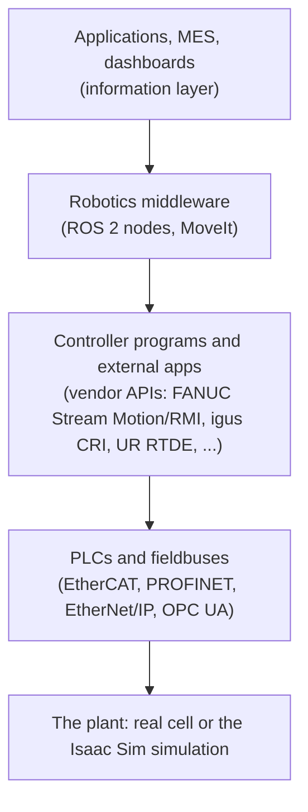

# Interoperability

!!! info "In this chapter"

    How a simulated cell can stand in for real machines and robots, or work alongside them, and how other
    controllers (ROS 2, vendor robot interfaces, PLCs) connect to it.

    **Builds on:** [Segments and the Control APIs](050-Segments-and-Control-APIs.md),
    [Manipulator Robots](070-Manipulator-Robots.md).

!!! info "Planned"

    The adapters described here (vendor protocol emulation, a ROS 2 bridge, OPC UA, time coupling for
    virtual commissioning) are planned.

This page explains how a simulated cell can stand in for, validate, control, or mirror real equipment (machines, robots, controllers),
and how this project's control APIs relate to robot vendor interfaces, ROS 2, and industrial networks.
It summarizes a research study from 2026-10-19.

## Where a swap can happen

"Swap the simulation for the real thing" means different things depending on **which layer** is swapped,
and each layer has different tools and limits:

| Swap layer | What stays the same | Industry name | Recommended approach |
|---|---|---|---|
| **Controller API** | A program or driver written for the real robot | Virtual robot controller (URSim, ROBOGUIDE, RobotStudio) | The simulation **answers the vendor's protocol**. A FANUC Stream Motion emulator is prototyped; igus CRI is the next candidate. |
| **Middleware** | ROS 2 nodes and MoveIt configurations | `ros2_control` hardware plugins | An **adapter**: a ROS 2 bridge (trajectories → frames, states → `/joint_states`), then a hardware plugin if needed |
| **Fieldbus / device** | The PLC and its program | **Virtual commissioning**, hardware in the loop | Couple through existing tools (an OPC UA bridge; stepped time coupling as in PLCSIM Advanced or FMI) rather than emulating fieldbus devices |
| **Information** | Monitoring, MES, dashboards | Digital shadow / twin | MTConnect (supported), OPC UA companion specifications, Asset Administration Shell |

## What real robot interfaces can do

Every streaming robot interface studied is **cyclic** (the controller expects a command every cycle), but
none of them **queues** commands the way this project's frame queue does: they hold the latest command
and interpolate. Each has a deadline and a defined action when it is missed.

| Interface | Cycle | Commands | Notes |
|---|---|---|---|
| FANUC Stream Motion | 8 ms (125 Hz; 1 ms on R-50iA with an option) | joint (or Cartesian ❓) targets each cycle, in degrees; I/O in the same packet | Needs the Stream Motion controller option (see the `fanuc_driver` system requirements), a running TP program, AUTO mode. FANUC publishes the protocol as Apache-2.0 code ([fanuc_driver](https://github.com/FANUC-CORPORATION/fanuc_driver)). |
| FANUC Remote Motion Interface (RMI) | event-driven | queued motion instructions (linear, joint, circular, with blending), registers, I/O; 8-instruction buffer | JSON over TCP; FANUC's own planner sets the timing |
| igus CRI ([CRI V17](https://wiki.cpr-robots.com/images/8/81/CPR_RobotInterfaceCRI_V17.pdf)) | keep-alive ≤ 1 s; status about 10 Hz ❓ | jog, single moves, uploaded programs; mm and degrees | No position streaming; the iRC PC simulation serves the same protocol |
| igus Position Interface ([V1](https://wiki.cpr-robots.com/images/7/70/CPR_PositionInterface_V1.pdf)) | 10–20 ms feedback; 10–500 ms input | joint or Cartesian position streaming | Single client; no acknowledgements |
| Universal Robots RTDE + `servoj` ([RTDE](https://docs.universal-robots.com/tutorials/communication-protocol-tutorials/rtde-guide.html)) | up to 500 Hz | joint targets; Cartesian via IK | Watchdog with action: ignore, pause, or stop |
| ABB EGM | about 4 ms ❓ | joint or pose targets, or path corrections | Paid option ❓ |
| KUKA RSI / FRI | 4 or 12 ms / 1 ms | corrections / absolute targets | Late replies stop the robot |

Queued motion (FANUC RMI, igus programs, UR `movel`, KUKA mxAutomation) and streamed targets (Stream Motion,
igus Position Interface, `servoj`, EGM, RSI) are the two universal modes, so a robot-level API needs
both.

## Time: who owns the clock

The simulation can run **in lockstep** (one step when told) or **as fast as possible**, as long as it owns
the clock. A real controller in the loop owns the clock instead: the simulation must keep up in **real
time**, or resample between its physics step and the controller's cycle. No vendor tool studied
(ROBOGUIDE, the igus iRC simulation) lets an external clock step it ❓.

| Mode | Available when |
|---|---|
| Lockstep (per step, or by timespan) | the simulation owns the clock: emulated controllers, reactive clients, co-simulation (FMI `doStep`, PLCSIM Advanced "timespan synchronized") |
| As fast as possible | the simulation owns the clock |
| Paced (soft real time) | a person or a wall-clock client is in the loop |
| Hard vendor cycle | a real controller is in the loop (e.g. 8 ms for FANUC Stream Motion) |

The supported modes are a **declared capability** of each connection, not a restriction applied to all of
them.

## ROS 2

ROS 2 is the de facto robotics-software interface:
- most major robot vendors maintain ROS 2 drivers (e.g. [FANUC](https://github.com/FANUC-CORPORATION/fanuc_driver),
  [Universal Robots](https://github.com/UniversalRobots/Universal_Robots_ROS2_Driver),
  [Yaskawa](https://github.com/Yaskawa-Global/motoros2));
- MoveIt plans against the same controllers for simulated and real hardware.

It is not an industrial control standard:
- no safety certification;
- Linux and real-time-kernel-centric drivers;
- a new distribution every year, with no cross-distribution compatibility guarantee
  ([releases](https://github.com/ros2/ros2_documentation/blob/rolling/source/Releases.rst));
- several vendors without official drivers.

The recommendation is to keep this project's APIs as the cross-platform contract and **add ROS 2 as an
adapter**, rather than replace them. This is a proposal awaiting a decision.
