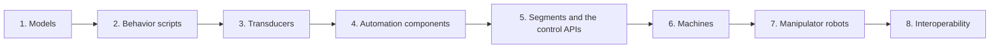

# Asset Development

An **asset** is a reusable simulated machine or robot: a USD model plus the Python that makes it
controllable. Testbeds are built from assets; controllers (people's programs, MES, robot programs) talk to
them over the control APIs.

This section is for people who **build** assets. The chapters build on each other: each one uses what the
ones before it introduced.

| Chapter | You learn |
|---|---|
| [1. Models](010-Models.md) | Why every value is a typed, validated model, and the built-in models |
| [2. Behavior Scripts](020-Behavior-Scripts.md) | Your first script (a slide that moves), the lifecycle, typed configuration |
| [3. Transducers](030-Transducers.md) | Sensors and actuators on prims; joints and articulations; writing your own |
| [4. Automation Components](040-Automation-Components.md) | Grouping transducers into one controllable machine |
| [5. Segments and the Control APIs](050-Segments-and-Control-APIs.md) | How a machine is controlled remotely, one frame per physics step, and the Python client |
| [6. Machines](060-Machines.md) | A complete worked example: the AMT VM-A1 3-axis mill |
| [7. Manipulator Robots](070-Manipulator-Robots.md) | Rigging, kinematics, tool changers, robot control, end-effector packages |
| [8. Interoperability](080-Interoperability.md) | Swapping the simulation for real equipment, and other controllers |

Appendices: [Conventions](900-Conventions.md) (units, rotations, frames, names) and
[Terminology](910-Terminology.md).

**If you only want to control an existing asset,** read chapter 1, then go straight to
[chapter 5](050-Segments-and-Control-APIs.md).

!!! info "These pages lead the code"

    These pages describe the design as it is planned, so they can guide the implementation. Features that
    don't exist yet are marked **Planned**.
