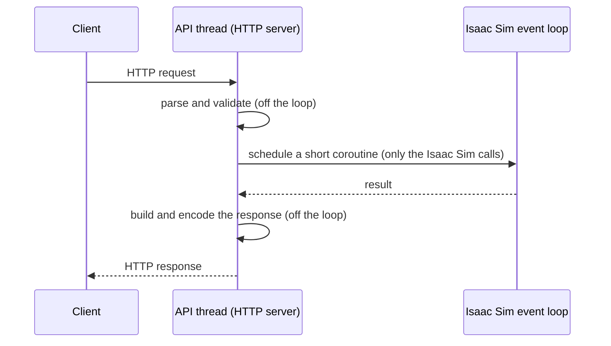

# Threading Model

**The most important rule for writing code in this extension:** Isaac Sim's main thread runs the event loop
that drives the whole simulation, and it must stay as fast as possible. So every API runs on **its own
thread**, and only the calls that must touch Isaac Sim are handed to **Isaac Sim's event loop**, as short
coroutines.

## Why

Isaac Sim's main thread runs an asyncio event loop. Rendering, the timeline, physics-step callbacks, behavior
scripts (`on_play`, `on_physics`, `on_update`), the USD stage, and the UI all run on it. Two consequences:

1. **Many Isaac Sim libraries must be called on that event loop**: from a behavior script, a timeline or
   physics callback, or a coroutine scheduled on the loop. Calling them from another thread isn't supported.
2. **Everything that runs on the loop delays the next frame and physics step.** Parsing HTTP requests,
   validating models, encoding JSON, generating code, or streaming results there would slow the simulation
   down.

## The pattern



1. **Run the HTTP server on its own thread**, with its own event loop. Never run it on Isaac Sim's loop. The
   library's `ApiHost` class (`amt.dtp.ise.lib.control.host`) does this for you; the control APIs
   (`CoreApi`, the segment API, the RobotAPI), the kinematics service, and the extension's own API are built on it.
2. **Capture Isaac Sim's loop when the API starts**: `ApiHost.start()` remembers the event loop of the thread
   that calls it, so call it from Isaac Sim's thread (the extension's startup, or a behavior script's `on_play`).
3. **Wrap every Isaac Sim call in a coroutine** and run it on Isaac Sim's loop, awaiting the result from the
   API thread:

    ```python
    @router.post("/toggle")
    async def toggle():
        async def on_isaac_loop():
            light.toggle()             # touches the stage: must run on Isaac Sim's loop
            return light.is_on
        return {"on": await api.run_coro_on_main_loop(on_isaac_loop())}
    ```

4. **Keep those coroutines short.** Do everything that doesn't need Isaac Sim (computation, encoding, file
   I/O) on the API thread.
5. **For per-physics-step work**, do the minimum inside the physics callback and pass results to the API
   thread. The segment API works this way: each physics step takes one queued frame, applies it, reads
   the state, and hands the response to the API thread, which does all the streaming.

## The exception: the kinematics service

The kinematics service (port 8014) doesn't touch Isaac Sim at all: it works with no stage open and no
simulation running, and an external program can use it without using Isaac Sim; Isaac Sim only hosts it. So
it never schedules anything on Isaac Sim's loop. It handles requests on its own thread, **one at a time**,
because the cuMotion library it uses isn't documented as thread-safe, and it shares a lock with the robot
code that calls cuMotion from Isaac Sim's thread.
